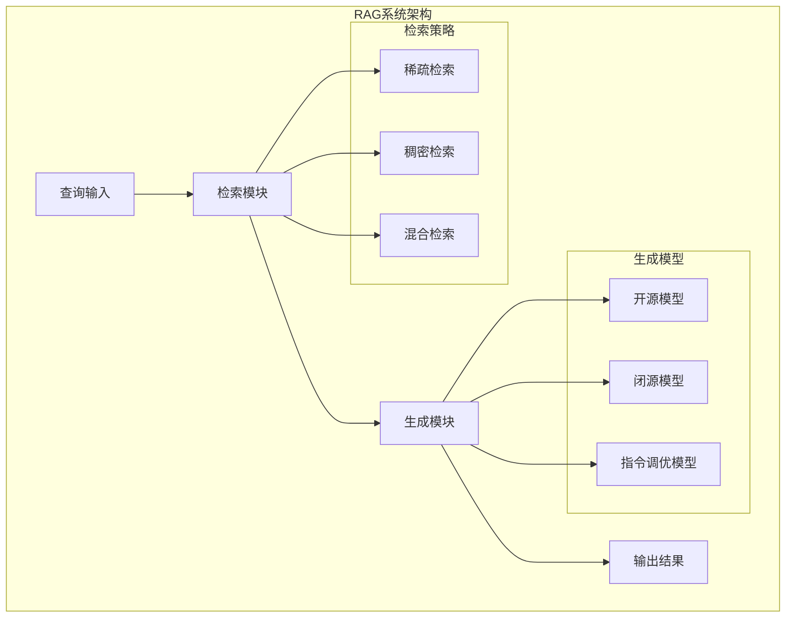
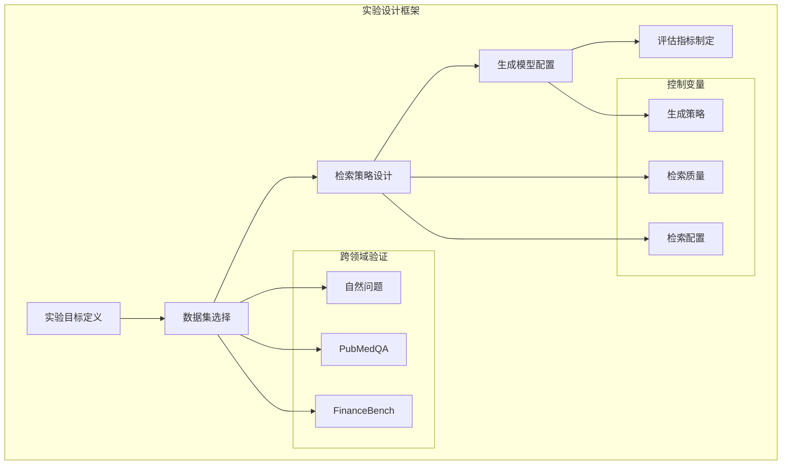
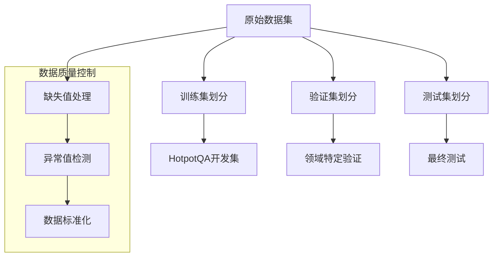
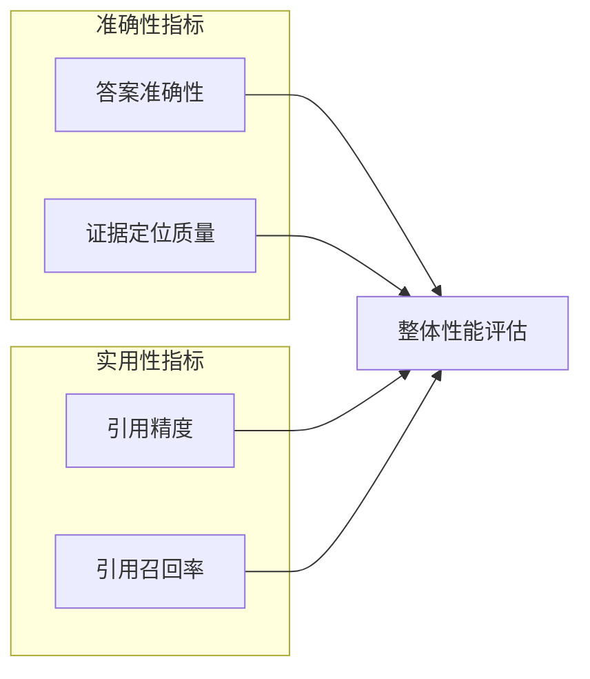
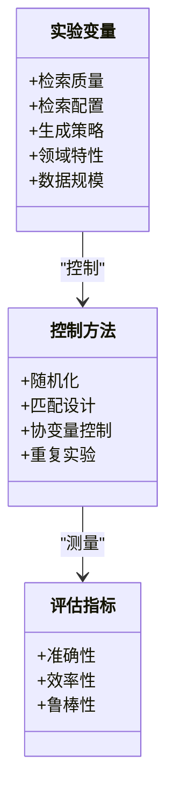
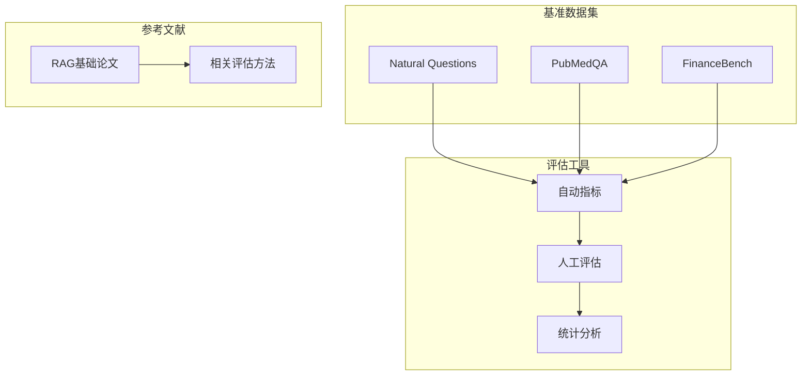
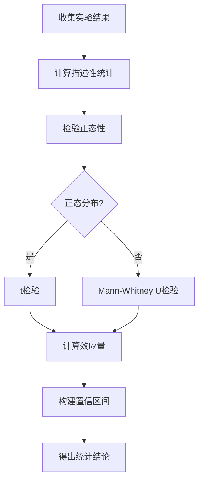

# 实验设计与方法

<cite>
**本文档中引用的文件**
- [task_desc.txt](file://task_desc.txt)
</cite>

## 目录
1. [引言](#引言)
2. [项目结构](#项目结构)
3. [核心组件](#核心组件)
4. [架构概览](#架构概览)
5. [详细组件分析](#详细组件分析)
6. [依赖分析](#依赖分析)
7. [性能考虑](#性能考虑)
8. [故障排除指南](#故障排除指南)
9. [结论](#结论)
10. [附录](#附录)

## 引言

本项目专注于检索增强生成（Retrieval-Augmented Generation, RAG）系统在知识密集型自然语言处理任务中的应用研究。RAG系统通过将神经检索与大语言模型相结合，能够从外部文档中检索相关信息来支撑生成过程，从而解决传统仅依赖参数化知识的局限性。

本实验设计旨在系统性地研究检索质量、检索配置和生成策略如何共同影响答案准确性和鲁棒性。通过对不同领域基准数据集的评估，分析检索和生成性能在具有不同知识结构和术语的领域间的差异。

## 项目结构

基于任务描述分析，该项目采用模块化设计，主要包含以下核心研究方向：

**图表来源**
- [task_desc.txt:4-16](file://task_desc.txt#L4-L16)

**章节来源**
- [task_desc.txt:1-22](file://task_desc.txt#L1-L22)

## 核心组件

### 检索-生成交互研究

该组件专注于探索不同的检索策略与各种大语言模型的配对效果：

#### 检索方法对比
- **BM25 vs. Contriever**：比较传统稀疏检索与现代稠密检索方法的性能差异
- **零样本 vs. 指令调优模型**：评估不同模型类型的适应性表现

#### 跨领域性能分析
- **至少两个不同领域**：分析模型在不同知识结构下的表现差异
- **HotpotQA开发集**：使用标准数据集进行精确度分析

#### 计算资源优化
- **限制每查询检索文档数量**：平衡性能与计算成本（3-5篇文档）

**章节来源**
- [task_desc.txt:4-16](file://task_desc.txt#L4-L16)

## 架构概览

**图表来源**
- [task_desc.txt:3-16](file://task_desc.txt#L3-L16)

## 详细组件分析

### 数据预处理方法

#### 数据集划分策略

**图表来源**
- [task_desc.txt:6-8](file://task_desc.txt#L6-L8)

#### 特征工程
- **查询重写**：探索创新检索策略
- **文档截断**：限制每查询检索3-5篇文档
- **领域适配**：针对不同领域的术语特点调整预处理

### 评估指标体系

#### 答案质量指标

**图表来源**
- [task_desc.txt:10-16](file://task_desc.txt#L10-L16)

#### 统计分析方法
- **置信区间计算**：使用Bootstrap方法估计指标的不确定性
- **显著性检验**：t检验或Mann-Whitney U检验比较不同方法的性能差异
- **交叉验证**：5折或10折交叉验证确保结果稳定性

### 实验变量控制

#### 可控变量设计

**图表来源**
- [task_desc.txt:3-16](file://task_desc.txt#L3-L16)

**章节来源**
- [task_desc.txt:3-16](file://task_desc.txt#L3-L16)

## 依赖分析

### 外部依赖关系

**图表来源**
- [task_desc.txt:17-22](file://task_desc.txt#L17-L22)

**章节来源**
- [task_desc.txt:17-22](file://task_desc.txt#L17-L22)

## 性能考虑

### 计算资源优化
- **文档数量限制**：每查询3-5篇文档平衡性能与成本
- **批量处理**：合理设置批次大小优化GPU利用率
- **缓存策略**：重用检索结果减少重复计算

### 结果稳定性
- **多次运行取平均**：减少随机性带来的波动
- **固定随机种子**：确保结果可重现
- **统计显著性检验**：验证性能差异的统计意义

## 故障排除指南

### 常见问题及解决方案

#### 检索性能问题
- **症状**：检索速度慢或准确率低
- **原因**：索引构建不当或查询预处理错误
- **解决**：检查索引配置和查询规范化

#### 生成质量不稳定
- **症状**：输出质量波动大
- **原因**：温度参数设置不当或上下文长度限制
- **解决**：调整生成参数和上下文窗口

#### 结果不可重现
- **症状**：相同设置产生不同结果
- **原因**：随机种子未固定或环境变量不一致
- **解决**：统一设置随机种子和CUDA设备

**章节来源**
- [task_desc.txt:15](file://task_desc.txt#L15)

## 结论

本实验设计通过系统性的方法论框架，为RAG系统的评估提供了全面的指导。通过严格控制实验变量、建立多维度评估指标体系和采用统计显著性检验，能够有效提高实验结果的可靠性和可重现性。

关键创新点包括：
- 跨领域性能对比分析
- 检索策略与生成模型的联合优化
- 创新检索策略的探索

## 附录

### 实验配置最佳实践

#### 数据集管理
- 使用标准划分：训练集(70%)、验证集(15%)、测试集(15%)
- 保持领域分布一致性
- 建立数据版本控制系统

#### 模型配置
- 固定随机种子：42
- 批次大小：根据GPU内存调整
- 学习率调度：余弦退火或阶梯衰减

#### 结果记录
- 完整记录所有超参数设置
- 保存中间结果和检查点
- 建立结果数据库便于比较

### 对照实验设计

#### 基线对照
- **Vanilla RAG**：标准RAG方法作为基线
- **仅检索**：仅使用检索不进行生成
- **仅生成**：仅使用预训练模型回答

#### 参数对照
- **检索器对比**：BM25 vs. Contriever
- **模型对比**：开源vs.闭源模型
- **配置对比**：不同文档数量限制

#### 统计分析流程

**图表来源**
- [task_desc.txt:10-16](file://task_desc.txt#L10-L16)
