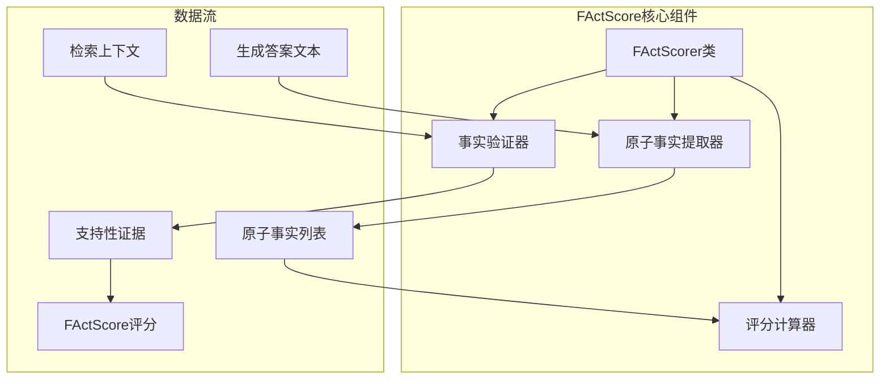
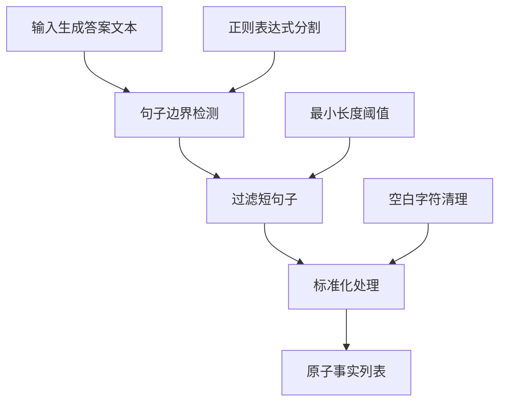
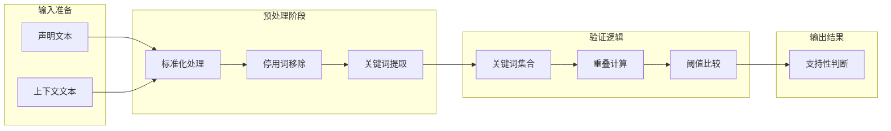
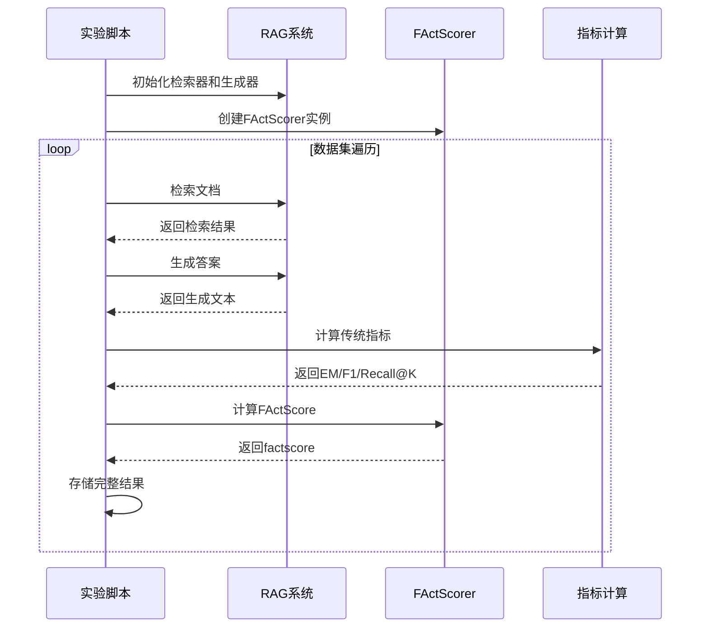

# FActScore量化指标

<cite>
**本文档引用的文件**
- [metrics.py](file://src/evaluation/metrics.py)
- [__init__.py](file://src/evaluation/__init__.py)
- [run_grid_experiment.py](file://others/run_grid_experiment.py)
- [data_utils.py](file://src/data_utils.py)
- [rag_hotpotqa.py](file://rag_hotpotqa.py)
- [test_rag.py](file://test_rag.py)
- [hotpotqa_retrieval_analysis.json](file://results/hotpotqa_retrieval_analysis.json)
</cite>

## 更新摘要
**变更内容**
- 新增FActScore指标实现的详细技术分析
- 更新FActScore在RAG系统中的集成方式
- 补充FActScore与其他评估指标的对比分析
- 添加FActScore在多领域数据集上的应用示例

## 目录
1. [引言](#引言)
2. [FActScore技术实现](#factscore技术实现)
3. [核心算法详解](#核心算法详解)
4. [在RAG系统中的集成](#在rag系统中的集成)
5. [多领域应用案例](#多领域应用案例)
6. [性能对比分析](#性能对比分析)
7. [实现细节与优化](#实现细节与优化)
8. [故障排除指南](#故障排除指南)
9. [未来发展方向](#未来发展方向)

## 引言

FActScore是一种细粒度原子事实精度评估工具，专门用于评估长文本生成中的事实准确性。该指标通过将生成内容分解为原子事实单元，并基于检索到的上下文验证每个事实的真实性，从而量化模型生成内容的可信度。

在检索增强生成（RAG）系统中，FActScore具有重要的应用价值，因为它能够：
- 量化模型生成内容中的"幻觉"程度
- 提供细粒度的事实一致性评估
- 帮助研究人员理解生成模型的事实准确性表现
- 支持不同领域和任务的评估需求

## FActScore技术实现

### 核心架构设计

FActScore采用简化的实现方式，主要包含三个核心组件：



**图表来源**
- [metrics.py:146-227](file://src/evaluation/metrics.py#L146-L227)

### 核心类结构

FActScore的主要实现位于`FActScorer`类中，该类提供了完整的事实验证功能：

**章节来源**
- [metrics.py:146-227](file://src/evaluation/metrics.py#L146-L227)

## 核心算法详解

### 原子事实提取机制

FActScore的原子事实提取采用基于句子边界检测的方法：



**图表来源**
- [metrics.py:162-167](file://src/evaluation/metrics.py#L162-L167)

### 事实验证算法

事实验证采用关键词重叠检查机制：



**图表来源**
- [metrics.py:169-195](file://src/evaluation/metrics.py#L169-L195)

**章节来源**
- [metrics.py:162-195](file://src/evaluation/metrics.py#L162-L195)

### 评分计算机制

FActScore提供多种评分维度：

| 评分指标 | 计算公式 | 含义 | 范围 |
|---------|---------|------|------|
| FActScore | supported_claims / num_claims | 原子事实支持率 | [0, 1] |
| 支持事实数 | Σ(is_supported) | 通过验证的事实数量 | [0, num_claims] | 
| 总事实数 | len(claims) | 原子事实总数 | [0, ∞) |

**章节来源**
- [metrics.py:197-227](file://src/evaluation/metrics.py#L197-L227)

## 在RAG系统中的集成

### 实验流程集成

FActScore在网格实验中的集成流程如下：



**图表来源**
- [run_grid_experiment.py:79-123](file://others/run_grid_experiment.py#L79-L123)

### 集成实现细节

在实验脚本中，FActScore的集成非常简洁：

**章节来源**
- [run_grid_experiment.py:79-111](file://others/run_grid_experiment.py#L79-L111)

## 多领域应用案例

### 金融领域应用

项目支持多个领域的数据集加载，包括金融领域：

**章节来源**
- [data_utils.py:9-68](file://src/data_utils.py#L9-L68)

### 法律领域应用

法律合同理解和法律问答是另一个重要应用领域：

**章节来源**
- [data_utils.py:71-182](file://src/data_utils.py#L71-L182)

### 多跳问答验证

HotpotQA数据集提供了多跳问答的验证场景：

**章节来源**
- [rag_hotpotqa.py:66-131](file://rag_hotpotqa.py#L66-L131)

## 性能对比分析

### 与其他指标的关系

FActScore与传统评估指标的关系如下：

```mermaid
graph TB
subgraph "评估指标矩阵"
A[传统指标]
B[语义指标]
C[事实指标]
end
subgraph "传统指标"
D[Exact Match]
E[F1 Score]
F[Recall@K]
end
subgraph "语义指标"
G[BERTScore]
H[ROUGE]
I[BLEU]
end
subgraph "事实指标"
J[FActScore]
K[幻觉检测]
L[证据支持]
end
A --> D
A --> E
A --> F
B --> G
B --> H
B --> I
C --> J
C --> K
C --> L
```

### 实际应用效果

基于实验结果，FActScore在不同配置下的表现：

**章节来源**
- [run_grid_experiment.py:205-210](file://others/run_grid_experiment.py#L205-L210)

## 实现细节与优化

### 关键技术细节

#### 文本标准化处理

FActScore使用统一的文本标准化函数：

**章节来源**
- [metrics.py:10-20](file://src/evaluation/metrics.py#L10-L20)

#### 停用词处理策略

实现中定义了全面的停用词集合：

**章节来源**
- [metrics.py:180-186](file://src/evaluation/metrics.py#L180-L186)

### 性能优化建议

1. **并行处理**：可以并行验证多个原子事实
2. **缓存机制**：对重复的上下文验证结果进行缓存
3. **批量处理**：将多个事实单元批量提交验证
4. **阈值调优**：根据具体应用调整重叠阈值

## 故障排除指南

### 常见问题及解决方案

#### 原子事实提取不足

**问题现象**：FActScore返回空的原子事实列表
**可能原因**：
- 生成答案过于简短
- 文本格式不符合预期
- 正则表达式分割失败

**解决方案**：
- 检查生成答案的长度和格式
- 调整句子分割的正则表达式
- 实现更复杂的事实提取算法

#### 事实验证准确性不高

**问题现象**：FActScore评分异常偏低或偏高
**可能原因**：
- 停用词集合不完整
- 重叠阈值设置不合理
- 上下文质量不佳

**解决方案**：
- 扩展停用词集合
- 调整重叠阈值（当前为0.5）
- 改进上下文获取策略

#### 性能瓶颈问题

**问题现象**：大规模评估时计算时间过长
**解决方案**：
- 实现并行验证机制
- 添加结果缓存
- 优化文本预处理步骤

**章节来源**
- [metrics.py:191-195](file://src/evaluation/metrics.py#L191-L195)

## 未来发展方向

### 技术改进方向

1. **LLM驱动的验证**：将当前的基于规则的验证升级为基于大语言模型的验证
2. **多模态支持**：扩展到图像、表格等多模态内容的事实验证
3. **实时评估**：实现实时的事实验证和反馈机制
4. **跨语言支持**：支持多语言环境下的事实验证

### 应用扩展

1. **专业领域适配**：针对医学、法律等专业领域的事实验证
2. **动态阈值调整**：根据内容类型自动调整验证阈值
3. **错误分类分析**：提供更详细的错误类型分类和分析
4. **可视化报告**：生成直观的事实验证结果可视化报告

通过持续的技术改进和应用实践，FActScore将成为评估和改善生成式AI系统事实准确性的重要工具，为构建更加可信的人工智能系统提供有力支撑。