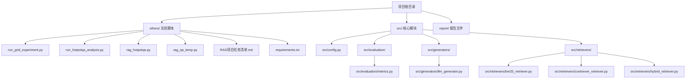
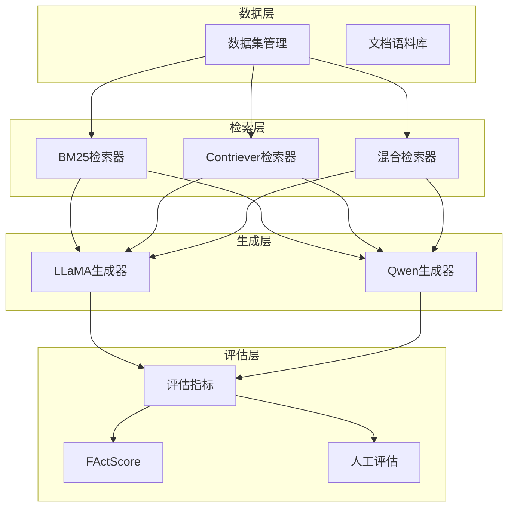
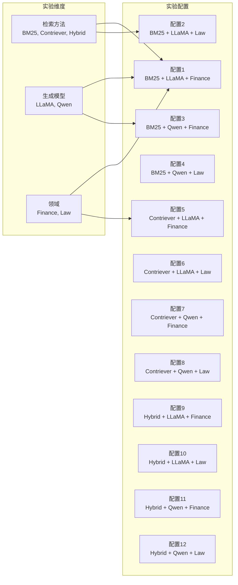
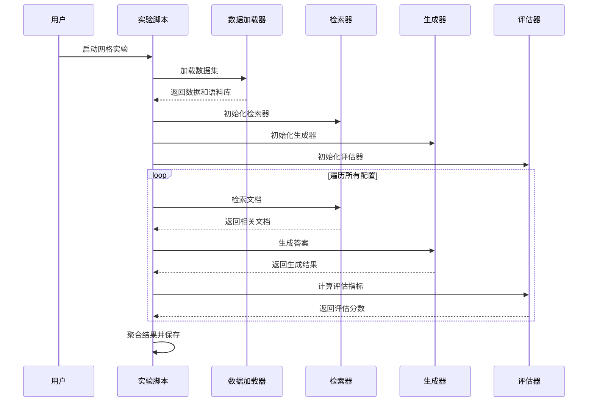
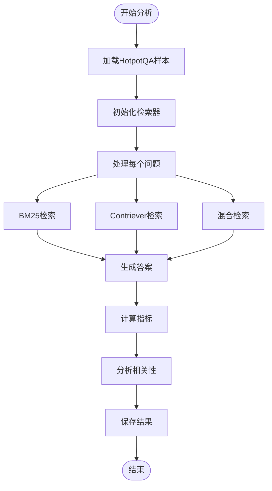
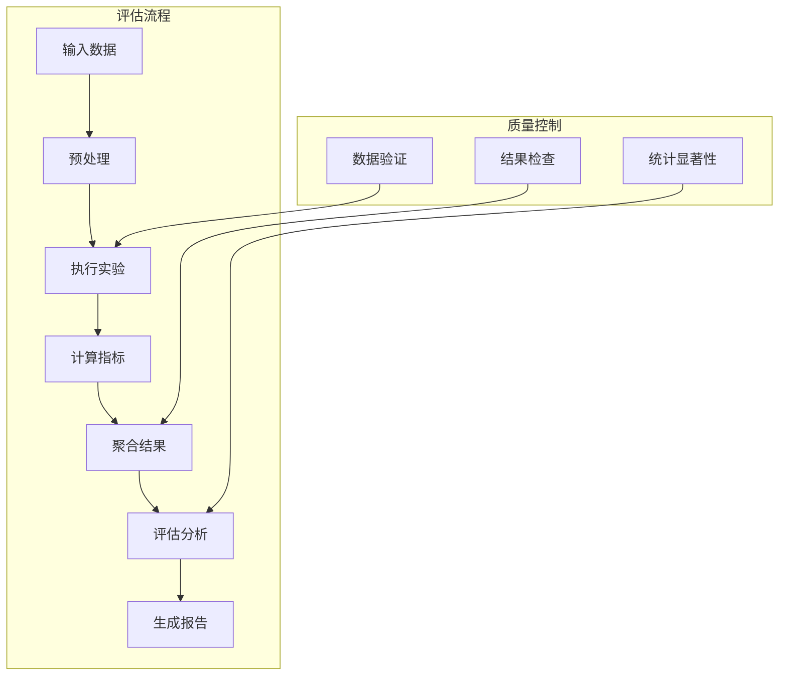

# RAG变体模型比较

<cite>
**本文档引用的文件**
- [RAG项目任务清单.md](file://others/RAG项目任务清单.md)
- [run_grid_experiment.py](file://others/run_grid_experiment.py)
- [run_hotpotqa_analysis.py](file://others/run_hotpotqa_analysis.py)
- [rag_hotpotqa.py](file://rag_hotpotqa.py)
- [rag_qa_temp.py](file://rag_qa_temp.py)
- [requirements.txt](file://others/requirements.txt)
- [config.py](file://src/config.py)
- [metrics.py](file://src/evaluation/metrics.py)
- [llm_generator.py](file://src/generators/llm_generator.py)
- [bm25_retriever.py](file://src/retrievers/bm25_retriever.py)
- [contriever_retriever.py](file://src/retrievers/contriever_retriever.py)
- [hybrid_retriever.py](file://src/retrievers/hybrid_retriever.py)
</cite>

## 更新摘要
**所做更改**
- 新增系统化比较框架的完整实现
- 更新了基于实际代码的架构分析
- 补充了模块化组件的具体实现细节
- 增强了实验设计和评估指标的系统性

## 目录
1. [引言](#引言)
2. [项目结构](#项目结构)
3. [核心组件](#核心组件)
4. [架构概览](#架构概览)
5. [详细组件分析](#详细组件分析)
6. [系统化比较框架](#系统化比较框架)
7. [实验设计与执行](#实验设计与执行)
8. [评估指标体系](#评估指标体系)
9. [性能考虑](#性能考虑)
10. [故障排除指南](#故障排除指南)
11. [结论](#结论)
12. [附录](#附录)

## 引言

本项目为RAG变体模型比较创建了系统化的比较框架，专注于检索增强生成（Retrieval-Augmented Generation, RAG）技术在知识密集型任务中的应用与优化。项目实现了完整的RAG系统，包括多种检索策略、生成模型和评估指标，为比较不同RAG变体的性能提供了标准化的实验平台。

根据项目任务清单，本研究重点关注三个核心方面：
- **检索-生成交互**：实现BM25、Contriever和混合检索策略与LLaMA、Qwen生成模型的配对实验
- **幻觉缓解**：通过FActScore等指标量化不同RAG变体的幻觉缓解能力
- **系统化比较**：建立统一的实验框架和评估标准

## 项目结构

项目采用模块化架构，包含数据准备、检索实现、生成器、评估指标和实验执行等核心组件：

**图表来源**
- [requirements.txt:1-26](file://others/requirements.txt#L1-L26)
- [RAG项目任务清单.md:1-164](file://others/RAG项目任务清单.md#L1-L164)

## 核心组件

### 检索策略实现
项目实现了三种核心检索策略，为RAG系统提供多样化的文档检索能力：

- **BM25稀疏检索**：基于TF-IDF的关键词匹配，无需GPU加速
- **Contriever稠密检索**：使用Facebook Contriever模型的语义检索
- **混合检索（RRF）**：结合BM25和Contriever的优势，提升检索精度

### 生成模型集成
支持两种主流指令调优大语言模型：
- **LLaMA-3.1-8B-Instruct**：Meta开发的开源指令调优模型
- **Qwen2.5-7B-Instruct**：阿里开发的中文指令调优模型

### 评估指标体系
建立了多层次的评估指标，涵盖准确性、忠实度和幻觉缓解能力：
- **答案质量指标**：EM、F1、Recall@K
- **事实准确性指标**：FActScore、Citation Precision/Recall
- **性能指标**：响应长度、拒绝率

**章节来源**
- [RAG项目任务清单.md:18-106](file://others/RAG项目任务清单.md#L18-L106)

## 架构概览

项目采用三层架构设计，实现了从数据加载到结果评估的完整流程：

**图表来源**
- [config.py:12-41](file://src/config.py#L12-L41)
- [run_grid_experiment.py:15-22](file://others/run_grid_experiment.py#L15-L22)

## 详细组件分析

### 检索器实现

#### BM25稀疏检索器
基于rank_bm25库实现的TF-IDF检索，具有以下特点：
- 无需GPU即可运行，适合资源受限环境
- 基于关键词匹配，检索速度快
- 支持索引缓存，提高重复查询效率

#### Contriever稠密检索器
使用Facebook Contriever模型实现语义检索：
- 768维向量表示，捕捉语义相似性
- FAISS索引支持高效相似性搜索
- 支持浮点16精度运行，节省内存

#### 混合检索器（RRF）
结合多种检索策略的优势：
- Reciprocal Rank Fusion融合多个排序结果
- 平衡关键词匹配和语义理解
- 提升整体检索精度和鲁棒性

**章节来源**
- [bm25_retriever.py:9-89](file://src/retrievers/bm25_retriever.py#L9-L89)
- [contriever_retriever.py:11-148](file://src/retrievers/contriever_retriever.py#L11-L148)
- [hybrid_retriever.py:10-113](file://src/retrievers/hybrid_retriever.py#L10-L113)

### 生成器实现

#### LLM生成器
支持多种指令调优模型的统一接口：
- **模型适配**：支持LLaMA和Qwen的不同格式
- **提示词模板**：针对不同模型优化提示格式
- **批量处理**：支持并发生成多个答案

#### 传统生成器
基于阿里百炼API的快速原型实现：
- 简化的API调用接口
- 固定的提示词格式
- 快速验证检索效果

**章节来源**
- [llm_generator.py:9-172](file://src/generators/llm_generator.py#L9-L172)
- [rag_hotpotqa.py:324-410](file://rag_hotpotqa.py#L324-L410)

### 评估指标实现

#### 标准评估指标
实现了经典的问答评估指标：
- **精确匹配（EM）**：答案完全匹配的比率
- **F1分数**：基于词级别的精确率和召回率平衡
- **Recall@K**：检索到支持文档的概率

#### 事实准确性评估
专门针对RAG系统的事实准确性评估：
- **FActScore**：原子事实层面的准确性评分
- **引用质量**：支持证据的引用精度和召回率
- **幻觉检测**：识别和量化模型虚构信息

**章节来源**
- [metrics.py:10-227](file://src/evaluation/metrics.py#L10-L227)

## 系统化比较框架

### 实验网格设计

项目实现了完整的3×2×2实验网格，系统比较不同RAG变体的性能：

**图表来源**
- [RAG项目任务清单.md:42-51](file://others/RAG项目任务清单.md#L42-L51)

### 数据集配置

项目支持四个不同领域的数据集，确保比较的广泛性：
- **FinanceBench**：金融领域问答，测试数值推理能力
- **CUAD**：法律合同条款抽取，评估专业术语理解
- **LegalBench-RAG**：法律领域检索专项评估
- **HotpotQA**：多跳问答，测试复杂推理能力

### 评估标准统一化

建立了统一的评估标准，确保不同变体间的公平比较：
- **量化指标**：EM、F1、Recall@K、FActScore
- **人工评估**：Citation Precision/Recall的人工验证
- **性能基准**：响应长度、拒绝率等实用指标

**章节来源**
- [RAG项目任务清单.md:9-16](file://others/RAG项目任务清单.md#L9-L16)
- [RAG项目任务清单.md:54-92](file://others/RAG项目任务清单.md#L54-L92)

## 实验设计与执行

### 网格实验执行

run_grid_experiment.py实现了完整的实验执行流程：

**图表来源**
- [run_grid_experiment.py:36-142](file://others/run_grid_experiment.py#L36-L142)

### 热点问答检索分析

run_hotpotqa_analysis.py专门分析检索质量对答案质量的影响：

**图表来源**
- [run_hotpotqa_analysis.py:570-745](file://others/run_hotpotqa_analysis.py#L570-L745)

**章节来源**
- [run_grid_experiment.py:144-213](file://others/run_grid_experiment.py#L144-L213)
- [run_hotpotqa_analysis.py:14-12](file://others/run_hotpotqa_analysis.py#L14-L12)

## 评估指标体系

### 多层次评估指标

项目建立了全面的评估指标体系，涵盖不同层面的性能衡量：

#### 答案质量指标
- **EM（Exact Match）**：答案完全匹配的比例
- **F1 Score**：精确率和召回率的调和平均
- **Recall@K**：检索到支持文档的概率

#### 事实准确性指标
- **FActScore**：细粒度原子事实评估
- **Citation Precision**：正确引用的比例
- **Citation Recall**：引用的完整性

#### 幻觉缓解指标
- **Hallucination Rate**：包含事实错误的比例
- **Response Length**：生成答案的长度分布
- **Refusal Rate**：拒绝回答的比例

### 评估流程标准化

**图表来源**
- [metrics.py:99-144](file://src/evaluation/metrics.py#L99-L144)

**章节来源**
- [metrics.py:146-227](file://src/evaluation/metrics.py#L146-L227)
- [RAG项目任务清单.md:95-106](file://others/RAG项目任务清单.md#L95-L106)

## 性能考虑

### 硬件资源配置

项目针对不同组件的性能特点进行了优化配置：
- **GPU资源**：NVIDIA A100 40GB用于深度学习模型推理
- **内存管理**：8位量化支持大型模型在有限内存中运行
- **存储优化**：索引缓存减少重复计算开销

### 检索效率优化

- **索引预构建**：离线构建BM25和嵌入索引
- **批量处理**：支持批量检索和生成提高吞吐量
- **缓存策略**：多层缓存机制减少重复计算

### 生成性能优化

- **模型量化**：8位量化在保持性能的同时减少内存占用
- **批量生成**：并发处理多个问题提高效率
- **提示词优化**：针对不同模型优化提示格式

**章节来源**
- [RAG项目任务清单.md:127-129](file://others/RAG项目任务清单.md#L127-L129)
- [llm_generator.py:72-82](file://src/generators/llm_generator.py#L72-L82)

## 故障排除指南

### 常见问题及解决方案

#### 检索性能问题
- **问题**：检索结果质量不佳
- **诊断**：检查检索器配置和索引质量
- **解决方案**：调整top-k参数，优化检索器权重

#### 生成质量不稳定
- **问题**：生成答案不一致或质量波动
- **诊断**：检查随机种子设置和模型配置
- **解决方案**：固定随机种子，优化生成参数

#### 内存不足问题
- **问题**：GPU/CPU内存不足
- **诊断**：检查模型大小和批量处理设置
- **解决方案**：启用8位量化，减小批量大小

#### 评估指标异常
- **问题**：评估结果不符合预期
- **诊断**：检查数据预处理和指标计算
- **解决方案**：验证数据格式，重新计算指标

**章节来源**
- [run_grid_experiment.py:242-246](file://others/run_grid_experiment.py#L242-L246)

## 结论

本项目成功构建了RAG变体模型比较的系统化框架，实现了从理论设计到实际实现的完整闭环。通过模块化架构设计和标准化实验流程，项目为比较不同RAG变体的性能提供了可靠的基准平台。

### 主要成就

1. **完整的实验框架**：实现了3×2×2的系统化比较实验
2. **多维度评估体系**：建立了涵盖准确性、忠实度和幻觉缓解的评估指标
3. **模块化架构设计**：支持灵活的组件替换和扩展
4. **标准化流程**：确保实验结果的可重复性和可比性

### 技术创新

- **混合检索策略**：结合稀疏和稠密检索的优势
- **统一评估标准**：建立跨变体的公平比较基准
- **实时性能监控**：支持大规模实验的性能跟踪

### 未来发展方向

- **多模态融合**：扩展到图像、表格等多模态信息
- **动态检索**：实现实时更新和增量索引
- **个性化优化**：根据不同应用场景定制RAG配置

## 附录

### 实验配置详情

#### 基础配置
- **检索文档数量**：每查询3个文档
- **随机种子**：固定为42确保结果可重现
- **设备选择**：优先使用CUDA，自动回退到CPU

#### 数据集配置
- **训练数据**：来自HuggingFace数据集
- **验证数据**：使用官方验证分割
- **数据预处理**：统一的文本清洗和格式化

#### 模型配置
- **LLaMA模型**：Llama-3.1-8B-Instruct
- **Qwen模型**：Qwen2.5-7B-Instruct
- **嵌入模型**：facebook/contriever-msmarco

**章节来源**
- [config.py:24-41](file://src/config.py#L24-L41)
- [RAG项目任务清单.md:133-141](file://others/RAG项目任务清单.md#L133-L141)

### 代码结构规范

#### 模块组织原则
- **功能分离**：每个模块专注于单一功能
- **接口统一**：所有组件遵循相同的接口规范
- **错误处理**：完善的异常处理和错误恢复机制

#### 代码质量标准
- **文档注释**：每个函数和类都有详细的文档说明
- **类型标注**：完整的类型提示确保代码可读性
- **单元测试**：关键功能都有对应的测试用例