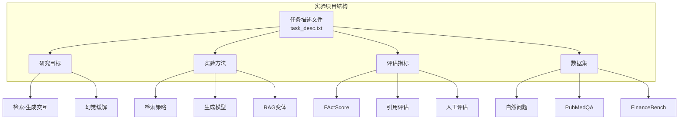
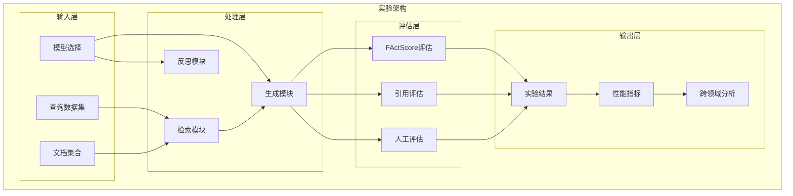
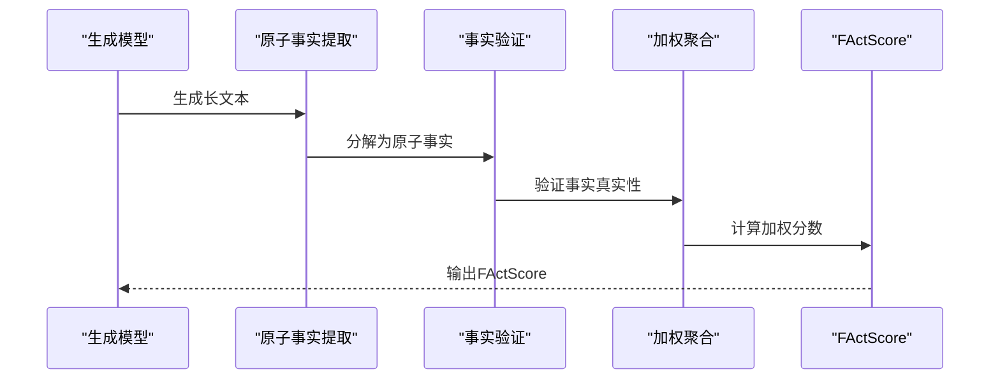
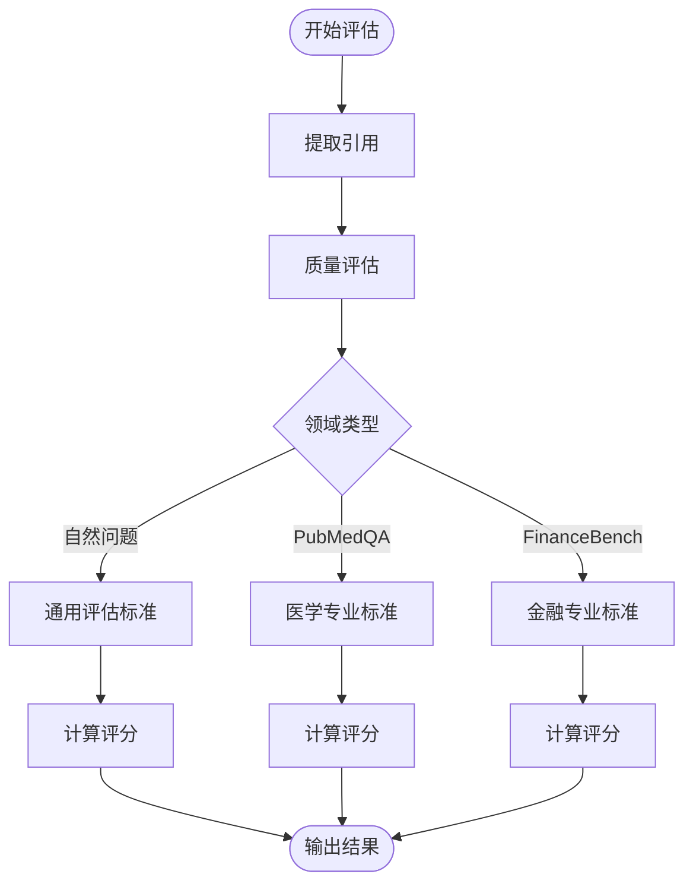
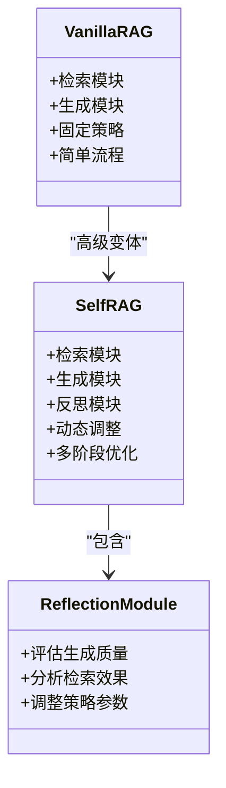
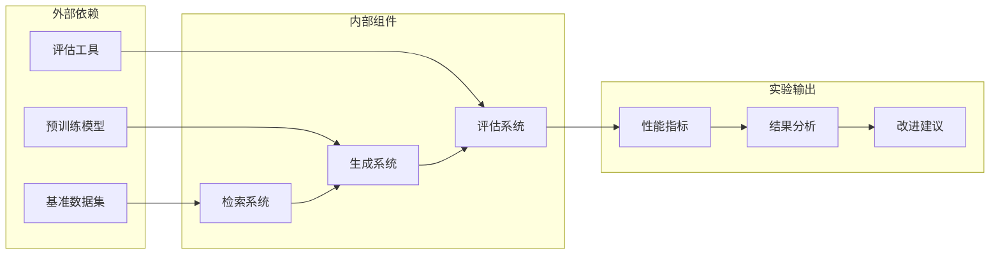

# 幻觉缓解实验

<cite>
**本文档中引用的文件**
- [task_desc.txt](file://task_desc.txt)
</cite>

## 目录
1. [引言](#引言)
2. [项目结构](#项目结构)
3. [核心组件](#核心组件)
4. [架构概览](#架构概览)
5. [详细组件分析](#详细组件分析)
6. [依赖关系分析](#依赖关系分析)
7. [性能考虑](#性能考虑)
8. [故障排除指南](#故障排除指南)
9. [结论](#结论)
10. [附录](#附录)

## 引言

本项目专注于检索增强生成（RAG）系统中的幻觉缓解实验研究。幻觉是指语言模型在生成过程中产生与事实不符的内容，这对知识密集型任务的准确性构成了严重威胁。本实验旨在系统性地研究检索质量、检索配置和生成策略如何共同影响答案准确性、忠实度和鲁棒性。

项目的核心目标包括：
- 量化幻觉率，特别是使用FActScore等精细原子评估指标
- 通过引用质量评估来衡量证据支撑质量
- 比较vanilla RAG与Self-RAG等高级变体的性能差异
- 实施人工评估方法，如引用精度/召回率
- 设计幻觉缓解策略并进行实验验证

## 项目结构

基于当前仓库结构，项目主要由单一的任务描述文件组成，该文件定义了完整的实验框架和要求。

**图表来源**
- [task_desc.txt:1-22](file://task_desc.txt#L1-L22)

**章节来源**
- [task_desc.txt:1-22](file://task_desc.txt#L1-L22)

## 核心组件

### 检索-生成交互组件

本项目的第一部分专注于检索生成交互，涉及以下关键组件：

#### 检索策略
- **稀疏检索**：如BM25算法
- **密集检索**：如Contriever模型
- **混合检索**：结合稀疏和密集方法的优势

#### 生成模型
- **开放源模型**：如LLaMA系列
- **闭源模型**：如GPT系列
- **零样本对比**：直接使用预训练模型
- **指令调优模型**：如Intel Neural Chat 7B v3.3

#### RAG变体比较
- **vanilla RAG**：基础检索增强生成
- **Self-RAG**：自反思学习检索、生成和批评
- **其他高级变体**：根据项目要求探索

**章节来源**
- [task_desc.txt:3-16](file://task_desc.txt#L3-L16)

### 幻觉缓解组件

第二部分专门针对幻觉缓解，包含以下核心要素：

#### 幻觉量化指标
- **FActScore**：细粒度原子事实精度评估
- **幻觉率**：量化模型虚构内容的比例
- **证据支撑质量**：评估检索到文档的质量

#### 引用质量评估
- **引用精度**：检索到的文档与实际需要的相关程度
- **引用召回率**：正确相关文档的检索完整性
- **跨领域差异**：不同知识结构下的表现变化

#### 人工评估方法
- **引用精度/召回率的人工标注**
- **领域特定评估标准**
- **多维度质量评分体系**

**章节来源**
- [task_desc.txt:9-14](file://task_desc.txt#L9-L14)

## 架构概览

项目的整体架构采用模块化设计，支持多种实验组合和评估方法。

**图表来源**
- [task_desc.txt:1-22](file://task_desc.txt#L1-L22)

## 详细组件分析

### FActScore指标体系

FActScore作为细粒度原子评估指标，在幻觉缓解实验中发挥关键作用。

#### 计算方法
FActScore通过以下步骤计算：
1. **原子事实提取**：将长文本分解为基本事实单元
2. **事实验证**：逐个验证每个原子事实的真实性
3. **加权聚合**：根据事实重要性和相关性进行加权
4. **最终评分**：生成整体事实精度分数

#### 应用场景
- **长文本生成评估**：特别适用于问答和摘要任务
- **跨领域适应**：支持医学、金融等专业领域的评估
- **精细化分析**：识别特定类型的幻觉模式

**图表来源**
- [task_desc.txt:10-12](file://task_desc.txt#L10-L12)

**章节来源**
- [task_desc.txt:10-12](file://task_desc.txt#L10-L12)

### 引用质量评估机制

引用质量评估是衡量证据支撑质量的重要工具。

#### 评估维度
- **相关性评估**：文档与查询的相关程度
- **权威性评估**：文档来源的可信度
- **时效性评估**：信息的新近程度
- **完整性评估**：覆盖所需信息的充分性

#### 跨领域差异评估
不同领域具有不同的知识结构和术语特点：
- **自然问题**：通用知识，结构相对简单
- **PubMedQA**：医学专业术语，需要严格的事实验证
- **FinanceBench**：金融术语和法规，强调准确性

**图表来源**
- [task_desc.txt:11-13](file://task_desc.txt#L11-L13)

**章节来源**
- [task_desc.txt:11-13](file://task_desc.txt#L11-L13)

### RAG变体性能比较

项目要求比较vanilla RAG与Self-RAG等高级变体的性能差异。

#### vanilla RAG特征
- **基础架构**：简单的检索-生成流程
- **固定检索**：使用预定义的检索策略
- **静态生成**：不进行自我反思和改进

#### Self-RAG特征
- **自反思能力**：能够评估和改进自己的检索
- **动态调整**：根据生成内容调整检索策略
- **多阶段优化**：包含检索、生成、批评三个阶段

**图表来源**
- [task_desc.txt:13-14](file://task_desc.txt#L13-L14)

**章节来源**
- [task_desc.txt:13-14](file://task_desc.txt#L13-L14)

### 人工评估方法

人工评估提供了主观但可靠的评估视角。

#### 引用精度/召回率实施
- **精度评估**：评估检索到的文档中有多少真正相关
- **召回评估**：评估所有相关文档中有多少被成功检索
- **标注标准**：建立明确的标注指南和评分标准

#### 多维度评估体系
- **事实准确性**：陈述的事实是否正确
- **证据充分性**：是否有足够的证据支撑
- **逻辑一致性**：推理过程是否合理
- **表达清晰度**：表述是否清楚易懂

**章节来源**
- [task_desc.txt:12-13](file://task_desc.txt#L12-L13)

## 依赖关系分析

项目的依赖关系体现了从输入到输出的完整实验流程。

**图表来源**
- [task_desc.txt:1-22](file://task_desc.txt#L1-L22)

**章节来源**
- [task_desc.txt:1-22](file://task_desc.txt#L1-L22)

## 性能考虑

### 计算效率优化
- **限制检索数量**：每查询限制3-5个文档以平衡性能和成本
- **模型选择策略**：根据任务复杂度选择合适的模型规模
- **缓存机制**：复用相似查询的检索结果

### 数据集管理
- **跨领域平衡**：确保各领域数据集的代表性
- **质量控制**：建立数据清洗和验证流程
- **版本管理**：跟踪数据集的更新和变化

### 评估效率
- **自动化评估**：优先使用可自动化的评估指标
- **抽样策略**：对大规模数据集进行有效抽样
- **并行处理**：利用多核CPU和GPU加速评估

## 故障排除指南

### 常见问题及解决方案

#### 检索性能问题
- **症状**：检索速度慢或准确率低
- **原因**：索引构建不当或查询预处理问题
- **解决**：优化索引参数，改进查询转换

#### 生成质量不稳定
- **症状**：同一查询产生不同质量的答案
- **原因**：随机种子设置或模型配置问题
- **解决**：固定随机种子，标准化配置

#### 评估指标异常
- **症状**：FActScore或引用评估结果异常
- **原因**：评估标准不一致或标注错误
- **解决**：重新培训标注员，完善评估指南

**章节来源**
- [task_desc.txt:14-16](file://task_desc.txt#L14-L16)

## 结论

本幻觉缓解实验项目为理解RAG系统中的幻觉问题提供了全面的研究框架。通过系统性的实验设计，包括FActScore量化、引用质量评估、人工评估和跨领域分析，能够深入理解不同检索策略和生成模型对幻觉的影响。

项目的关键贡献在于：
1. 建立了完整的幻觉量化评估体系
2. 提供了跨领域的性能比较方法
3. 设计了从vanilla RAG到Self-RAG的渐进式改进路径
4. 开发了结合自动化和人工评估的综合方法

这些成果为后续的幻觉缓解研究和应用提供了重要的参考基础。

## 附录

### 实验设计建议

#### 基准数据集选择
- **HotpotQA**：用于分析检索精度对最终答案质量的影响
- **Natural Questions**：通用知识问答，评估基础性能
- **PubMedQA**：医学专业领域，评估专业术语处理能力
- **FinanceBench**：金融领域，评估专业规范遵循能力

#### 评估指标组合
- **客观指标**：FActScore、答案准确性、检索精度
- **主观指标**：人工评估、引用质量评分
- **性能指标**：推理时间、内存使用、吞吐量

#### 实验报告模板
- **实验设置**：模型配置、数据集详情、评估参数
- **结果分析**：各指标的数值、统计显著性检验
- **讨论**：结果解释、与其他工作的比较、局限性
- **结论**：主要发现、实践意义、未来工作方向