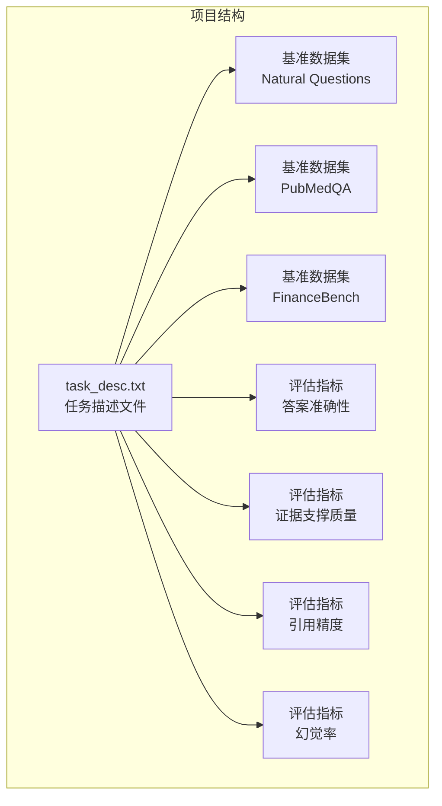
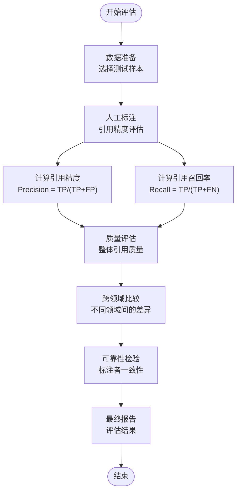
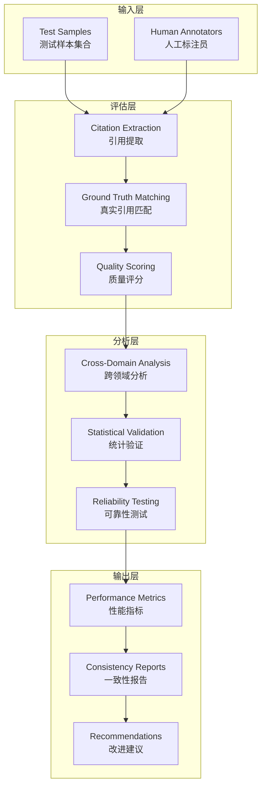
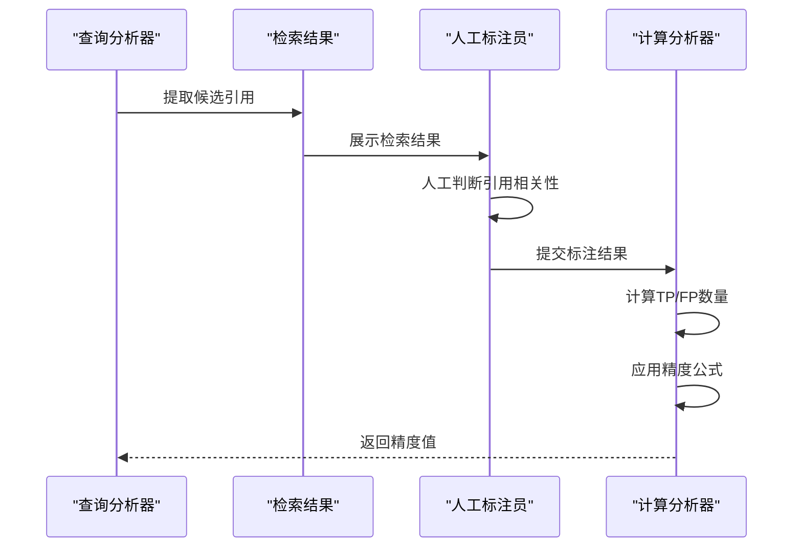
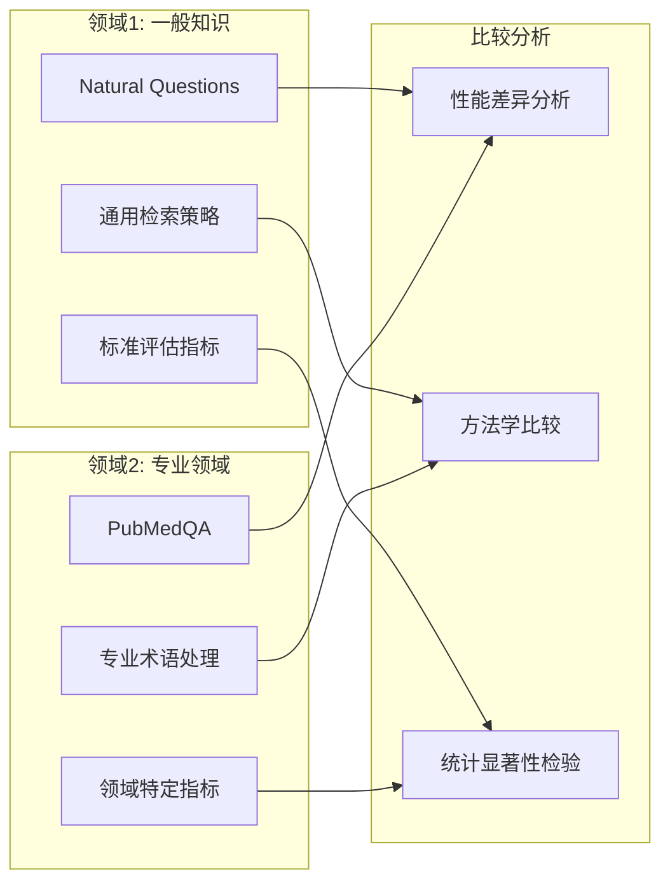
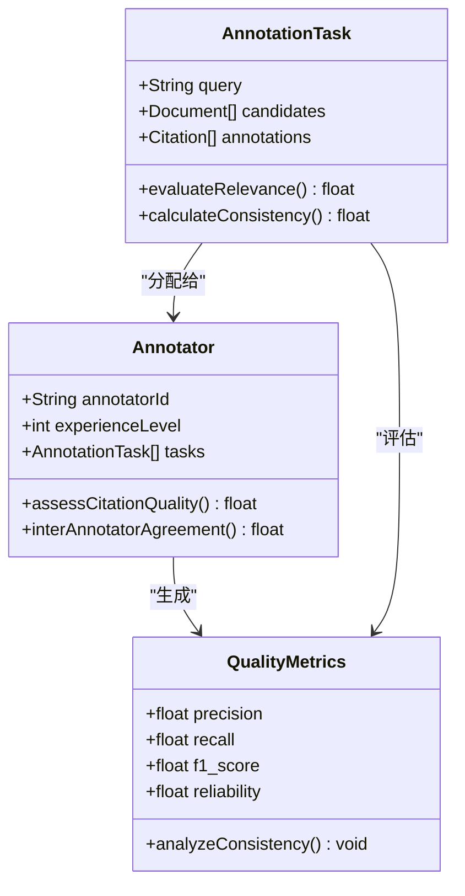
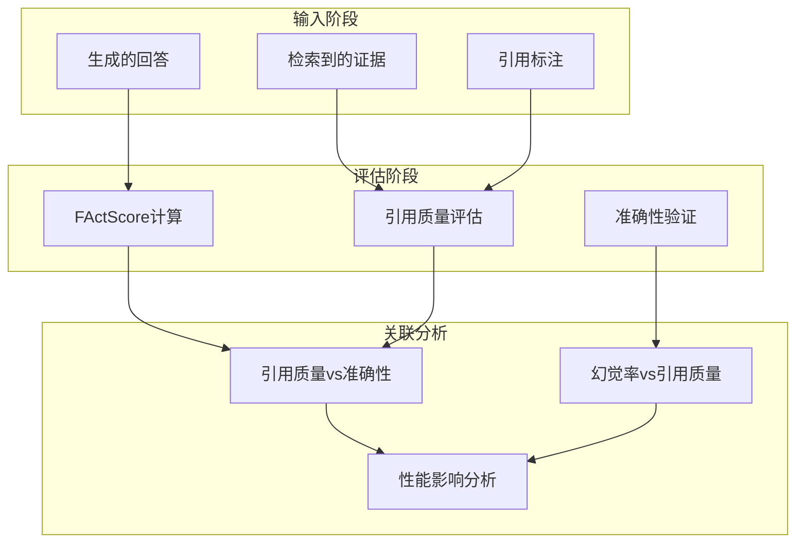
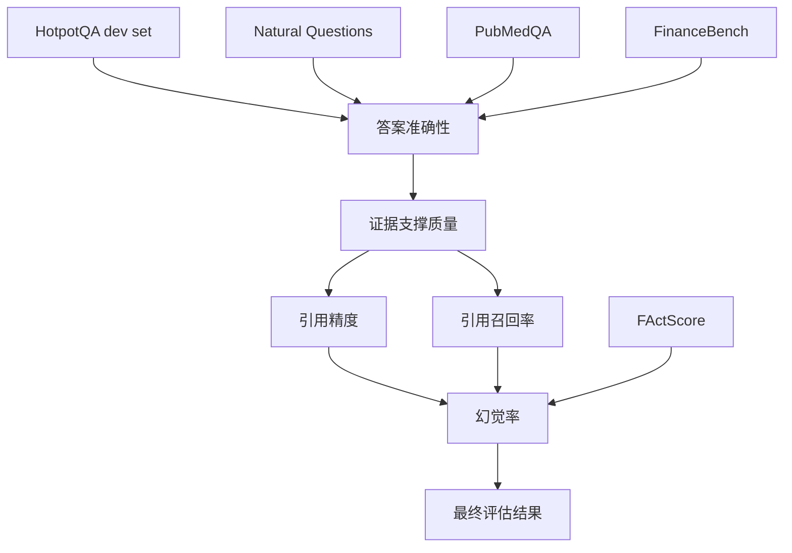
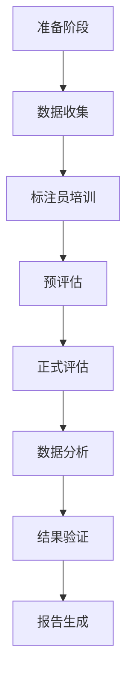

# 引用质量评估

<cite>
**本文档中引用的文件**
- [task_desc.txt](file://task_desc.txt)
</cite>

## 目录
1. [引言](#引言)
2. [项目结构](#项目结构)
3. [核心组件](#核心组件)
4. [架构概览](#架构概览)
5. [详细组件分析](#详细组件分析)
6. [依赖分析](#依赖分析)
7. [性能考虑](#性能考虑)
8. [故障排除指南](#故障排除指南)
9. [结论](#结论)
10. [附录](#附录)

## 引言

本项目专注于检索增强生成（RAG）系统中引用质量评估的研究。随着大语言模型在知识密集型自然语言处理任务中的应用，如何有效评估和改进模型的引用质量成为关键问题。本项目旨在系统性地研究检索质量、检索配置和生成策略如何共同影响答案准确性、真实性和鲁棒性，并特别关注引用精度和召回率的人工评估方法。

项目的核心目标包括：
- 评估不同检索策略（稀疏/密集/混合检索）与各种大语言模型的组合效果
- 分析检索精度对最终答案质量的影响
- 比较零样本与指令微调模型的性能
- 使用来自不同领域的基准数据集进行跨领域性能差异分析
- 通过人类评估量化引用质量（引用精度/召回率）
- 对比传统RAG与先进变体（如Self-RAG）的效果

## 项目结构

该项目采用简洁的文本描述形式，主要包含任务说明和参考文献信息：



**图表来源**
- [task_desc.txt:1-22](file://task_desc.txt#L1-L22)

**章节来源**
- [task_desc.txt:1-22](file://task_desc.txt#L1-L22)

## 核心组件

### 引用质量评估框架

项目明确要求通过人类评估来量化引用质量，重点关注引用精度和召回率两个关键指标：



**图表来源**
- [task_desc.txt:12-13](file://task_desc.txt#L12-L13)

### 基准数据集选择

项目选择了三个具有代表性的基准数据集来支持跨领域评估：

| 数据集 | 领域特征 | 样本数量 | 评估重点 |
|--------|----------|----------|----------|
| Natural Questions | 一般知识问答 | 大规模问答数据 | 通用检索能力 |
| PubMedQA | 生物医学领域 | 医学问答数据 | 专业术语理解 |
| FinanceBench | 金融领域 | 金融问答数据 | 专业领域知识 |

**章节来源**
- [task_desc.txt:1-22](file://task_desc.txt#L1-L22)

## 架构概览

### 引用质量评估系统架构



**图表来源**
- [task_desc.txt:10-16](file://task_desc.txt#L10-L16)

## 详细组件分析

### 引用精度计算方法

引用精度是衡量检索到的文档中有多少与问题相关的关键指标：



**图表来源**
- [task_desc.txt:13](file://task_desc.txt#L13)

### 引用召回率计算方法

引用召回率衡量系统能够找到的相关引用占所有相关引用的比例：

```mermaid
flowchart TD
A[开始召回率计算] --> B[识别所有相关引用]
B --> C[统计系统找到的引用]
C --> D[计算召回率]
D --> E[召回率 = TP/(TP+FN)]
E --> F[评估系统覆盖度]
F --> G[生成召回率报告]
G --> H[结束]
```

**图表来源**
- [task_desc.txt:13](file://task_desc.txt#L13)

### 跨领域性能比较方法论

项目要求在至少两个不同领域进行实验，以报告跨领域性能差异：



**图表来源**
- [task_desc.txt:9](file://task_desc.txt#L9)

**章节来源**
- [task_desc.txt:9-13](file://task_desc.txt#L9-L13)

### 人类标注可靠性与一致性

项目强调通过人工标注来评估引用质量的可靠性和一致性：



**图表来源**
- [task_desc.txt:12-13](file://task_desc.txt#L12-L13)

**章节来源**
- [task_desc.txt:12-13](file://task_desc.txt#L12-L13)

### 幻觉率量化与引用质量关系

项目使用FActScore等指标量化幻觉率，并评估引用质量与最终回答准确性之间的关系：



**图表来源**
- [task_desc.txt:10-13](file://task_desc.txt#L10-L13)

**章节来源**
- [task_desc.txt:10-13](file://task_desc.txt#L10-L13)

## 依赖分析

### 评估指标依赖关系



**图表来源**
- [task_desc.txt:1-22](file://task_desc.txt#L1-L22)

**章节来源**
- [task_desc.txt:1-22](file://task_desc.txt#L1-L22)

## 性能考虑

### 计算效率优化

项目建议限制每次查询检索的文档数量以平衡性能和计算成本：

- **推荐文档数量**: 3-5篇文档/查询
- **性能权衡**: 在检索质量和计算成本之间找到平衡点
- **扩展性考虑**: 确保评估框架能够处理大规模数据集

### 评估时间管理


## 故障排除指南

### 常见问题及解决方案

| 问题类型 | 症状表现 | 解决方案 | 预防措施 |
|----------|----------|----------|----------|
| 标注不一致 | 不同标注员评分差异大 | 建立标注指南和培训 | 定期校准训练 |
| 引用遗漏 | 相关引用未被识别 | 扩大检索范围 | 多策略验证 |
| 评估偏差 | 系统性偏见影响结果 | 双盲评估设计 | 统计显著性检验 |
| 数据不平衡 | 某领域样本过少 | 数据增强技术 | 分层抽样设计 |

**章节来源**
- [task_desc.txt:15](file://task_desc.txt#L15)

## 结论

本项目为引用质量评估提供了全面的框架和方法论。通过结合自动化指标和人工评估，能够有效量化RAG系统的引用质量，并在不同领域间进行公平比较。关键要点包括：

1. **多维度评估**: 同时考虑精度、召回率、幻觉率等多个指标
2. **跨领域验证**: 在多个具有不同知识结构的领域中测试系统性能
3. **人类参与**: 通过人工标注确保评估结果的可靠性和一致性
4. **统计分析**: 使用适当的统计方法验证结果的显著性
5. **方法学严谨**: 建立标准化的评估流程和质量控制措施

这些方法为未来RAG系统的改进和评估奠定了坚实基础。

## 附录

### 评估标准流程



### 关键参考文献

- Lewis P, et al. Retrieval-augmented generation for knowledge-intensive NLP tasks. NeurIPS 2020
- Izacard G, et al. Leveraging passage retrieval with generative models for open domain QA. EACL 2021  
- Asai A, et al. Self-RAG: Learning to Retrieve, Generate, and Critique through Self-Reflection. ICLR 2024
- Min S, et al. FActScore: Fine-grained Atomic Evaluation of Factual Precision in Long Form Text Generation. EMNLP 2023