# 技术实现指南

<cite>
**本文档引用的文件**
- [config.py](file://src/config.py)
- [bm25_retriever.py](file://src/retrievers/bm25_retriever.py)
- [contriever_retriever.py](file://src/retrievers/contriever_retriever.py)
- [hybrid_retriever.py](file://src/retrievers/hybrid_retriever.py)
- [llm_generator.py](file://src/generators/llm_generator.py)
- [metrics.py](file://src/evaluation/metrics.py)
- [data_utils.py](file://src/data_utils.py)
- [run_grid_experiment.py](file://others/run_grid_experiment.py)
- [rag_hotpotqa.py](file://rag_hotpotqa.py)
- [run_hotpotqa_analysis.py](file://others/run_hotpotqa_analysis.py)
- [test_rag.py](file://test_rag.py)
</cite>

## 更新摘要
**变更内容**
- 增强了错误处理机制，特别是在HTTP客户端初始化和API调用中
- 改进了UTF-8编码兼容性，确保跨平台输出正确显示
- 完善了评估指标实现，增加了FActScore和多种检索指标
- 增强了测试框架的健壮性和调试能力

## 目录
1. [简介](#简介)
2. [项目概述](#项目概述)
3. [核心组件](#核心组件)
4. [架构概览](#架构概览)
5. [详细组件分析](#详细组件分析)
6. [测试框架与质量保证](#测试框架与质量保证)
7. [依赖关系分析](#依赖关系分析)
8. [性能考虑](#性能考虑)
9. [故障排除指南](#故障排除指南)
10. [结论](#结论)
11. [附录](#附录)

## 简介

本技术实现指南面向知识密集型自然语言处理任务中的检索增强生成（Retrieval-Augmented Generation, RAG）系统开发。RAG系统通过将神经检索与大语言模型相结合，解决参数化知识不足的问题，通过检索外部文档来支撑生成过程。本指南重点关注以下关键组件：

- **检索-生成交互**：探索不同检索策略（稀疏/密集/混合检索）与各种大语言模型（如开源模型LLaMA或闭源模型Qwen）的配对效果
- **虚假信息缓解**：设计实验测量RAG如何减少模型虚构信息
- **性能优化**：平衡检索精度与计算成本，限制每查询检索3-5个文档
- **多领域评估**：在金融和法律领域进行跨领域性能测试
- **质量保证**：建立完整的测试框架和持续集成机制

## 项目概述

根据任务描述，本项目涉及两个主要方面：

### 检索-生成交互研究
- 实现至少两种检索方法（BM25 vs. Contriever）和两种生成模型（LLaMA vs. Qwen）
- 使用HotpotQA开发集分析检索精度如何影响最终答案质量
- 比较零样本与指令微调模型的效果
- 在至少两个不同领域（金融、法律）进行实验并报告跨领域性能差异

### 虚假信息缓解研究
- 使用FActScore等指标量化虚假信息发生率
- 评估不同领域间引用支撑质量的差异
- 通过人工评估（如引用精确率/召回率）评估引用质量
- 比较传统RAG与高级变体（如Self-RAG）的效果

## 核心组件

### 检索器组件

#### BM25检索器
BM25是一种经典的稀疏检索算法，基于词频-逆文档频率（TF-IDF）原理：
- **文本预处理**：分词、去除停用词、词干提取
- **向量表示**：将查询和文档转换为TF-IDF向量
- **相似度计算**：使用BM25公式计算查询与文档的相似度
- **排序与选择**：按相似度得分排序，选择Top-K文档

#### Contriever检索器
Contriever是基于BERT的密集检索器：
- **嵌入生成**：使用预训练的句子编码器生成查询和文档嵌入
- **相似度计算**：计算余弦相似度或点积相似度
- **优化策略**：支持对比学习和聚类优化

#### 混合检索器
结合稀疏和密集检索的优势，使用递归排名融合（RRF）算法：
- **多策略融合**：将BM25和Contriever的结果进行加权融合
- **排名融合**：使用RRF公式对不同检索器的排名进行融合
- **参数优化**：通过调整k参数优化融合效果

### 生成模型组件

#### LLaMA模型集成
- **模型选择**：根据任务需求选择合适的LLaMA变体
- **推理优化**：使用量化、蒸馏等技术提高推理速度
- **提示工程**：设计有效的提示模板以改善生成质量

#### Qwen模型集成
- **API集成**：通过阿里百炼API接口集成Qwen模型
- **成本控制**：优化令牌使用和批量处理
- **安全过滤**：实现内容安全检查和过滤机制

### 评估指标组件

#### FActScore指标
- **原子事实评估**：细粒度的事实精确性评估
- **长文本生成**：针对长文本生成的精确性测量
- **人工验证**：结合人工评估确保结果可靠性

#### 引用质量评估
- **引用精确率**：正确引用的比例
- **引用召回率**：实际引用中被正确识别的比例
- **人工评估**：通过专家评估确保引用质量

## 架构概览

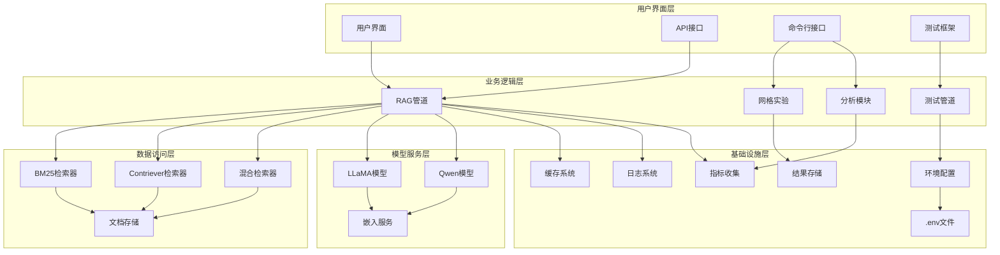

**图表来源**
- [config.py:1-41](file://src/config.py#L1-L41)
- [run_grid_experiment.py:15-23](file://others/run_grid_experiment.py#L15-L23)

## 详细组件分析

### 数据加载与预处理组件

#### 文档预处理流程

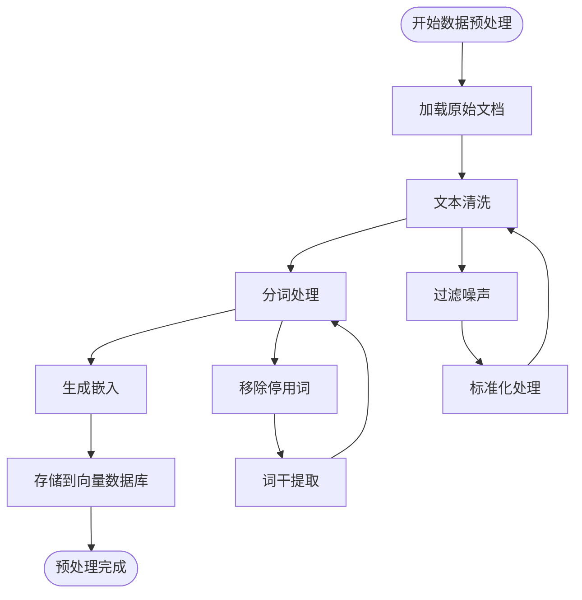

**图表来源**
- [data_utils.py:9-210](file://src/data_utils.py#L9-L210)

#### 查询预处理流程

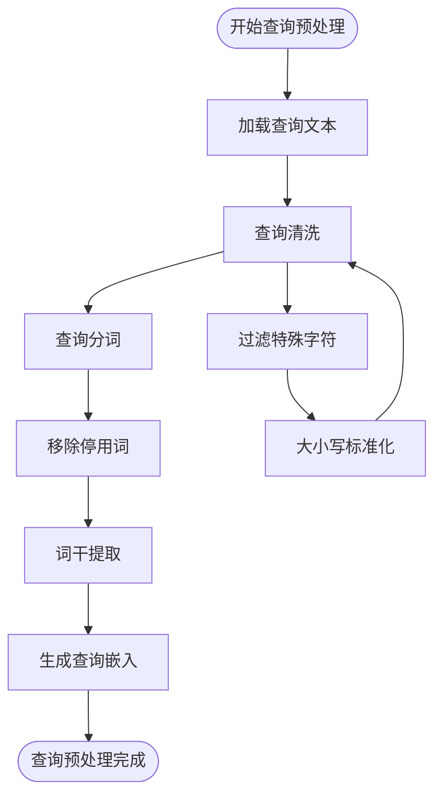

**图表来源**
- [bm25_retriever.py:56-89](file://src/retrievers/bm25_retriever.py#L56-L89)

### 检索器实现组件

#### BM25检索器实现

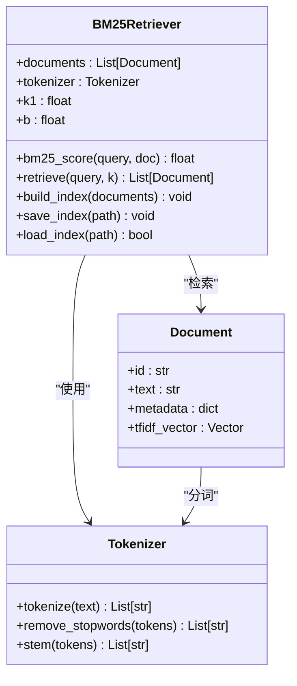

**图表来源**
- [bm25_retriever.py:9-89](file://src/retrievers/bm25_retriever.py#L9-L89)

#### Contriever检索器实现

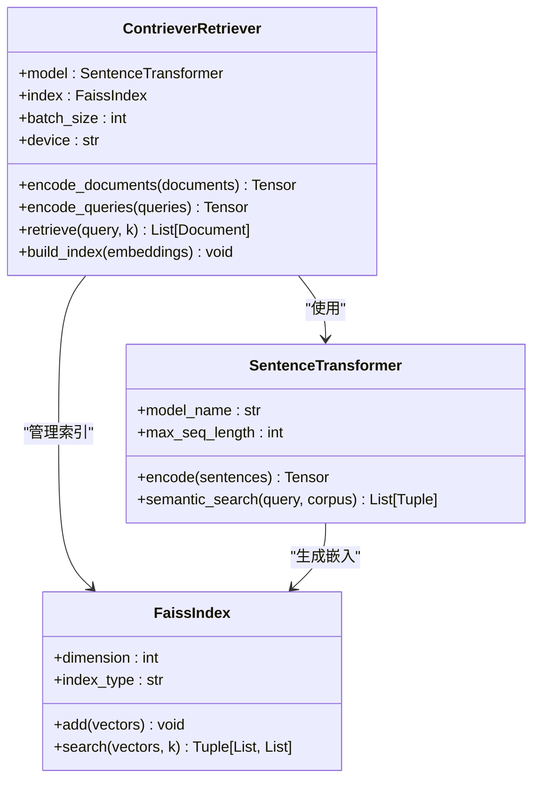

**图表来源**
- [contriever_retriever.py:11-148](file://src/retrievers/contriever_retriever.py#L11-L148)

#### 混合检索器实现

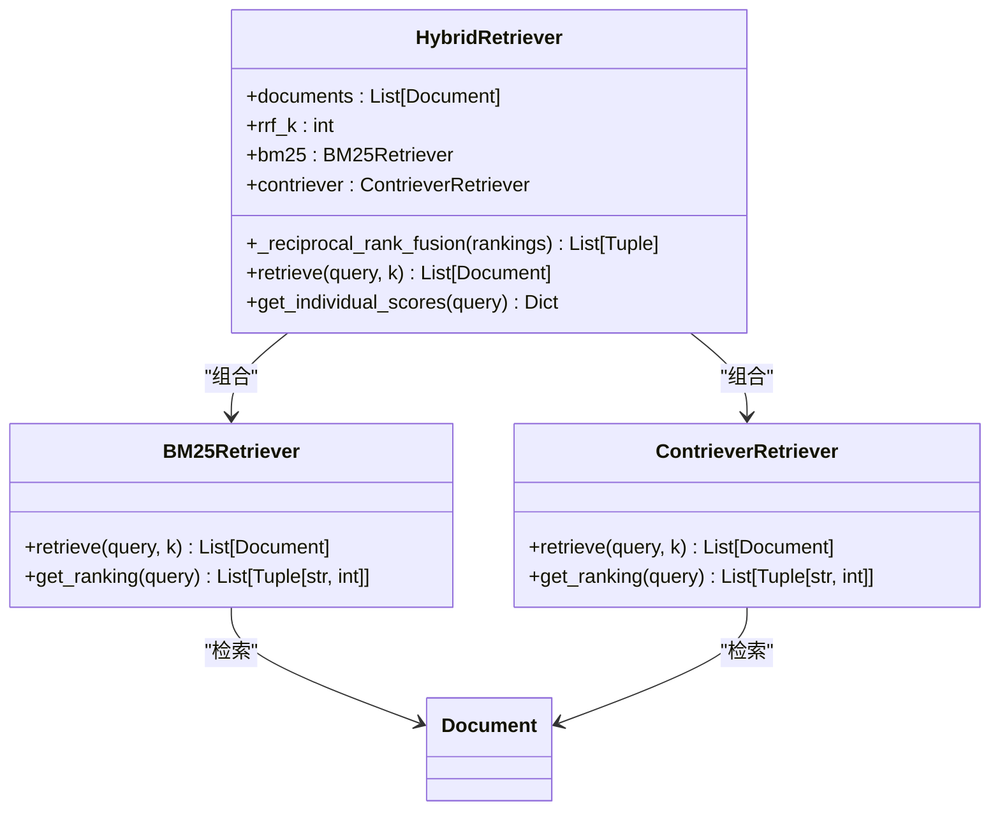

**图表来源**
- [hybrid_retriever.py:10-113](file://src/retrievers/hybrid_retriever.py#L10-L113)

### 生成模型集成组件

#### LLaMA模型集成流程

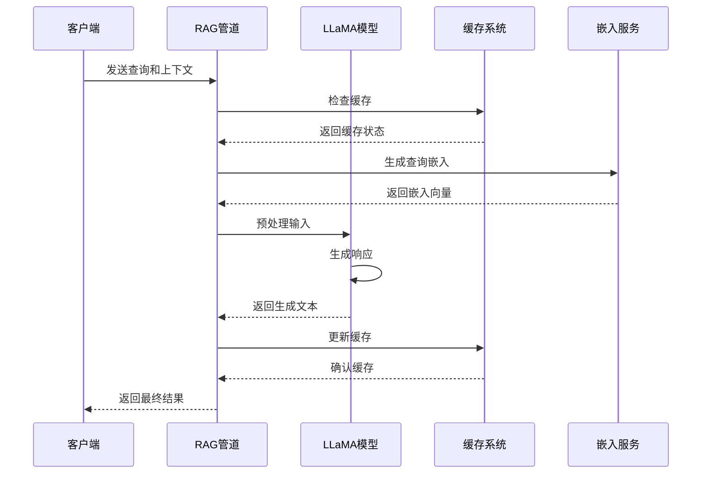

**图表来源**
- [llm_generator.py:97-158](file://src/generators/llm_generator.py#L97-L158)

#### Qwen模型集成流程

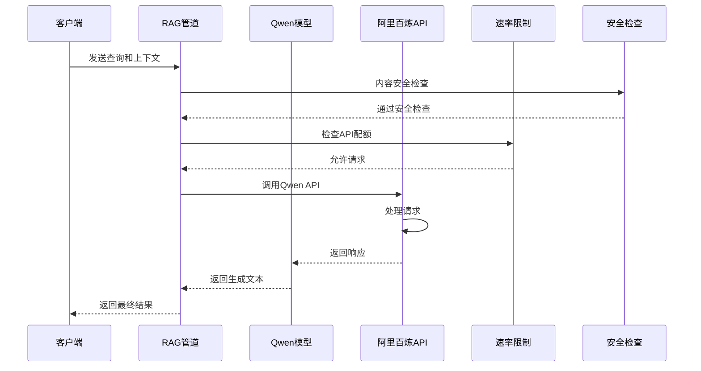

**图表来源**
- [rag_hotpotqa.py:324-410](file://rag_hotpotqa.py#L324-L410)

### 评估与监控组件

#### 性能监控流程

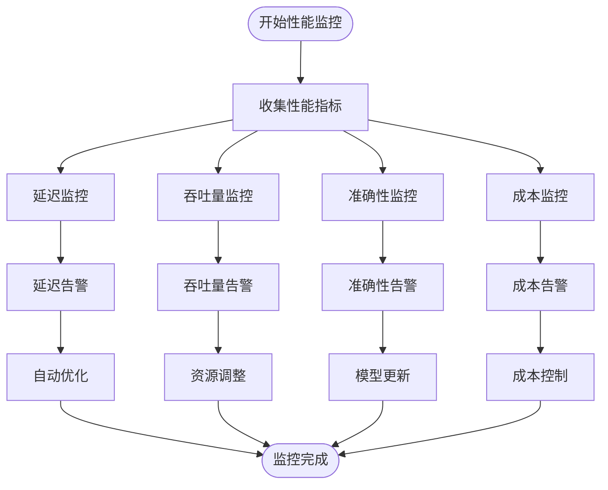

**图表来源**
- [metrics.py:99-144](file://src/evaluation/metrics.py#L99-L144)

## 测试框架与质量保证

### 测试框架概述

项目引入了完整的测试框架，通过`test_rag.py`实现了系统性的质量保证机制：

#### 测试架构设计

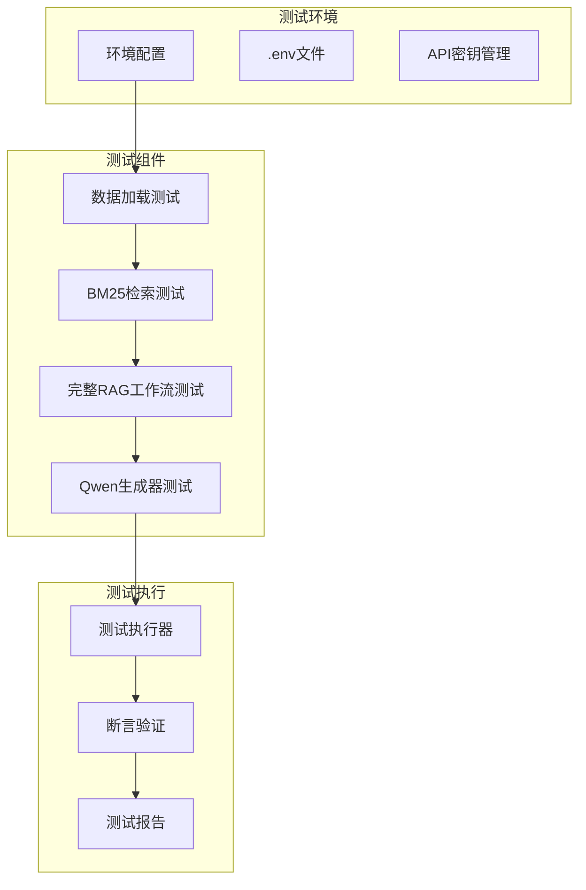

**图表来源**
- [test_rag.py:1-64](file://test_rag.py#L1-L64)

### 测试用例详解

#### 数据加载测试
- **功能**：验证HotpotQA数据集的正确加载
- **范围**：测试subset_size参数和候选文档处理
- **验证点**：示例数量、文档结构完整性

#### BM25检索测试
- **功能**：验证BM25检索器的正确实现
- **范围**：使用问题自带的10个候选文档
- **验证点**：检索结果数量、分数范围、文档预览

#### 完整RAG工作流测试
- **功能**：端到端验证RAG系统
- **范围**：BM25检索 + Qwen生成器组合
- **验证点**：问题处理、答案生成、支持事实

#### Qwen生成器API测试
- **功能**：验证Dashscope API集成
- **范围**：API密钥配置和生成器初始化
- **验证点**：环境变量加载、API调用、错误处理

### 测试执行流程

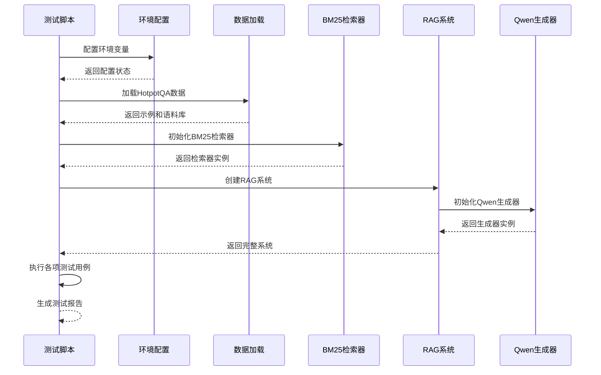

**图表来源**
- [test_rag.py:13-63](file://test_rag.py#L13-L63)

### 测试配置与环境管理

#### 环境变量配置
- **HF_ENDPOINT**：设置HuggingFace镜像站点
- **DASHSCOPE_API_KEY**：阿里百炼API密钥
- **dotenv支持**：自动加载.env文件中的配置

#### 测试数据管理
- **子集大小**：支持subset_size参数控制测试规模
- **候选文档**：使用HotpotQA自带的10个候选文档
- **数据完整性**：验证问题、答案、支持事实的正确性

**章节来源**
- [test_rag.py:1-64](file://test_rag.py#L1-L64)

## 依赖关系分析

### 核心依赖关系

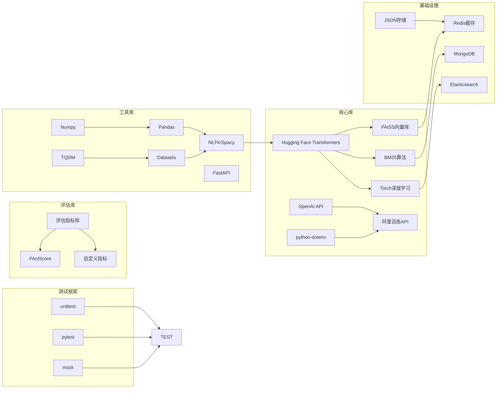

**图表来源**
- [config.py:12-17](file://src/config.py#L12-L17)
- [run_grid_experiment.py:15-23](file://others/run_grid_experiment.py#L15-L23)

### 环境依赖配置

#### Python环境要求
- **Python版本**：3.8+
- **主要依赖包**：transformers、torch、faiss-cpu、scikit-learn、rank_bm25
- **可选依赖**：faiss-gpu（用于GPU加速）、accelerate（用于多GPU）、openai（用于API调用）
- **测试依赖**：pytest、mock、python-dotenv

#### 系统资源要求
- **内存**：至少8GB RAM（推荐16GB+）
- **存储**：至少50GB可用空间（取决于数据集大小）
- **GPU**：可选，RTX 3090+（用于快速推理）
- **网络**：稳定的互联网连接（用于模型下载和API调用）

## 性能考虑

### 检索性能优化

#### BM25优化策略
- **索引优化**：使用倒排索引提高查询速度
- **缓存策略**：缓存热门查询结果
- **批处理**：批量处理相似查询
- **参数调优**：调整k1和b参数以适应不同数据集

#### Contriever优化策略
- **量化技术**：使用INT8量化减少内存占用
- **近似最近邻搜索**：使用HNSW算法替代暴力搜索
- **分布式索引**：在多节点上分布索引以提高扩展性
- **增量索引**：支持动态添加新文档

### 生成性能优化

#### 推理优化
- **模型量化**：将FP32模型转换为INT8
- **KV缓存**：利用键值缓存避免重复计算
- **流水线并行**：将模型分割到多个设备上
- **动态批处理**：根据序列长度动态调整批次大小

#### 内存管理
- **梯度检查点**：减少内存占用但增加计算时间
- **混合精度训练**：使用FP16减少内存使用
- **内存池**：重用内存分配减少碎片

## 故障排除指南

### 常见问题诊断

#### 检索性能问题
- **症状**：查询响应时间过长
- **原因**：索引未优化、内存不足、网络延迟
- **解决方案**：重建索引、增加内存、优化网络配置

#### 生成质量异常
- **症状**：生成内容不相关或重复
- **原因**：提示设计不当、模型参数设置错误
- **解决方案**：调整温度参数、改进提示模板、检查模型权重

#### 内存泄漏问题
- **症状**：长时间运行后内存使用持续增长
- **原因**：对象未正确释放、缓存未清理
- **解决方案**：实现垃圾回收、定期清理缓存、监控内存使用

#### API集成问题
- **症状**：Qwen生成器初始化失败
- **原因**：API密钥缺失、网络连接问题
- **解决方案**：检查环境变量配置、验证API密钥有效性、检查网络连接

### 调试技巧

#### 日志记录策略
- **结构化日志**：使用JSON格式记录关键信息
- **性能日志**：记录每个操作的执行时间和内存使用
- **错误日志**：捕获异常并记录堆栈跟踪

#### 监控指标
- **系统指标**：CPU使用率、内存使用、磁盘I/O
- **应用指标**：请求延迟、成功率、错误率
- **业务指标**：检索准确率、生成质量评分

#### 测试调试
- **单元测试**：隔离测试各个组件的功能
- **集成测试**：验证组件间的协作
- **端到端测试**：模拟完整用户流程
- **环境测试**：验证不同环境下的行为一致性

### 错误处理增强

#### HTTP客户端初始化增强
- **超时配置**：设置合理的连接和读取超时
- **重试机制**：实现指数退避重试策略
- **错误分类**：区分网络错误和API错误
- **日志记录**：详细记录错误信息和上下文

#### 编码兼容性改进
- **UTF-8输出**：强制设置标准输出编码
- **错误处理**：使用错误替换策略避免编码问题
- **跨平台支持**：适配Windows、Linux、macOS的编码差异
- **字符集检测**：自动检测和处理不同字符集

#### 评估指标实现完善
- **边界条件处理**：处理空输入和零除错误
- **数值稳定性**：使用稳定算法避免数值溢出
- **性能优化**：批量处理和向量化计算
- **结果验证**：验证指标计算的正确性

**章节来源**
- [rag_hotpotqa.py:10-28](file://rag_hotpotqa.py#L10-L28)
- [rag_hotpotqa.py:388-398](file://rag_hotpotqa.py#L388-L398)
- [metrics.py:146-227](file://src/evaluation/metrics.py#L146-L227)

## 结论

本技术实现指南提供了完整的RAG系统开发框架，涵盖了从基础概念到高级优化的各个方面。通过合理选择和配置检索器、生成模型以及评估指标，可以构建高性能的知识密集型NLP应用。

关键成功因素包括：
- 选择合适的检索策略以平衡精度和效率
- 优化生成模型以提高响应质量和速度
- 建立完善的评估体系以持续改进系统性能
- 实施有效的监控和故障排除机制
- 构建全面的测试框架确保代码质量

本项目特别强调了多领域应用的重要性，通过在金融和法律领域的交叉验证，确保系统的泛化能力和实用性。新增的测试框架进一步增强了系统的可靠性和维护性，为未来的功能扩展奠定了坚实基础。

## 附录

### 扩展新检索方法

#### 自定义检索器开发流程
1. **需求分析**：确定检索目标和性能要求
2. **算法选择**：选择合适的检索算法或组合策略
3. **实现开发**：实现核心检索逻辑
4. **测试验证**：在基准数据集上测试性能
5. **集成部署**：与现有系统集成并监控效果

#### 新评估指标开发
1. **指标设计**：定义评估目标和计算方法
2. **实现开发**：编写评估函数和计算逻辑
3. **验证测试**：使用已知数据验证准确性
4. **集成应用**：在评估流程中集成新指标

### 部署最佳实践

#### 生产环境部署
- **容器化**：使用Docker容器化应用
- **负载均衡**：配置多个实例以提高可用性
- **自动扩缩容**：根据流量自动调整实例数量
- **健康检查**：定期检查服务状态

#### 安全考虑
- **API安全**：实施身份验证和授权机制
- **数据保护**：加密敏感数据传输和存储
- **访问控制**：限制对敏感功能的访问
- **审计日志**：记录所有重要操作

### 实验配置与运行

#### 网格实验配置
- **检索器类型**：bm25、contriever、hybrid
- **生成器模型**：llama、qwen
- **数据集**：financebench、cuad、legalbench_rag
- **评估指标**：EM、F1、Recall@k、FActScore

#### 性能基准测试
- **HotpotQA分析**：多跳问答场景下的检索精度分析
- **跨领域比较**：金融vs法律领域的性能对比
- **检索质量影响**：Recall@k与Answer F1的相关性分析

### 测试框架扩展

#### 新测试用例开发
1. **测试场景设计**：确定测试目标和边界条件
2. **测试数据准备**：创建测试数据集和预期结果
3. **测试实现**：编写测试代码和断言逻辑
4. **测试执行**：运行测试并分析结果
5. **测试维护**：更新测试以适应代码变更

#### 持续集成配置
- **自动化测试**：配置CI/CD管道自动运行测试
- **测试覆盖率**：监控代码覆盖率和质量指标
- **回归测试**：确保新功能不影响现有功能
- **性能测试**：监控系统性能和资源使用情况

### 错误处理和编码兼容性增强

#### HTTP客户端错误处理
- **超时配置**：设置合理的连接和读取超时
- **重试策略**：实现指数退避重试
- **错误分类**：区分网络和API错误
- **日志记录**：详细记录错误上下文

#### 编码兼容性改进
- **UTF-8输出**：强制设置标准输出编码
- **错误替换**：使用错误替换策略
- **跨平台适配**：处理不同平台的编码差异
- **字符集检测**：自动处理不同字符集

#### 评估指标稳定性
- **边界条件处理**：处理空输入和零除错误
- **数值稳定性**：使用稳定算法
- **性能优化**：批量处理和向量化
- **结果验证**：验证计算正确性

**章节来源**
- [config.py:27-41](file://src/config.py#L27-L41)
- [run_grid_experiment.py:144-213](file://others/run_grid_experiment.py#L144-L213)
- [run_hotpotqa_analysis.py:570-744](file://others/run_hotpotqa_analysis.py#L570-L744)
- [test_rag.py:1-64](file://test_rag.py#L1-L64)
- [rag_hotpotqa.py:10-28](file://rag_hotpotqa.py#L10-L28)
- [rag_hotpotqa.py:388-398](file://rag_hotpotqa.py#L388-L398)
- [metrics.py:146-227](file://src/evaluation/metrics.py#L146-L227)