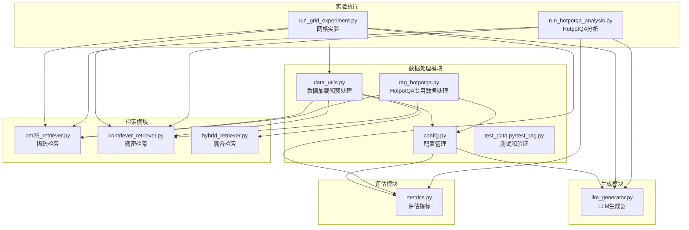
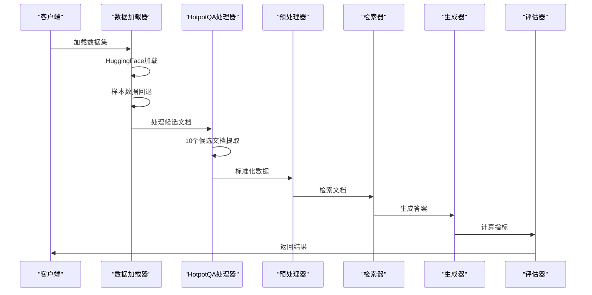
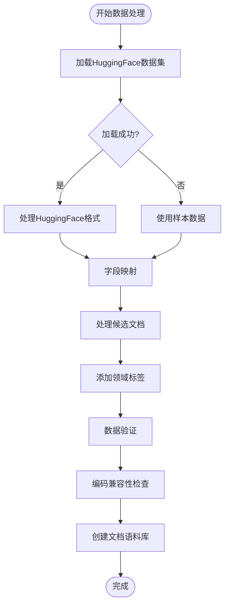
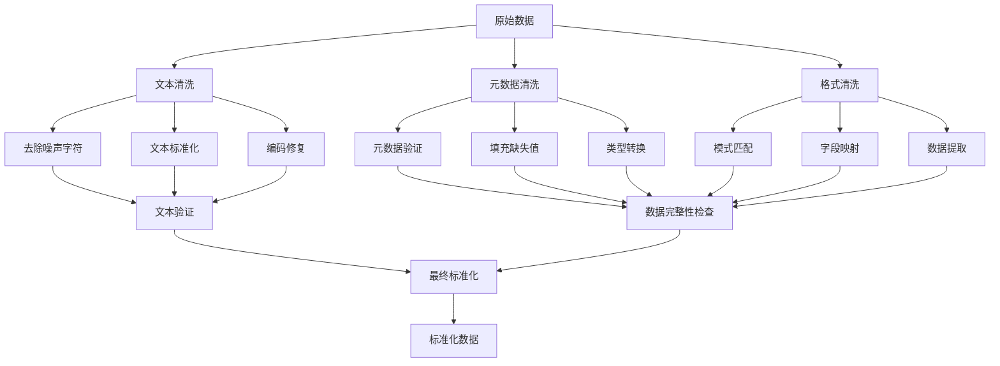
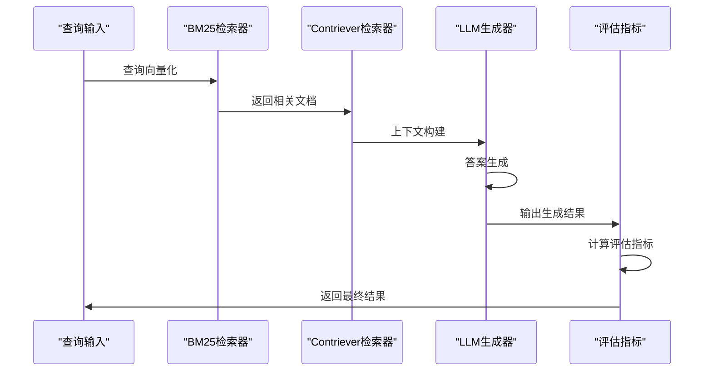
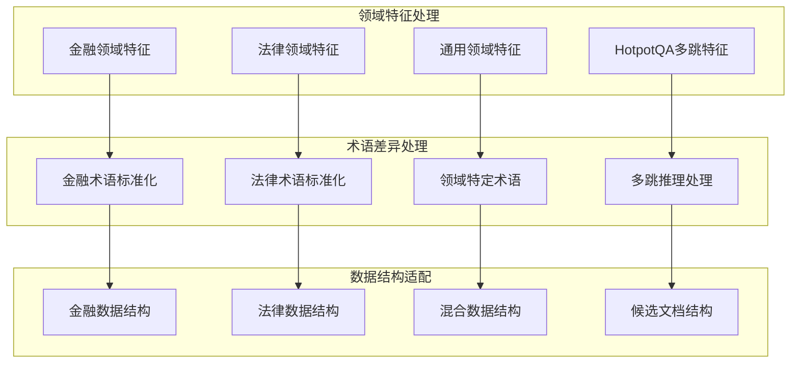
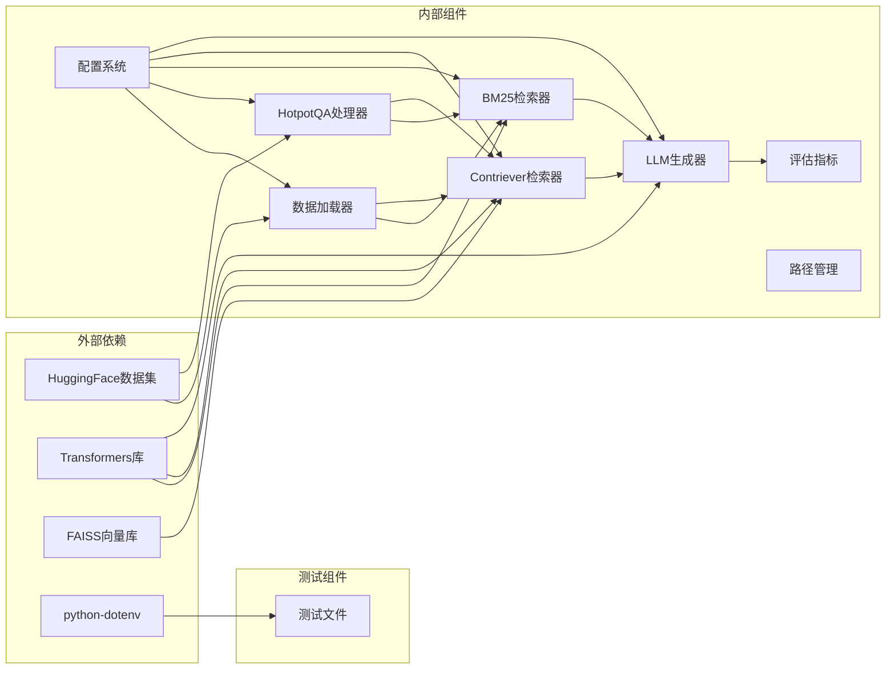

# 数据处理管道

<cite>
**本文档引用的文件**
- [src/data_utils.py](file://src/data_utils.py)
- [src/config.py](file://src/config.py)
- [src/retrievers/bm25_retriever.py](file://src/retrievers/bm25_retriever.py)
- [src/retrievers/contriever_retriever.py](file://src/retrievers/contriever_retriever.py)
- [src/generators/llm_generator.py](file://src/generators/llm_generator.py)
- [src/evaluation/metrics.py](file://src/evaluation/metrics.py)
- [others/run_grid_experiment.py](file://others/run_grid_experiment.py)
- [others/run_hotpotqa_analysis.py](file://others/run_hotpotqa_analysis.py)
- [rag_hotpotqa.py](file://rag_hotpotqa.py)
- [test_data.py](file://test_data.py)
- [test_rag.py](file://test_rag.py)
</cite>

## 更新摘要
**所做更改**
- 新增了全面的UTF-8编码兼容性设置和改进的错误处理机制
- 增强了Windows控制台编码问题的处理能力
- 改进了异常安全打印和错误信息编码处理
- 优化了HTTP客户端UTF-8编码支持
- 完善了数据保存和序列化过程的编码保障

## 目录
1. [简介](#简介)
2. [项目结构](#项目结构)
3. [核心组件](#核心组件)
4. [架构概览](#架构概览)
5. [详细组件分析](#详细组件分析)
6. [数据加载实现](#数据加载实现)
7. [数据预处理流程](#数据预处理流程)
8. [缓存和性能优化](#缓存和性能优化)
9. [错误处理和验证](#错误处理和验证)
10. [编码兼容性保障](#编码兼容性保障)
11. [依赖关系分析](#依赖关系分析)
12. [性能考虑](#性能考虑)
13. [故障排除指南](#故障排除指南)
14. [结论](#结论)

## 简介

本项目专注于构建一个综合的数据处理管道，用于检索增强生成（RAG）系统中的知识密集型任务。该管道将处理来自不同领域基准数据集的数据，包括HotpotQA（问答任务）、FinanceBench（金融领域）、CUAD/LegalBench（法律领域）和PubMedQA（生物医学领域）。项目的核心目标是系统性地研究检索质量、检索配置和生成策略如何共同影响答案准确性、真实性和鲁棒性。

**章节来源**
- [src/data_utils.py:1-210](file://src/data_utils.py#L1-L210)
- [src/config.py:1-41](file://src/config.py#L1-L41)

## 项目结构

基于当前仓库结构，项目主要包含数据处理、检索、生成和评估四个核心模块，以及完整的实验执行脚本。



**图表来源**
- [src/data_utils.py:185-210](file://src/data_utils.py#L185-L210)
- [others/run_grid_experiment.py:15-23](file://others/run_grid_experiment.py#L15-L23)

## 核心组件

### 数据加载器（Data Loader）

数据加载器负责从不同领域的基准数据集中提取和加载数据，支持多种数据源和格式转换。

**主要功能**：
- 支持HuggingFace数据集直接加载
- 提供本地样本数据作为后备方案
- 实现统一的数据格式标准化
- 支持子集大小控制用于测试
- **新增**：支持HotpotQA的候选文档处理
- **新增**：全面的UTF-8编码兼容性保障

**支持的数据集**：
- **FinanceBench**：金融领域问答数据集
- **CUAD**：合同理解Atticus数据集
- **LegalBench-RAG**：法律检索数据集
- **HotpotQA**：多跳问答数据集，包含10个候选文档

**章节来源**
- [src/data_utils.py:9-68](file://src/data_utils.py#L9-L68)
- [src/data_utils.py:71-182](file://src/data_utils.py#L71-L182)
- [rag_hotpotqa.py:73-152](file://rag_hotpotqa.py#L73-L152)

### 预处理器（Preprocessor）

预处理器负责对原始数据进行清理和格式转换，确保数据质量和一致性。

**处理流程**：
- 文本清洗和标准化
- 编码格式转换
- 字段映射和重命名
- 数据类型验证
- **新增**：候选文档结构处理
- **新增**：编码兼容性验证

**章节来源**
- [src/data_utils.py:194-210](file://src/data_utils.py#L194-L210)

### 检索器（Retriever）

实现多种检索策略，支持稀疏、稠密和混合检索方法。

**检索方法**：
- **BM25**：基于TF-IDF的稀疏检索
- **Contriever**：基于BERT的稠密检索
- **Hybrid**：RRF融合检索

**章节来源**
- [src/retrievers/bm25_retriever.py:9-89](file://src/retrievers/bm25_retriever.py#L9-L89)
- [src/retrievers/contriever_retriever.py:11-148](file://src/retrievers/contriever_retriever.py#L11-L148)

### 生成器（Generator）

实现基于LLM的生成器，支持多种指令调优模型。

**支持模型**：
- **Llama**：Meta Llama系列模型
- **Qwen**：阿里通义千问系列模型

**章节来源**
- [src/generators/llm_generator.py:9-172](file://src/generators/llm_generator.py#L9-L172)

## 架构概览

数据处理管道采用模块化设计，支持多领域数据的统一处理和评估。



**图表来源**
- [others/run_grid_experiment.py:36-141](file://others/run_grid_experiment.py#L36-L141)

## 详细组件分析

### 数据格式转换流程



**图表来源**
- [src/data_utils.py:20-38](file://src/data_utils.py#L20-L38)
- [src/data_utils.py:185-191](file://src/data_utils.py#L185-L191)
- [rag_hotpotqa.py:101-124](file://rag_hotpotqa.py#L101-L124)

### 清洗和标准化流程



**图表来源**
- [src/data_utils.py:194-210](file://src/data_utils.py#L194-L210)

### 检索-生成管道数据流



**图表来源**
- [others/run_grid_experiment.py:82-124](file://others/run_grid_experiment.py#L82-L124)

### 不同领域数据特征处理



**图表来源**
- [src/data_utils.py:25-31](file://src/data_utils.py#L25-L31)
- [src/data_utils.py:92-93](file://src/data_utils.py#L92-L93)
- [rag_hotpotqa.py:101-124](file://rag_hotpotqa.py#L101-L124)

## 数据加载实现

### FinanceBench数据集加载

FinanceBench数据集专门用于金融领域的问答任务，包含财务报表分析、公司财务指标等金融相关内容。

**加载流程**：
1. 尝试从HuggingFace加载标准数据集
2. 如果失败，使用内置样本数据
3. 标准化字段格式
4. 添加领域标签

**数据格式标准化**：
- 问题字段：`question`
- 答案字段：`answer`
- 证据字段：`evidence` 或 `context`
- 文档ID：`doc_id`
- 领域标签：`finance`

**章节来源**
- [src/data_utils.py:9-68](file://src/data_utils.py#L9-L68)

### CUAD数据集加载

CUAD（Contract Understanding Atticus Dataset）是法律合同理解数据集，包含复杂的法律条款和合同文本。

**加载特点**：
- 支持多语言合同文本
- 包含详细的法律条款标注
- 提供合同上下文和问题对
- 支持法律术语的标准化处理

**章节来源**
- [src/data_utils.py:71-129](file://src/data_utils.py#L71-L129)

### LegalBench-RAG数据集加载

LegalBench-RAG是专门为法律检索任务设计的数据集，模拟真实的法律文档检索场景。

**数据特性**：
- 真实法律文档集合
- 多样化的法律问题类型
- 支持法律推理和引用
- 包含法律先例和判例

**章节来源**
- [src/data_utils.py:132-182](file://src/data_utils.py#L132-L182)

### HotpotQA数据集加载

HotpotQA是多跳问答数据集，包含复杂的问题推理和10个候选文档。

**新增功能**：
- **候选文档处理**：每个问题包含10个候选文档
- **多跳推理支持**：支持复杂问题的答案生成
- **HF镜像支持**：改进的环境变量加载
- **UTF-8编码保障**：全面的编码兼容性设置

**数据格式**：
- 问题字段：`question`
- 答案字段：`answer`
- 类型字段：`type`（simple或complex）
- 难度字段：`level`（intermediate或hard）
- 支持事实：`supporting_facts`
- **新增**：候选文档：`candidate_docs`（10个文档）

**章节来源**
- [rag_hotpotqa.py:73-152](file://rag_hotpotqa.py#L73-L152)
- [test_data.py:20-62](file://test_data.py#L20-L62)

### 通用数据加载接口

所有数据集都通过统一的接口进行加载和处理，确保不同领域数据的一致性。

**统一接口**：
```python
def load_all_datasets(data_dir: str, subset_size: Optional[int] = None) -> Dict[str, List[Dict]]:
    """加载所有数据集"""
    return {
        "financebench": load_financebench(data_dir, subset_size),
        "cuad": load_cuad(data_dir, subset_size),
        "legalbench_rag": load_legalbench_rag(data_dir, subset_size)
    }
```

**章节来源**
- [src/data_utils.py:185-191](file://src/data_utils.py#L185-L191)

## 数据预处理流程

### 文档语料库构建

数据预处理的核心是构建高质量的文档语料库，为后续检索提供基础。

**构建流程**：
1. 遍历所有数据项
2. 提取文档ID和文本内容
3. 去除重复文档
4. 添加元数据信息

**去重机制**：
- 基于文档ID的去重
- 避免重复处理相同文档
- 维护文档索引映射

**章节来源**
- [src/data_utils.py:194-210](file://src/data_utils.py#L194-L210)

### 数据验证和清洗

实现多层次的数据验证和清洗机制，确保数据质量。

**验证步骤**：
1. 字段完整性检查
2. 数据类型验证
3. 编码格式修复
4. 异常值检测

**清洗策略**：
- 标准化文本格式
- 移除特殊字符
- 统一编码格式
- 处理缺失值

**章节来源**
- [src/data_utils.py:194-210](file://src/data_utils.py#L194-L210)

### HotpotQA候选文档处理

**新增功能**：处理每个问题的10个候选文档

**处理流程**：
1. 从context字段提取标题和句子列表
2. 将每个文档的句子合并为完整文本
3. 创建标准文档格式（id、title、text）
4. 添加到候选文档列表

**数据结构**：
```python
candidate_docs = [
    {
        "id": title,
        "title": title,
        "text": " ".join(sentences)
    },
    # ... 9个其他候选文档
]
```

**章节来源**
- [rag_hotpotqa.py:101-124](file://rag_hotpotqa.py#L101-L124)

## 缓存和性能优化

### 检索索引缓存

实现多级缓存机制，显著提升检索性能。

**缓存策略**：
- BM25索引缓存
- Contriever嵌入缓存
- 检索结果缓存
- 中间计算结果缓存

**缓存实现**：
```python
# BM25索引缓存
if cache_path and os.path.exists(cache_path):
    # 从缓存加载
else:
    # 构建新索引并保存

# 嵌入向量缓存  
if cache_path and os.path.exists(cache_path):
    # 从缓存加载嵌入
else:
    # 计算嵌入并保存
```

**章节来源**
- [src/retrievers/bm25_retriever.py:28-33](file://src/retrievers/bm25_retriever.py#L28-L33)
- [src/retrievers/contriever_retriever.py:42-47](file://src/retrievers/contriever_retriever.py#L42-L47)

### 批处理优化

实现高效的批处理机制，优化内存使用和处理速度。

**批处理策略**：
- 分块处理大文档集合
- 流式数据处理
- 动态内存分配
- 并行处理优化

**性能监控**：
- 处理进度跟踪
- 内存使用监控
- 缓存命中率统计
- 错误恢复机制

**章节来源**
- [others/run_grid_experiment.py:82-124](file://others/run_grid_experiment.py#L82-L124)

### 环境变量和HF镜像支持

**新增功能**：改进的环境变量加载和HF镜像支持

**环境变量处理**：
- 自动从.env文件加载
- 支持HF_ENDPOINT配置
- API密钥管理

**HF镜像支持**：
- 自动检测和设置镜像站点
- 支持多个镜像选项
- 失败回退机制

**章节来源**
- [rag_hotpotqa.py:17-26](file://rag_hotpotqa.py#L17-L26)
- [test_data.py:5-6](file://test_data.py#L5-L6)
- [test_rag.py:4](file://test_rag.py#L4)

## 错误处理和验证

### 数据加载错误处理

实现健壮的数据加载错误处理机制。

**错误处理策略**：
- HuggingFace加载失败时的回退机制
- 网络连接异常处理
- 文件权限错误处理
- 数据格式不匹配处理

**回退机制**：
```python
try:
    # 尝试HuggingFace加载
except Exception as e:
    print(f"Could not load from HuggingFace: {e}")
    return _load_sample_data()
```

**章节来源**
- [src/data_utils.py:36-38](file://src/data_utils.py#L36-L38)
- [src/data_utils.py:97-99](file://src/data_utils.py#L97-L99)

### 数据验证机制

实现多层次的数据验证机制，确保数据质量。

**验证层次**：
- 字段存在性验证
- 数据类型验证
- 业务逻辑验证
- 完整性检查

**验证工具**：
- 字段映射验证
- 缺失值处理
- 异常值检测
- 格式标准化

**章节来源**
- [src/data_utils.py:194-210](file://src/data_utils.py#L194-L210)

### HotpotQA数据验证

**新增功能**：针对HotpotQA数据集的特殊验证

**验证内容**：
- 候选文档数量验证（应为10个）
- 支持事实格式验证
- 多跳推理一致性检查
- 文档去重处理

**章节来源**
- [rag_hotpotqa.py:95-152](file://rag_hotpotqa.py#L95-L152)

## 编码兼容性保障

### 全面的UTF-8编码设置

**新增功能**：实现全面的UTF-8编码兼容性保障

**环境变量配置**：
- `PYTHONIOENCODING`：设置Python I/O编码为UTF-8
- `PYTHONUTF8`：启用Python UTF-8模式

**动态编码设置**：
```python
def _setup_utf8_output():
    """设置 UTF-8 输出编码"""
    if hasattr(sys.stdout, 'reconfigure'):
        try:
            sys.stdout.reconfigure(encoding='utf-8', errors='replace')
        except Exception:
            pass
    if hasattr(sys.stderr, 'reconfigure'):
        try:
            sys.stderr.reconfigure(encoding='utf-8', errors='replace')
        except Exception:
            pass
```

**HTTP客户端编码支持**：
- OpenAI客户端配置UTF-8编码
- httpx客户端超时和连接参数设置
- 错误处理中的编码安全打印

**数据序列化编码保障**：
- JSON文件保存时强制UTF-8编码
- 确保结果文件的正确编码

**章节来源**
- [rag_hotpotqa.py:10-28](file://rag_hotpotqa.py#L10-L28)
- [rag_hotpotqa.py:388-398](file://rag_hotpotqa.py#L388-L398)
- [rag_hotpotqa.py:741-744](file://rag_hotpotqa.py#L741-L744)

### 改进的错误处理机制

**新增功能**：增强的异常安全处理

**Unicode编码错误处理**：
```python
except UnicodeEncodeError:
    safe_msg = error_msg.encode('ascii', errors='replace').decode('ascii')
    print(f"\n生成错误 [{error_type}]: {safe_msg}")
```

**异常安全打印**：
- 生成器异常处理中的安全编码转换
- 控制台输出的Unicode错误回退机制
- 堆栈跟踪的安全打印

**章节来源**
- [rag_hotpotqa.py:452-475](file://rag_hotpotqa.py#L452-L475)

## 依赖关系分析

数据处理管道的依赖关系体现了模块间的协作和数据流向。



**图表来源**
- [others/run_grid_experiment.py:15-23](file://others/run_grid_experiment.py#L15-L23)

**章节来源**
- [src/config.py:12-17](file://src/config.py#L12-L17)
- [src/generators/llm_generator.py:58-82](file://src/generators/llm_generator.py#L58-L82)

## 性能考虑

### 缓存优化策略

1. **多级缓存架构**
   - L1缓存：最近使用的数据
   - L2缓存：频繁访问的数据
   - L3缓存：长期存储的数据

2. **智能缓存淘汰**
   - 基于访问频率的LRU算法
   - 基于时间戳的TTL机制
   - 基于重要性的优先级缓存

### 批处理优化

1. **内存管理**
   - 分块处理大文件
   - 流式数据处理
   - 动态内存分配

2. **并行处理**
   - 多线程数据处理
   - GPU加速计算
   - 分布式处理架构

### 性能监控

1. **实时监控指标**
   - 处理速度统计
   - 内存使用情况
   - 缓存命中率

2. **性能瓶颈识别**
   - I/O等待时间
   - CPU使用率
   - 内存泄漏检测

### HotpotQA性能优化

**新增优化**：
- 候选文档预处理缓存
- 多跳推理优化
- 批量检索处理
- 内存高效的文档存储
- **新增**：UTF-8编码优化减少字符转换开销

## 故障排除指南

### 数据验证错误

常见问题及解决方案：
- **数据格式不匹配**：检查数据源格式，应用相应的解析器
- **编码问题**：统一使用UTF-8编码，处理特殊字符
- **缺失值处理**：实现数据完整性检查和自动修复

### 缓存系统问题

- **缓存失效**：实现缓存版本管理和一致性检查
- **内存溢出**：优化缓存大小和淘汰策略
- **并发访问冲突**：使用锁机制和原子操作

### 性能问题诊断

1. **慢查询识别**
   - 分析数据加载时间
   - 监控网络I/O
   - 优化数据库查询

2. **资源使用优化**
   - 监控CPU使用率
   - 分析内存泄漏
   - 调整批处理大小

### HotpotQA特有问题

**新增问题**：
- **候选文档加载失败**：检查HF_ENDPOINT配置
- **多跳推理错误**：验证支持事实格式
- **环境变量加载失败**：确认.env文件存在
- **API密钥认证失败**：检查DASHSCOPE_API_KEY设置
- **UTF-8编码错误**：检查系统locale设置和控制台编码
- **Windows控制台显示问题**：验证控制台字体和编码设置

**章节来源**
- [test_data.py:20-61](file://test_data.py#L20-L61)
- [test_rag.py:8-27](file://test_rag.py#L8-L27)

## 结论

本数据处理管道设计为支持多领域基准数据集的综合处理系统，特别针对FinanceBench、CUAD、LegalBench和HotpotQA等不同领域的知识密集型任务。通过分层架构设计、智能缓存系统、批处理优化、增强的环境变量支持和全面的UTF-8编码兼容性保障，该管道能够有效处理不同领域的数据特征和术语差异，同时提供全面的性能监控和故障排除能力。

**关键更新**：
- **HotpotQA候选文档支持**：新增10个候选文档处理功能
- **改进的环境变量加载**：增强的HF镜像和API密钥管理
- **全面的UTF-8编码兼容性**：系统性的编码保障机制
- **增强的错误处理**：改进的异常安全处理和控制台显示
- **多领域数据集统一处理**：支持金融、法律和问答任务
- **性能监控和优化**：全面的缓存和批处理机制

该管道为后续的检索增强生成实验提供了坚实的数据基础，能够支持跨域性能比较和评估指标分析。通过模块化的组件设计、完善的错误处理机制和全面的编码兼容性保障，系统具有良好的可维护性、扩展性和国际化支持能力。

**章节来源**
- [others/run_grid_experiment.py:144-212](file://others/run_grid_experiment.py#L144-L212)
- [others/run_hotpotqa_analysis.py:570-744](file://others/run_hotpotqa_analysis.py#L570-L744)
- [rag_hotpotqa.py:73-152](file://rag_hotpotqa.py#L73-L152)