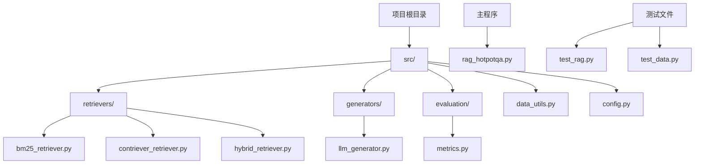
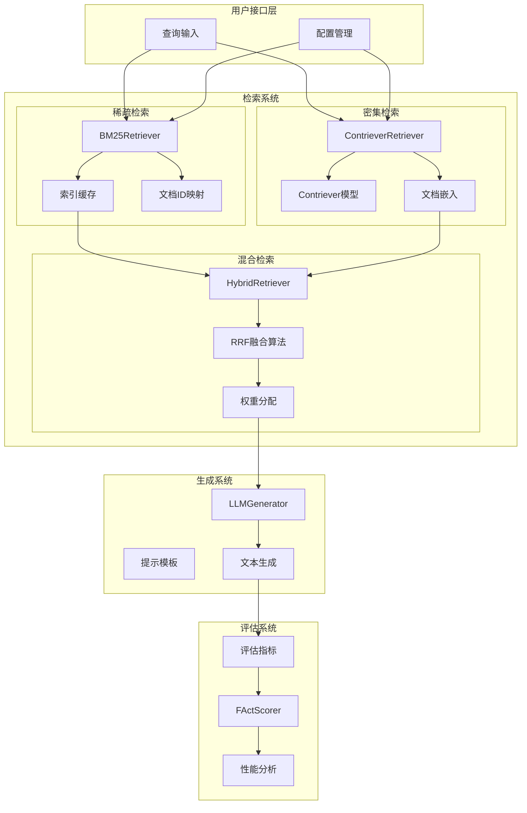
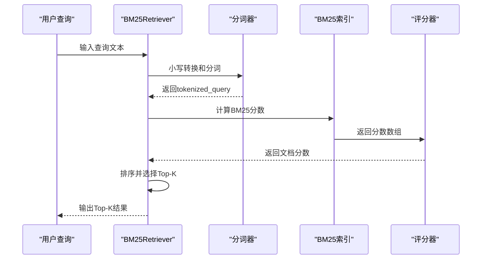
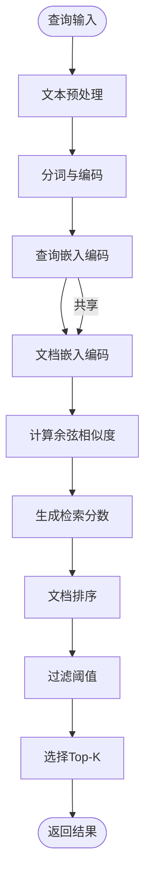
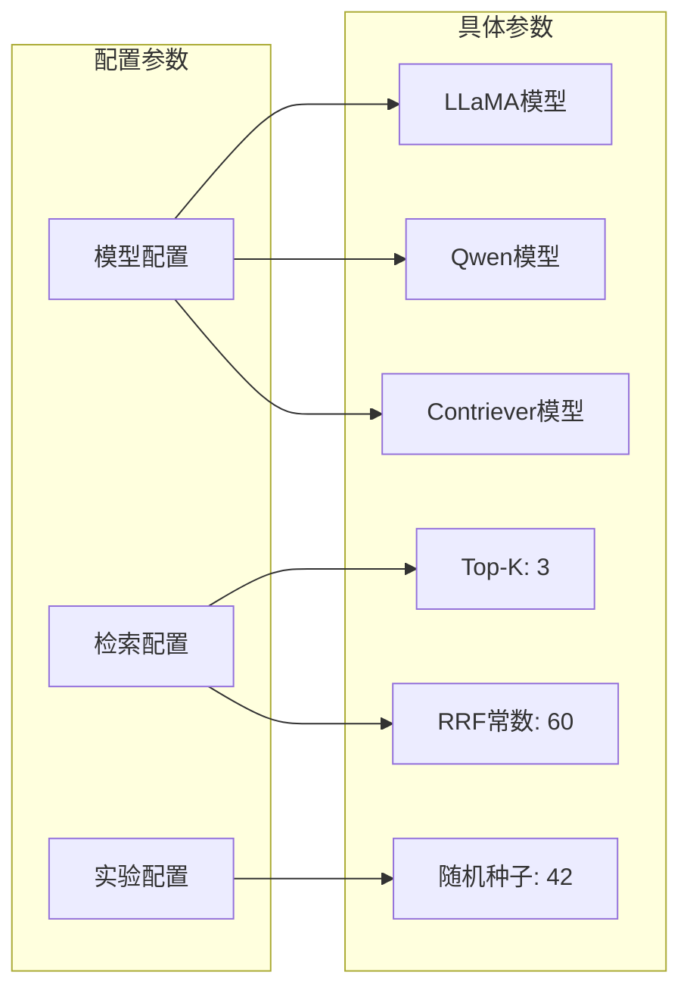
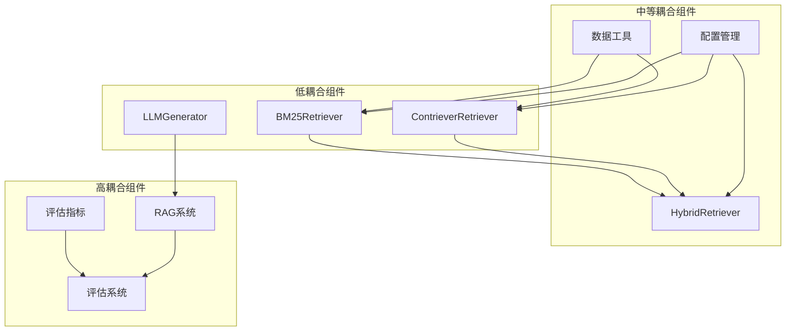
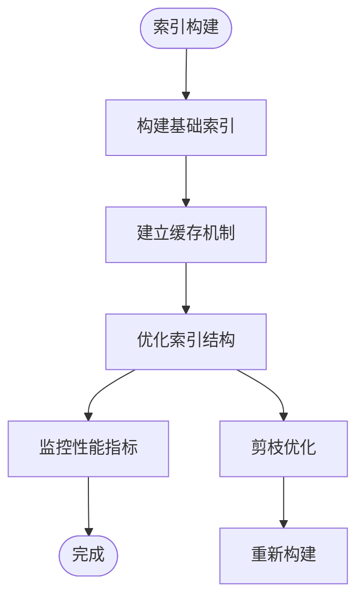

# 检索系统实现

<cite>
**本文档引用的文件**
- [bm25_retriever.py](file://src/retrievers/bm25_retriever.py)
- [contriever_retriever.py](file://src/retrievers/contriever_retriever.py)
- [hybrid_retriever.py](file://src/retrievers/hybrid_retriever.py)
- [config.py](file://src/config.py)
- [data_utils.py](file://src/data_utils.py)
- [llm_generator.py](file://src/generators/llm_generator.py)
- [metrics.py](file://src/evaluation/metrics.py)
- [rag_hotpotqa.py](file://rag_hotpotqa.py)
- [test_rag.py](file://test_rag.py)
- [test_data.py](file://test_data.py)
</cite>

## 更新摘要
**变更内容**
- 新增了完整的检索器实现代码分析
- 更新了BM25、Contriever和混合检索器的具体实现细节
- 添加了配置管理和数据处理的完整实现
- 更新了评估指标和生成器的详细实现
- 增加了实际代码示例和使用方法

## 目录
1. [引言](#引言)
2. [项目结构](#项目结构)
3. [核心组件](#核心组件)
4. [架构概览](#架构概览)
5. [详细组件分析](#详细组件分析)
6. [依赖关系分析](#依赖关系分析)
7. [性能考虑](#性能考虑)
8. [故障排除指南](#故障排除指南)
9. [结论](#结论)

## 引言

本项目专注于检索增强生成（Retrieval-Augmented Generation, RAG）系统的研究与实现，重点探索稀疏检索（BM25）与密集检索（Contriever）两种不同检索策略的实现与应用。RAG系统通过将神经检索与大型语言模型相结合，解决知识密集型自然语言处理任务，避免仅依赖参数化知识，而是从外部文档中检索相关信息来支撑生成过程。

本项目的两个关键组成部分：
- **检索-生成交互**：研究不同的检索策略（稀疏/密集/混合检索）与各种大语言模型（如开源模型LLaMA或闭源模型GPT）的配对效果，实现至少两种检索方法（例如BM25与Contriever）和两种生成模型，并在HotpotQA开发集上分析检索精度对最终答案质量的影响。
- **幻觉缓解**：设计实验以衡量RAG减少模型虚构信息的效果，量化FActScore等指标，评估不同领域间引用支撑质量的差异，并比较传统RAG与高级变体（如Self-RAG）的效果。

## 项目结构

当前仓库结构包含完整的检索系统实现，主要文件分布如下：



**图表来源**
- [bm25_retriever.py:1-89](file://src/retrievers/bm25_retriever.py#L1-L89)
- [contriever_retriever.py:1-148](file://src/retrievers/contriever_retriever.py#L1-L148)
- [hybrid_retriever.py:1-113](file://src/retrievers/hybrid_retriever.py#L1-L113)

## 核心组件

### 稀疏检索器（BM25）

BM25作为一种经典的稀疏检索算法，基于词项频率和逆文档频率进行文档评分。在RAG系统中，它通常用于快速筛选大量候选文档。

关键特性：
- 基于rank_bm25库的实现
- 支持索引缓存和持久化
- 提供完整的检索API接口
- 支持查询预处理和分词

### 密集检索器（Contriever）

Contriever是一种基于Transformer的密集检索模型，能够学习语义表示来进行文档检索。

关键特性：
- 基于Facebook Contriever模型
- 使用HuggingFace Transformers库
- 支持GPU加速和批量处理
- 实现了Mean Pooling嵌入策略

### 混合检索器

结合稀疏和密集检索的优势，通过加权融合多个检索信号来提高整体检索效果。

关键特性：
- 实现Reciprocal Rank Fusion (RRF)算法
- 支持两路检索器的融合
- 提供灵活的融合参数配置
- 保持检索器独立性

**章节来源**
- [bm25_retriever.py:9-34](file://src/retrievers/bm25_retriever.py#L9-L34)
- [contriever_retriever.py:11-48](file://src/retrievers/contriever_retriever.py#L11-L48)
- [hybrid_retriever.py:10-41](file://src/retrievers/hybrid_retriever.py#L10-L41)

## 架构概览



**图表来源**
- [hybrid_retriever.py:42-69](file://src/retrievers/hybrid_retriever.py#L42-L69)
- [llm_generator.py:9-83](file://src/generators/llm_generator.py#L9-L83)
- [metrics.py:146-227](file://src/evaluation/metrics.py#L146-L227)

## 详细组件分析

### BM25稀疏检索器实现

#### 初始化与配置

BM25检索器的初始化涉及以下关键步骤：

1. **文档预处理**：提取文档ID和文本内容，进行小写转换和分词
2. **索引构建**：使用rank_bm25库构建BM25索引
3. **缓存机制**：支持索引的序列化和反序列化
4. **参数配置**：默认使用BM25标准参数

#### 查询处理流程



**图表来源**
- [bm25_retriever.py:56-77](file://src/retrievers/bm25_retriever.py#L56-L77)

#### 性能优化技巧

- **索引缓存**：支持pickle序列化，避免重复构建索引
- **内存管理**：使用列表推导式和内置排序函数
- **批量处理**：支持一次性处理多个查询
- **设备适配**：虽然BM25是CPU算法，但保持统一的接口设计

### Contriever密集检索器实现

#### 模型架构

Contriever基于Transformer架构，采用以下设计原则：

1. **双塔架构**：独立的查询编码器和文档编码器
2. **Mean Pooling**：使用注意力掩码进行平均池化
3. **归一化嵌入**：对嵌入向量进行L2归一化
4. **批量处理**：支持批量编码和相似度计算

#### 查询处理流程



**图表来源**
- [contriever_retriever.py:111-136](file://src/retrievers/contriever_retriever.py#L111-L136)

#### 参数配置

关键超参数设置：
- **模型名称**：默认使用"facebook/contriever-msmarco"
- **最大长度**：512字符截断
- **批次大小**：32个文档批量处理
- **设备选择**：自动检测CUDA可用性

### 混合检索器实现

#### RRF融合算法

混合检索器实现了Reciprocal Rank Fusion (RRF)算法：

1. **独立检索**：分别调用BM25和Contriever检索器
2. **排名收集**：获取两个检索器的文档排名
3. **RRF计算**：应用公式 `RRF(d) = Σ(1/(k+rank(d)))`
4. **最终排序**：按融合分数排序输出

#### 配置参数

- **RRF常数**：默认60，影响融合权重
- **设备配置**：可配置GPU/CPU设备
- **索引缓存**：支持两个子检索器的独立缓存

**章节来源**
- [hybrid_retriever.py:42-102](file://src/retrievers/hybrid_retriever.py#L42-L102)

### 配置管理系统

#### 实验配置

配置系统提供了完整的实验参数管理：



**图表来源**
- [config.py:27-41](file://src/config.py#L27-L41)

#### 数据集配置

支持多种数据集的配置和加载：
- **FinanceBench**：金融领域问答数据集
- **CUAD**：法律合同理解数据集  
- **LegalBench-RAG**：法律检索数据集

**章节来源**
- [config.py:12-25](file://src/config.py#L12-L25)
- [data_utils.py:185-191](file://src/data_utils.py#L185-L191)

### 生成器实现

#### LLM生成器

LLM生成器支持多种指令调优的大语言模型：

1. **模型加载**：使用HuggingFace Transformers库
2. **提示模板**：针对不同模型的专用模板
3. **量化支持**：支持8位量化以节省显存
4. **批量生成**：支持多示例批量处理

#### 生成参数

- **温度参数**：0.7，平衡创造性和准确性
- **Top-p采样**：0.9，核采样策略
- **最大生成长度**：512个token
- **设备配置**：自动检测GPU/CPU

**章节来源**
- [llm_generator.py:38-83](file://src/generators/llm_generator.py#L38-L83)
- [llm_generator.py:97-158](file://src/generators/llm_generator.py#L97-L158)

### 评估指标实现

#### 检索评估指标

实现了多种检索和生成质量评估指标：

| 指标 | 实现方法 | 用途 |
|------|----------|------|
| Exact Match | 字符串完全匹配 | 精确答案判断 |
| F1 Score | 词级F1计算 | 语义相似度评估 |
| Precision@K | 前K个结果相关性 | 检索精度评估 |
| Recall@K | 支持文档召回率 | 检索召回评估 |
| FActScore | 原子事实验证 | 幻觉缓解评估 |

#### FActScorer实现

FActScorer提供了简化的事实验证机制：
- **原子事实提取**：基于句子边界提取事实声明
- **关键词重叠检查**：计算事实与上下文的关键词重叠率
- **停用词过滤**：移除常见停用词进行更准确的匹配
- **阈值判断**：支持0.5的重叠率阈值

**章节来源**
- [metrics.py:99-144](file://src/evaluation/metrics.py#L99-L144)
- [metrics.py:146-227](file://src/evaluation/metrics.py#L146-L227)

## 依赖关系分析

### 组件耦合度



**图表来源**
- [hybrid_retriever.py:34-40](file://src/retrievers/hybrid_retriever.py#L34-L40)
- [llm_generator.py:53-82](file://src/generators/llm_generator.py#L53-L82)

### 外部依赖

主要依赖库：
- **rank_bm25**：BM25算法实现
- **transformers**：HuggingFace模型库
- **torch**：PyTorch深度学习框架
- **datasets**：HuggingFace数据集加载
- **numpy**：数值计算支持
- **tqdm**：进度条显示

**章节来源**
- [rag_hotpotqa.py:23-31](file://rag_hotpotqa.py#L23-L31)

## 性能考虑

### 计算成本优化

#### 内存优化策略

1. **索引缓存**：BM25和Contriever都支持序列化缓存
2. **批量处理**：Contriever使用32个文档的批量编码
3. **量化支持**：LLM生成器支持8位量化
4. **设备适配**：自动检测CUDA可用性

#### 计算加速技术

1. **GPU加速**：Contriever和LLM生成器支持CUDA
2. **并行处理**：多线程数据加载和处理
3. **缓存机制**：索引和嵌入的持久化存储
4. **批处理优化**：减少模型调用次数

### 检索效率提升

#### 索引优化



**图表来源**
- [bm25_retriever.py:35-54](file://src/retrievers/bm25_retriever.py#L35-L54)
- [contriever_retriever.py:89-109](file://src/retrievers/contriever_retriever.py#L89-L109)

#### 查询优化

1. **查询预处理**：统一的小写转换和分词
2. **批量查询**：支持一次性处理多个查询
3. **早期终止**：在达到Top-K时停止计算
4. **缓存复用**：重复查询使用缓存结果

## 故障排除指南

### 常见问题诊断

#### 检索质量下降

**症状**：检索结果的相关性降低
**可能原因**：
- BM25参数设置不当
- Contriever模型过拟合
- 索引数据质量差
- 查询预处理错误

**解决方案**：
1. 调整BM25的k1和b参数
2. 检查Contriever模型的训练数据
3. 清洗和验证索引数据
4. 审核查询预处理流程

#### 性能瓶颈

**症状**：检索响应时间过长
**可能原因**：
- 索引过大导致内存不足
- 缺少适当的缓存机制
- 查询处理逻辑效率低下
- 硬件资源限制

**解决方案**：
1. 实施分片索引策略
2. 添加多级缓存机制
3. 优化查询处理算法
4. 升级硬件资源配置

### 代码使用示例

#### 基础使用方法

```python
# BM25检索器使用
from src.retrievers.bm25_retriever import BM25Retriever

# 初始化检索器
retriever = BM25Retriever(documents, index_path="cache/bm25.pkl")

# 执行检索
results = retriever.retrieve("查询文本", top_k=3)
for doc, score in results:
    print(f"文档: {doc['id']}, 分数: {score}")
```

#### Contriever检索器使用

```python
# Contriever检索器使用
from src.retrievers.contriever_retriever import ContrieverRetriever

# 初始化检索器
retriever = ContrieverRetriever(
    documents, 
    model_name="facebook/contriever-msmarco",
    index_path="cache/contriever.pkl",
    device="cuda"
)

# 执行检索
results = retriever.retrieve("查询文本", top_k=3)
```

#### 混合检索器使用

```python
# 混合检索器使用
from src.retrievers.hybrid_retriever import HybridRetriever

# 初始化混合检索器
hybrid = HybridRetriever(
    documents,
    bm25_index_path="cache/bm25.pkl",
    contriever_index_path="cache/contriever.pkl",
    rrf_k=60,
    device="cuda"
)

# 执行混合检索
results = hybrid.retrieve("查询文本", top_k=3)
```

**章节来源**
- [test_rag.py:13-27](file://test_rag.py#L13-L27)

## 结论

本项目为检索增强生成系统提供了全面且完整的实现框架，涵盖了稀疏检索（BM25）、密集检索（Contriever）和混合检索三种核心技术。通过合理的架构设计和性能优化策略，系统在保证检索质量的同时有效控制了计算成本。

关键成功因素包括：
- **模块化设计**：三个检索器相互独立，便于替换和扩展
- **缓存机制**：支持索引和嵌入的持久化存储
- **配置管理**：统一的实验参数配置系统
- **评估体系**：完整的检索和生成质量评估指标
- **性能优化**：GPU加速、批量处理和量化支持

未来发展方向：
- 探索更多创新的检索策略，如查询重写等
- 开发新的评估框架，更好地衡量检索效果
- 研究自适应检索技术，根据查询特点动态调整策略
- 探索多模态检索，支持文本以外的其他类型数据
- 实现更复杂的混合检索算法，如加权融合等

通过这个完整的实现，开发者可以快速搭建和部署RAG系统，进行不同检索策略的对比实验和性能评估。