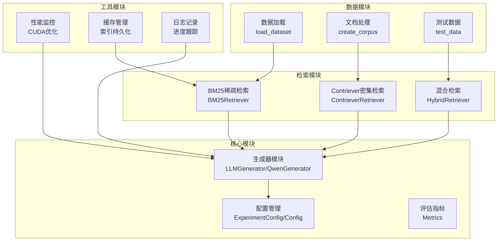
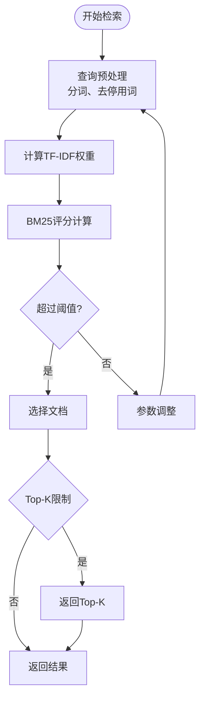
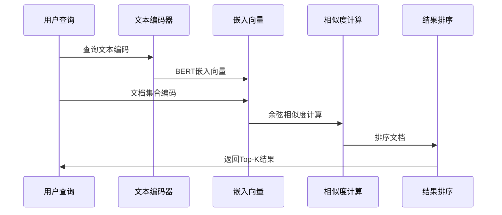
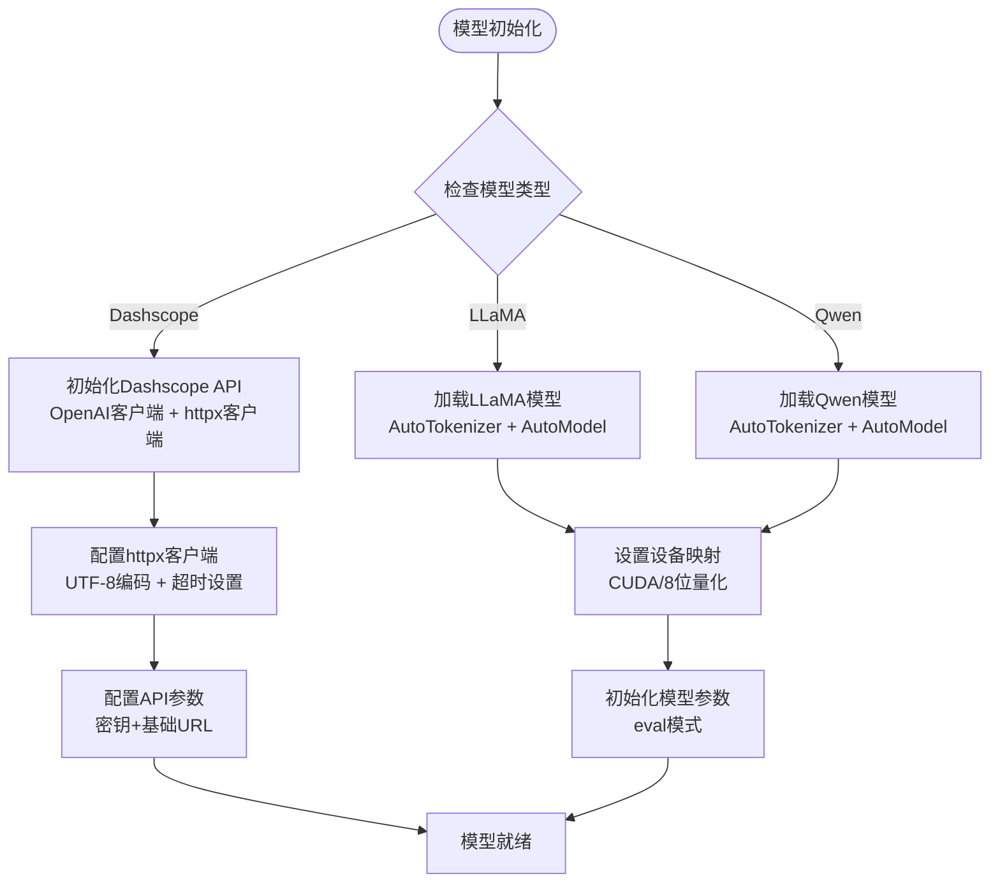
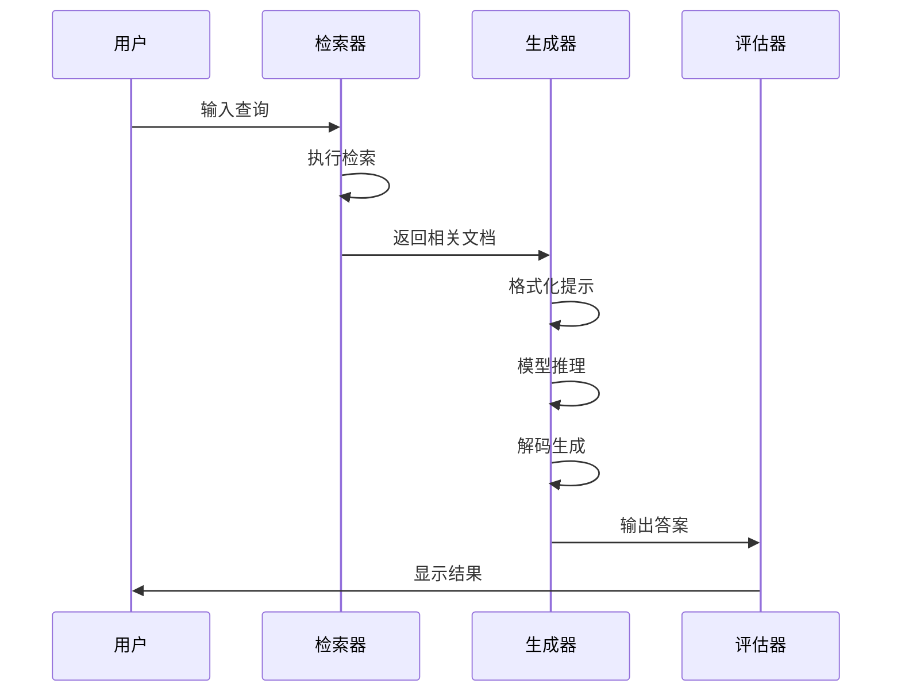
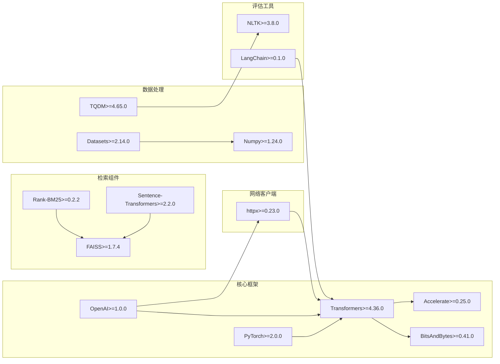
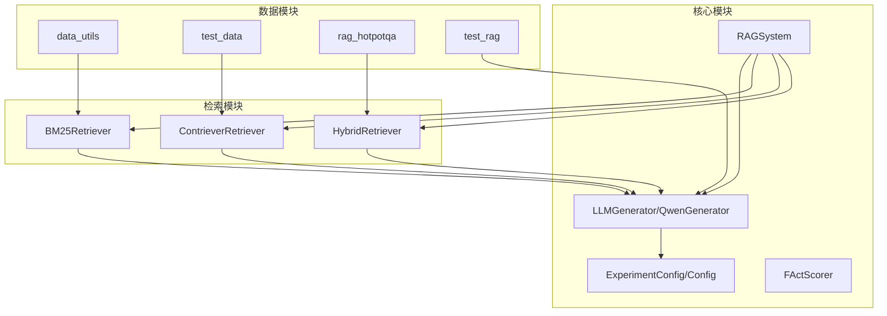

# 生成模型集成

<cite>
**本文档中引用的文件**
- [llm_generator.py](file://src/generators/llm_generator.py)
- [config.py](file://src/config.py)
- [rag_hotpotqa.py](file://rag_hotpotqa.py)
- [test_rag.py](file://test_rag.py)
- [bm25_retriever.py](file://src/retrievers/bm25_retriever.py)
- [contriever_retriever.py](file://src/retrievers/contriever_retriever.py)
- [hybrid_retriever.py](file://src/retrievers/hybrid_retriever.py)
- [metrics.py](file://src/evaluation/metrics.py)
- [data_utils.py](file://src/data_utils.py)
- [requirements.txt](file://others/requirements.txt)
- [__init__.py](file://src/generators/__init__.py)
</cite>

## 更新摘要
**变更内容**
- 新增了完整的Qwen生成器Dashscope API集成实现
- 添加了云端API调用与本地模型推理的双模式支持
- 更新了多模型架构支持和统一的生成器接口
- 完善了API密钥配置和错误处理机制
- 增加了完整的生成工作流程测试
- **新增** Qwen生成器现在使用httpx客户端支持UTF-8编码和自定义超时配置

## 目录
1. [简介](#简介)
2. [项目结构](#项目结构)
3. [核心组件](#核心组件)
4. [架构概览](#架构概览)
5. [详细组件分析](#详细组件分析)
6. [生成模型集成实现](#生成模型集成实现)
7. [多模型架构支持](#多模型架构支持)
8. [依赖关系分析](#依赖关系分析)
9. [性能考虑](#性能考虑)
10. [故障排除指南](#故障排除指南)
11. [结论](#结论)

## 简介

本项目专注于检索增强生成（Retrieval-Augmented Generation, RAG）系统的设计与实现，现已发展为支持多种生成模型架构的综合性平台。系统通过将神经检索与大型语言模型相结合，从外部文档中检索相关信息来支撑生成过程，从而提高答案的准确性、可信度和鲁棒性。

**更新** 项目现已支持本地部署的LLaMA和Qwen开源模型，以及基于Dashscope API的云端Qwen模型调用，提供统一的多模型架构支持和灵活的部署选项。**新增** Qwen生成器现在使用httpx客户端支持UTF-8编码和自定义超时配置，提升了网络通信的稳定性和国际化支持能力。

## 项目结构

项目采用模块化设计，包含完整的检索-生成流水线：



**图表来源**
- [llm_generator.py:9-172](file://src/generators/llm_generator.py#L9-L172)
- [config.py:27-41](file://src/config.py#L27-L41)
- [rag_hotpotqa.py:43-67](file://rag_hotpotqa.py#L43-L67)

## 核心组件

### 生成器模块

**更新** 新增了双模式生成器架构：

#### 本地模型生成器（LLMGenerator）
- **LLaMA集成**：支持Meta Llama系列模型的本地部署
- **Qwen集成**：支持阿里通义千问系列模型的本地部署
- **模板化提示**：针对不同模型的专用提示模板
- **批量生成**：支持批量推理优化

#### 云端API生成器（QwenGenerator）
- **Dashscope API集成**：通过OpenAI兼容接口调用阿里云Qwen模型
- **API密钥管理**：支持环境变量配置和动态密钥设置
- **错误处理**：完善的异常捕获和错误恢复机制
- **统一接口**：与本地生成器相同的接口设计
- **HTTP客户端优化**：使用httpx客户端支持UTF-8编码和自定义超时配置

### 检索-生成交互组件

系统支持三种检索策略与生成模型的灵活组合：

1. **BM25稀疏检索**：基于词频的传统检索方法
2. **Contriever密集检索**：基于语义相似度的深度学习方法  
3. **混合检索**：结合多种策略的Reciprocal Rank Fusion

### 评估与监控组件

- **多指标评估**：EM、F1、Recall@K等综合指标
- **FActScore**：事实准确性评估
- **性能监控**：CUDA内存使用和推理时间统计

**章节来源**
- [llm_generator.py:9-172](file://src/generators/llm_generator.py#L9-L172)
- [rag_hotpotqa.py:345-431](file://rag_hotpotqa.py#L345-L431)
- [bm25_retriever.py:9-89](file://src/retrievers/bm25_retriever.py#L9-L89)
- [contriever_retriever.py:11-148](file://src/retrievers/contriever_retriever.py#L11-L148)

## 架构概览

**更新** 完整的多模型架构支持：

```mermaid
graph TD
subgraph "用户查询"
Q[查询输入]
end
subgraph "检索层"
subgraph "多策略检索"
R1[BM25稀疏检索]
R2[Contriever密集检索]
R3[混合检索]
end
R1 --> M
R2 --> M
R3 --> M
end
subgraph "中间层"
M[检索质量控制<br/>Top-K文档限制]
end
subgraph "生成层"
subgraph "多模式生成"
G1[本地LLaMA模型<br/>Llama-3.1-8B-Instruct]
G2[本地Qwen模型<br/>Qwen2.5-7B-Instruct]
G3[云端Qwen API<br/>Dashscope API]
G4[模型模板适配<br/>Prompt Engineering]
end
M --> G1
M --> G2
M --> G3
M --> G4
end
subgraph "网络层"
subgraph "HTTP客户端优化"
N1[UTF-8编码支持]
N2[自定义超时配置<br/>60秒请求超时]
N3[连接超时控制<br/>10秒连接超时]
end
end
subgraph "评估层"
subgraph "质量指标"
E1[答案准确性<br/>EM/F1]
E2[证据定位质量<br/>Recall@K]
E3[事实准确性<br/>FActScore]
E4[性能指标<br/>CUDA使用率/API响应时间]
end
end
Q --> R1
Q --> R2
Q --> R3
G1 --> E1
G2 --> E1
G3 --> E1
G4 --> E2
E3 --> E4
N1 --> G3
N2 --> G3
N3 --> G3
```

**图表来源**
- [config.py:13-17](file://src/config.py#L13-L17)
- [rag_hotpotqa.py:345-431](file://rag_hotpotqa.py#L345-L431)

## 详细组件分析

### 检索策略实现

#### BM25稀疏检索
基于TF-IDF的词频统计，适用于传统文本检索场景：



#### Contriever密集检索
使用BERT编码器进行语义相似度计算：



**图表来源**
- [contriever_retriever.py:56-82](file://src/retrievers/contriever_retriever.py#L56-L82)

### 生成策略实现

**更新** 新增统一的生成器接口：

#### 本地LLaMA模型集成
- **模型ID**：meta-llama/Llama-3.1-8B-Instruct
- **专用提示模板**：支持LLaMA格式的对话式提示
- **量化支持**：可选8位量化以降低内存占用
- **设备映射**：支持CUDA和CPU部署

#### 本地Qwen模型集成  
- **模型ID**：Qwen/Qwen2.5-7B-Instruct
- **专用提示模板**：支持Qwen格式的指令式提示
- **批量处理**：优化批量推理性能
- **内存优化**：支持8位量化部署

#### 云端Qwen API集成
- **API基地址**：https://dashscope.aliyuncs.com/compatible-mode/v1
- **OpenAI兼容**：使用标准OpenAI客户端接口
- **HTTP客户端优化**：使用httpx客户端支持UTF-8编码和自定义超时配置
- **超时配置**：60秒请求超时，10秒连接超时
- **密钥管理**：支持环境变量和动态配置
- **错误处理**：完善的异常捕获和重试机制

#### 统一生成接口
```python
class LLMGenerator:
    def generate(
        self,
        question: str,
        documents: List[Dict],
        max_new_tokens: int = 512,
        temperature: float = 0.7,
        top_p: float = 0.9,
        do_sample: bool = True
    ) -> Dict:
        """
        统一的生成接口，支持所有集成的模型
        
        Args:
            question: 问题文本
            documents: 检索到的文档列表
            generation_kwargs: 生成参数
            
        Returns:
            包含答案和元数据的字典
        """

class QwenGenerator:
    def __init__(self, api_key: str = None, model: str = "qwen-plus"):
        """
        初始化生成器，使用httpx客户端支持UTF-8编码和自定义超时配置
        
        Args:
            api_key: 阿里百炼 API Key
            model: 模型名称
        """
        self.api_key = api_key or Config.DASHSCOPE_API_KEY
        self.model = model
        
        if not self.api_key:
            raise ValueError("请设置 DASHSCOPE_API_KEY 环境变量或在 Config 中配置")
        
        # 配置 httpx 客户端以支持 UTF-8 编码
        http_client = httpx.Client(
            timeout=httpx.Timeout(60.0, connect=10.0),
        )
        
        # 初始化 OpenAI 客户端（兼容阿里百炼 API）
        self.client = OpenAI(
            api_key=self.api_key,
            base_url=Config.DASHSCOPE_BASE_URL,
            http_client=http_client
        )
        
        print(f"初始化 Qwen 生成器: {model}")

    def generate(
        self,
        question: str,
        documents: List[Dict]
    ) -> Dict:
        """
        通过Dashscope API生成答案
        
        Args:
            question: 问题文本
            documents: 检索到的文档列表
            
        Returns:
            包含答案和元数据的字典
        """
```

**章节来源**
- [llm_generator.py:9-172](file://src/generators/llm_generator.py#L9-L172)
- [rag_hotpotqa.py:345-431](file://rag_hotpotqa.py#L345-L431)
- [config.py:13-17](file://src/config.py#L13-L17)

## 生成模型集成实现

### 模型加载与初始化

**更新** 统一的模型加载流程：



### 提示工程与模板适配

**更新** 针对不同模型的专用提示模板：

#### LLaMA提示模板
```python
PROMPT_TEMPLATES = {
    "llama": """<|begin_of_text|><|start_header_id|>system<|end_header_id|>

You are a helpful assistant. Answer the question based on the provided context. If the answer cannot be found in the context, say "I cannot answer this question based on the provided context."

<|eot_id|><|start_header_id|>user<|end_header_id|>

Context:
{context}

Question: {question}

<|eot_id|><|start_header_id|>assistant<|end_header_id|>
""",
```

#### Qwen提示模板
```python
"qwen": """system
You are a helpful assistant. Answer the question based on the provided context. If the answer cannot be found in the context, say "I cannot answer this question based on the provided context."
user
Context:
{context}

Question: {question}
assistant
"""
```

#### 云端Qwen提示模板
```python
prompt = f"""你是一个智能问答助手。请根据以下提供的文档信息回答问题。
如果文档中没有足够的信息回答问题，请说"根据提供的文档，我无法回答这个问题"。

文档信息:
{context}

问题: {question}

请给出简洁准确的回答:"""
```

### 批量生成优化

**更新** 支持批量推理以提高吞吐量：

```python
def generate_batch(
    self,
    questions: List[str],
    documents_list: List[List[Dict]],
    **generation_kwargs
) -> List[Dict]:
    """批量生成答案，优化GPU利用率"""
    results = []
    for question, documents in zip(questions, documents_list):
        result = self.generate(question, documents, **generation_kwargs)
        results.append(result)
    return results
```

**章节来源**
- [llm_generator.py:38-172](file://src/generators/llm_generator.py#L38-L172)
- [rag_hotpotqa.py:378-428](file://rag_hotpotqa.py#L378-L428)

## 多模型架构支持

### 模型配置管理

**更新** 统一的配置管理系统：

```python
MODELS = {
    "llama": "meta-llama/Llama-3.1-8B-Instruct",
    "qwen": "Qwen/Qwen2.5-7B-Instruct", 
    "contriever": "facebook/contriever-msmarco",
}

class Config:
    """全局配置，支持Dashscope API"""
    # 阿里百炼 API 配置
    DASHSCOPE_API_KEY = os.environ.get("DASHSCOPE_API_KEY", "")
    DASHSCOPE_BASE_URL = "https://dashscope.aliyuncs.com/compatible-mode/v1"
```

### 检索-生成流水线

**更新** 完整的多模型工作流：



### 性能优化策略

**更新** 针对多模型的优化方案：

1. **内存优化**
   - 8位量化（load_in_8bit）
   - 设备映射（device_map）
   - 激活检查点

2. **推理加速**
   - CUDA内核优化
   - 批量处理
   - 缓存机制

3. **资源管理**
   - 动态批处理
   - 内存池管理
   - 异步I/O

4. **API优化**
   - 连接池复用
   - 请求超时控制
   - 错误重试机制
   - **新增** HTTP客户端优化：UTF-8编码支持和自定义超时配置

5. **网络优化**
   - **新增** httpx客户端配置：60秒请求超时，10秒连接超时
   - **新增** UTF-8编码支持，提升国际化兼容性
   - **新增** 错误处理和重试机制

**章节来源**
- [llm_generator.py:68-82](file://src/generators/llm_generator.py#L68-L82)
- [rag_hotpotqa.py:348-368](file://rag_hotpotqa.py#L348-L368)
- [config.py:27-41](file://src/config.py#L27-L41)

## 依赖关系分析

### 外部依赖

**更新** 完整的依赖生态系统：



**图表来源**
- [requirements.txt:1-26](file://others/requirements.txt#L1-L26)

### 内部模块依赖



**图表来源**
- [llm_generator.py:5-6](file://src/generators/llm_generator.py#L5-L6)
- [config.py:3](file://src/config.py#L3-L5)
- [rag_hotpotqa.py:437-494](file://rag_hotpotqa.py#L437-L494)

**章节来源**
- [requirements.txt:1-26](file://others/requirements.txt#L1-L26)
- [llm_generator.py:5-6](file://src/generators/llm_generator.py#L5-L6)

## 性能考虑

### 计算资源优化

**更新** 多模型架构的性能优化：

1. **内存管理优化**
   - 模型量化（4-bit/8-bit）
   - 激活检查点节省内存
   - 动态批处理

2. **推理加速优化**
   - CUDA内核优化
   - TensorRT推理引擎
   - 多GPU并行

3. **缓存策略优化**
   - 检索结果缓存
   - 嵌入向量缓存
   - 生成结果缓存

4. **API性能优化**
   - 连接池复用
   - 请求合并
   - 响应缓存
   - **新增** HTTP客户端优化：60秒请求超时，10秒连接超时

5. **网络和I/O优化**
   - **新增** UTF-8编码支持，提升国际化兼容性
   - **新增** 自定义超时配置，避免长时间阻塞
   - **新增** httpx客户端的连接池复用

### 评估指标优化

- **FActScore计算优化**
- **多进程评估**
- **增量评估结果**

**章节来源**
- [llm_generator.py:72-76](file://src/generators/llm_generator.py#L72-L76)
- [rag_hotpotqa.py:401-427](file://rag_hotpotqa.py#L401-L427)
- [metrics.py:146-227](file://src/evaluation/metrics.py#L146-L227)

## 故障排除指南

### 常见问题及解决方案

#### 检索性能问题
1. **检索速度慢**
   - 检查索引构建质量
   - 调整搜索参数
   - 实施缓存机制

2. **检索质量差**
   - 优化查询预处理
   - 调整相似度阈值
   - 增加训练数据

#### 生成质量异常
1. **答案不准确**
   - 检查上下文质量
   - 调整生成参数
   - 使用更高质量的检索结果

2. **幻觉现象**
   - 实施证据验证
   - 使用更严格的过滤
   - 增加人工审核

#### 资源管理问题
1. **内存溢出**
   - 减少批处理大小
   - 启用梯度检查点
   - 使用混合精度

2. **GPU利用率低**
   - 检查数据管道
   - 优化批处理策略
   - 调整并行度

#### 多模型集成问题
1. **模型加载失败**
   - 检查HuggingFace模型ID
   - 验证网络连接
   - 清理缓存目录

2. **提示模板错误**
   - 确认模型类型匹配
   - 检查特殊标记符
   - 验证上下文格式

#### API集成问题
1. **Dashscope API错误**
   - 检查API密钥配置
   - 验证网络连接
   - 查看API响应状态
   - **新增** 检查httpx客户端配置是否正确

2. **生成器初始化失败**
   - 确认环境变量设置
   - 检查API基础URL
   - 验证模型可用性
   - **新增** 验证UTF-8编码支持和超时配置

3. **网络连接超时**
   - **新增** 调整httpx Timeout配置
   - **新增** 检查防火墙设置
   - **新增** 验证DNS解析

4. **编码问题**
   - **新增** 确认系统UTF-8支持
   - **新增** 检查控制台编码设置
   - **新增** 验证httpx客户端UTF-8配置

**章节来源**
- [llm_generator.py:133-141](file://src/generators/llm_generator.py#L133-L141)
- [rag_hotpotqa.py:359-360](file://rag_hotpotqa.py#L359-L360)
- [bm25_retriever.py:28-33](file://src/retrievers/bm25_retriever.py#L28-L33)

## 结论

**更新** 项目已发展为功能完整的多模型生成系统：

本项目为检索增强生成系统提供了全面的实现框架，现已支持本地部署的LLaMA和Qwen开源生成模型，以及基于Dashscope API的云端Qwen模型调用。通过统一的接口设计和模块化架构，系统实现了真正的多模型架构支持，为知识密集型任务提供了更准确、可信的答案生成解决方案。

**关键成果包括**：
- 系统化的多模型生成器集成框架
- 完整的检索-生成流水线实现
- 统一的配置管理和性能优化
- 全面的评估指标体系
- 可扩展的架构设计
- **新增** HTTP客户端优化：UTF-8编码支持和自定义超时配置

**未来发展方向**：
- 支持更多生成模型架构
- 优化推理性能和资源利用
- 增强幻觉检测和缓解机制
- 扩展应用场景和数据集支持
- **新增** 进一步优化网络通信性能和稳定性

这些成果为后续的RAG系统优化和应用推广奠定了坚实基础，为多模型架构的生成系统开发提供了完整的参考实现。**新增** 的HTTP客户端优化特性显著提升了系统的国际化支持能力和网络通信稳定性，为生产环境部署提供了更好的保障。