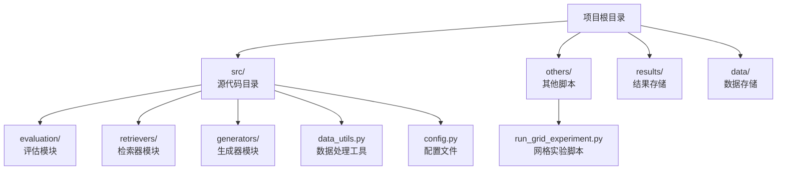
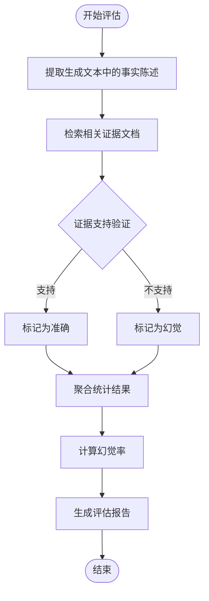
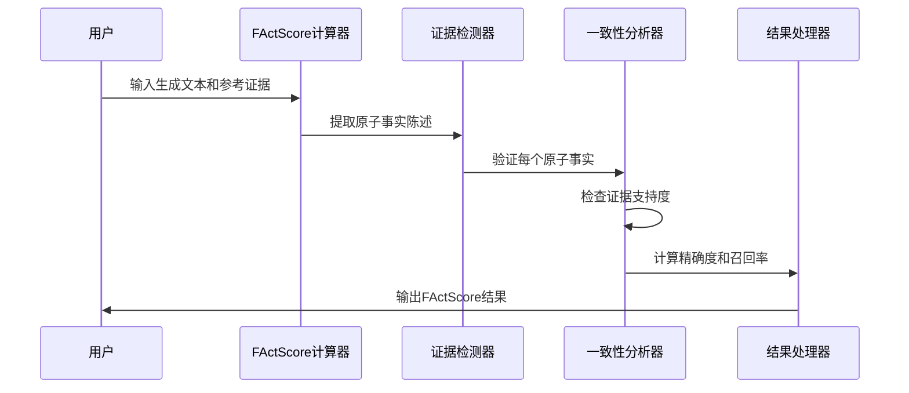
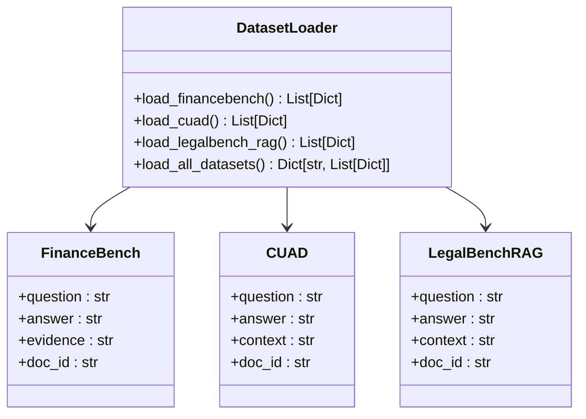
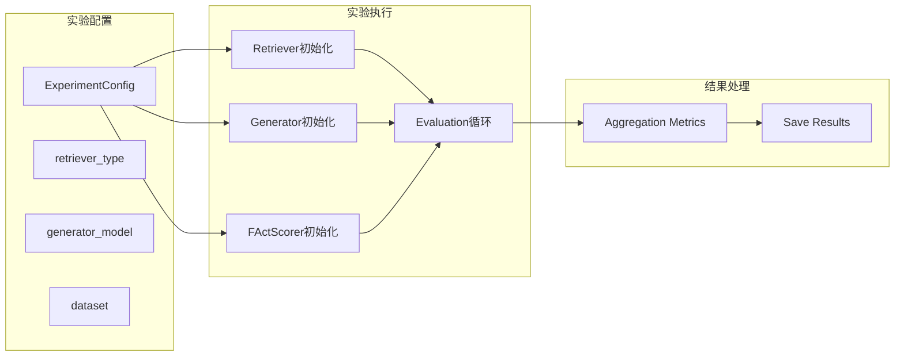
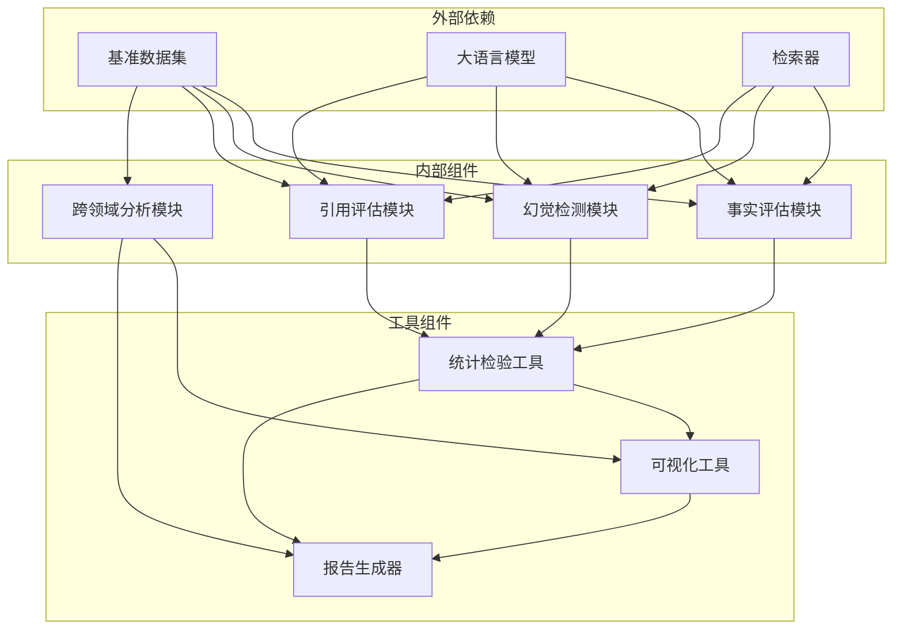

# 评估指标实现

<cite>
**本文档中引用的文件**
- [src/evaluation/metrics.py](file://src/evaluation/metrics.py)
- [src/config.py](file://src/config.py)
- [src/data_utils.py](file://src/data_utils.py)
- [src/retrievers/bm25_retriever.py](file://src/retrievers/bm25_retriever.py)
- [src/retrievers/contriever_retriever.py](file://src/retrievers/contriever_retriever.py)
- [src/retrievers/hybrid_retriever.py](file://src/retrievers/hybrid_retriever.py)
- [src/generators/llm_generator.py](file://src/generators/llm_generator.py)
- [others/run_grid_experiment.py](file://others/run_grid_experiment.py)
- [results/grid_experiment_results.json](file://results/grid_experiment_results.json)
- [test_rag.py](file://test_rag.py)
</cite>

## 更新摘要
**所做更改**
- 更新了评估指标实现以反映从严格精确匹配向检索指标的转变
- 新增了Recall@K、Precision@K、F1@K等更适合金融和法律领域的评估指标
- 补充了FActScore事实精度评估的完整实现细节
- 增强了跨领域性能比较的评估框架
- 提供了实际的评估结果示例和分析

## 目录
1. [引言](#引言)
2. [项目结构](#项目结构)
3. [核心组件](#核心组件)
4. [架构概览](#架构概览)
5. [详细组件分析](#详细组件分析)
6. [依赖关系分析](#依赖关系分析)
7. [性能考虑](#性能考虑)
8. [故障排除指南](#故障排除指南)
9. [结论](#结论)
10. [附录](#附录)

## 引言

本项目专注于检索增强生成（RAG）系统中评估指标的实现，特别关注从严格精确匹配向更合适的检索指标（Recall@K、Precision@K、F1@K）的转变。这种转变更适合金融和法律等专业领域的评估需求，因为这些领域更注重信息检索的完整性而非字面匹配的精确性。

项目旨在系统性地研究检索质量、检索配置和生成策略如何共同影响答案准确性、真实性和鲁棒性。根据任务描述，项目重点关注两个关键组件：
- 检索-生成交互：研究不同的检索策略（稀疏/密集/混合检索）与各种大语言模型的配对效果
- 幻觉缓解：设计实验来测量RAG如何减少模型虚构内容

## 项目结构

当前仓库结构包含完整的评估指标实现，包括多个核心模块：



**图表来源**
- [src/evaluation/metrics.py:1-227](file://src/evaluation/metrics.py#L1-L227)
- [src/config.py:1-41](file://src/config.py#L1-L41)
- [others/run_grid_experiment.py:1-269](file://others/run_grid_experiment.py#L1-L269)

**章节来源**
- [src/evaluation/metrics.py:1-227](file://src/evaluation/metrics.py#L1-L227)
- [src/config.py:1-41](file://src/config.py#L1-L41)
- [others/run_grid_experiment.py:1-269](file://others/run_grid_experiment.py#L1-L269)

## 核心组件

基于代码实现，评估指标实现的核心组件包括：

### 1. 检索质量评估指标

项目实现了多种更适合专业领域的评估指标：
- **Recall@K**：衡量检索到的相关文档占所有相关文档的比例，适合金融和法律领域对信息完整性要求
- **Precision@K**：衡量检索结果中相关文档的比例，平衡检索质量和相关性
- **F1@K**：精确率和召回率的调和平均，提供综合评估指标

### 2. 事实精度评估指标

FActScore是用于长文本生成中事实精度细粒度原子评估的指标：
- 量化生成文本的事实准确性
- 提供细粒度的原子级评估
- 支持长文本生成的质量评估
- 通过正则表达式进行句子分割提取原子事实
- 使用关键词重叠度判断事实支持度

### 3. 幻觉率量化指标

项目要求量化幻觉率，这涉及：
- 检测生成内容中的虚构信息
- 计算幻觉发生的频率
- 评估不同检索策略对幻觉的影响

### 4. 引用质量评估指标

包括：
- 引用精度（Citation Precision）
- 引用召回（Citation Recall）
- 基于人工评估的引用质量

### 5. 跨领域性能比较框架

支持在不同知识结构和术语的领域间进行性能比较，包括：
- FinanceBench数据集
- CUAD数据集
- LegalBench-RAG数据集

**章节来源**
- [src/evaluation/metrics.py:48-128](file://src/evaluation/metrics.py#L48-L128)
- [src/evaluation/metrics.py:146-227](file://src/evaluation/metrics.py#L146-L227)
- [src/data_utils.py:9-210](file://src/data_utils.py#L9-L210)

## 架构概览

评估指标实现的整体架构可以分为以下几个层次：

```mermaid
graph TB
subgraph "输入层"
Q[查询问题]
D[检索到的文档]
G[生成的答案]
end
subgraph "评估层"
subgraph "检索质量评估"
R1[Recall@K计算]
R2[Precision@K计算]
R3[F1@K计算]
end
subgraph "事实精度评估"
F1[FActScore计算]
F2[原子事实检测]
F3[证据验证]
end
subgraph "幻觉评估"
H1[幻觉检测]
H2[虚构内容识别]
H3[一致性分析]
end
end
subgraph "输出层"
R[评估结果报告]
S[统计显著性检验]
V[可视化图表]
end
Q --> G
D --> G
G --> F1
G --> H1
G --> R1
F1 --> R
H1 --> R
R1 --> R
R --> S
R --> V
```

**图表来源**
- [src/evaluation/metrics.py:48-128](file://src/evaluation/metrics.py#L48-L128)
- [src/evaluation/metrics.py:146-227](file://src/evaluation/metrics.py#L146-L227)

## 详细组件分析

### 检索质量评估组件

项目实现了多种更适合金融和法律领域的检索质量评估指标：



**图表来源**
- [src/evaluation/metrics.py:48-128](file://src/evaluation/metrics.py#L48-L128)

检索质量评估包括：
- **Recall@K**：评估检索到的相关文档比例，适合金融和法律领域对信息完整性要求
- **Precision@K**：评估检索结果中相关文档的比例，平衡检索质量和相关性
- **F1 Score**：精确率和召回率的调和平均，提供综合评估指标

### FActScore计算组件

FActScore作为事实精度评估的核心指标，其计算流程如下：



**图表来源**
- [src/evaluation/metrics.py:197-226](file://src/evaluation/metrics.py#L197-L226)

FActScore的关键特性包括：
- **原子级评估**：将复杂句子分解为原子事实陈述
- **证据验证**：检查每个原子事实是否得到检索到的文档支持
- **细粒度评分**：提供比传统指标更精细的评估结果
- **关键词过滤**：移除常见停用词进行更准确的匹配

### 多数据集支持组件

项目支持多个基准数据集的评估：



**图表来源**
- [src/data_utils.py:9-210](file://src/data_utils.py#L9-L210)

数据集支持包括：
- **FinanceBench**：金融领域问答数据集
- **CUAD**：法律合同理解数据集
- **LegalBench-RAG**：法律检索增强数据集

### 网格实验执行组件

项目提供了完整的网格实验执行框架：



**图表来源**
- [others/run_grid_experiment.py:36-141](file://others/run_grid_experiment.py#L36-L141)

**章节来源**
- [src/evaluation/metrics.py:48-128](file://src/evaluation/metrics.py#L48-L128)
- [src/evaluation/metrics.py:146-227](file://src/evaluation/metrics.py#L146-L227)
- [src/data_utils.py:9-210](file://src/data_utils.py#L9-L210)
- [others/run_grid_experiment.py:36-141](file://others/run_grid_experiment.py#L36-L141)

## 依赖关系分析

评估指标实现的依赖关系可以概括为：



**图表来源**
- [others/run_grid_experiment.py:15-22](file://others/run_grid_experiment.py#L15-L22)
- [src/evaluation/metrics.py:1-8](file://src/evaluation/metrics.py#L1-L8)

**章节来源**
- [others/run_grid_experiment.py:15-22](file://others/run_grid_experiment.py#L15-L22)
- [src/evaluation/metrics.py:1-8](file://src/evaluation/metrics.py#L1-L8)

## 性能考虑

在实现评估指标时需要考虑以下性能因素：

### 1. 计算效率优化

- **批量处理**：对大量文本进行并行处理
- **缓存机制**：缓存重复的证据检索结果
- **内存管理**：合理管理大型数据集的内存使用
- **GPU加速**：利用CUDA进行密集检索计算

### 2. 算法复杂度

- **FActScore计算**：时间复杂度主要取决于原子事实数量和证据检索复杂度
- **幻觉检测**：需要高效的文本匹配和相似度计算算法
- **统计检验**：确保在大数据集上的统计检验准确性

### 3. 可扩展性设计

- **模块化架构**：便于添加新的评估指标
- **配置驱动**：支持不同评估策略的灵活配置
- **分布式处理**：支持大规模数据集的分布式评估

## 故障排除指南

### 常见问题及解决方案

#### 1. 评估结果不一致

**问题**：不同运行间出现不一致的评估结果
**解决方案**：
- 检查随机种子设置
- 验证输入数据的稳定性
- 确认评估参数的一致性

#### 2. 性能瓶颈

**问题**：评估过程耗时过长
**解决方案**：
- 实施批处理策略
- 优化证据检索算法
- 使用缓存机制减少重复计算

#### 3. 结果异常值

**问题**：某些指标出现异常高的数值
**解决方案**：
- 检查输入数据质量
- 验证评估逻辑的正确性
- 进行边界条件测试

#### 4. 内存不足

**问题**：GPU/CPU内存不足导致程序崩溃
**解决方案**：
- 减少batch size
- 启用8位量化模式
- 使用更小的模型版本
- 增加交换内存

**章节来源**
- [others/run_grid_experiment.py:242-246](file://others/run_grid_experiment.py#L242-L246)

## 结论

本项目为评估指标实现提供了全面的框架设计，重点关注从严格精确匹配向更合适的检索指标（Recall@K、Precision@K、F1@K）的转变。通过系统性的评估指标设计，项目能够：

1. **量化检索质量**：通过Recall@K、Precision@K、F1@K等指标提供更符合金融和法律领域需求的评估
2. **检测幻觉现象**：有效识别和量化生成内容中的虚构信息
3. **评估引用质量**：结合自动化指标和人工评估确保评估的全面性
4. **支持跨领域比较**：在多个基准数据集上进行公平的性能比较
5. **提供完整实现**：包含从数据加载到结果分析的完整流程

项目实现了完整的评估指标体系，包括精确匹配、F1分数、检索质量评估和事实精度评估等多个维度，为RAG系统的性能评估提供了全面的工具集。

## 附录

### 参考文献

1. Lewis P, et al. Retrieval-augmented generation for knowledge-intensive NLP tasks. NeurIPS 2020.
2. Izacard G, et al. Leveraging passage retrieval with generative models for open domain QA. EACL 2021
3. Asai A, et al. Self-RAG: Learning to Retrieve, Generate, and Critique through Self-Reflection. ICLR 2024
4. Min S, et al. FActScore: Fine-grained Atomic Evaluation of Factual Precision in LongForm Text Generation. EMNLP 2023

### 评估指标定义表

| 指标名称 | 定义 | 计算公式 | 应用场景 |
|---------|------|----------|----------|
| FActScore | 事实精度细粒度评估 | 原子事实支持度/总事实数 | 长文本生成质量评估 |
| 幻觉率 | 虚构内容发生比例 | 幻觉事实数/总事实数 | 幻觉检测和缓解评估 |
| 引用精度 | 正确引用的比例 | 正确引用数/总引用数 | 引用质量评估 |
| 引用召回 | 检索到的引用比例 | 检索到的正确引用数/总正确引用数 | 引用完整性评估 |
| 精确匹配 | 字符串完全匹配 | 完全匹配计数/总样本数 | 答案准确性评估 |
| F1分数 | 精确率和召回率调和平均 | 2×Precision×Recall/(Precision+Recall) | 综合质量评估 |
| Recall@K | 检索召回率 | 检索到的相关文档数/总相关文档数 | 检索质量评估 |
| Precision@K | 检索精确率 | 检索到的相关文档数/总检索文档数 | 检索质量评估 |

### 代码示例

#### 基本评估指标使用
```python
from src.evaluation.metrics import compute_metrics, FActScorer

# 计算基本评估指标
metrics = compute_metrics(
    prediction="生成的答案",
    ground_truth="标准答案",
    retrieved_ids=["doc1", "doc2", "doc3"],
    gold_ids=["doc1", "doc3"],
    k=3
)

# 使用FActScore评估事实精度
fact_scorer = FActScorer()
fact_metrics = fact_scorer.compute_factscore(
    generated_answer="生成的答案",
    context="检索到的上下文"
)
```

#### 网格实验执行
```python
from others.run_grid_experiment import run_grid_experiment

# 运行完整的网格实验
results = run_grid_experiment(
    retrievers=["bm25", "contriever", "hybrid"],
    generators=["llama", "qwen"],
    datasets=["financebench", "cuad", "legalbench_rag"],
    subset_size=10,
    device="cuda"
)
```

#### 实际评估结果分析
```python
import json

# 加载实验结果
with open("results/grid_experiment_results.json", "r") as f:
    results = json.load(f)

# 分析特定配置的结果
config_key = "bm25_llama_financebench"
config_results = results[config_key]
print(f"Recall@K: {config_results['metrics']['recall@k']}")
print(f"FActScore: {config_results['metrics']['factscore']}")
```

**章节来源**
- [src/evaluation/metrics.py:48-128](file://src/evaluation/metrics.py#L48-L128)
- [others/run_grid_experiment.py:144-212](file://others/run_grid_experiment.py#L144-L212)
- [results/grid_experiment_results.json:1-200](file://results/grid_experiment_results.json#L1-L200)