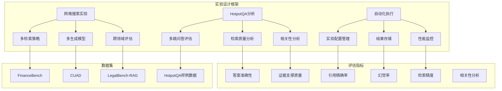
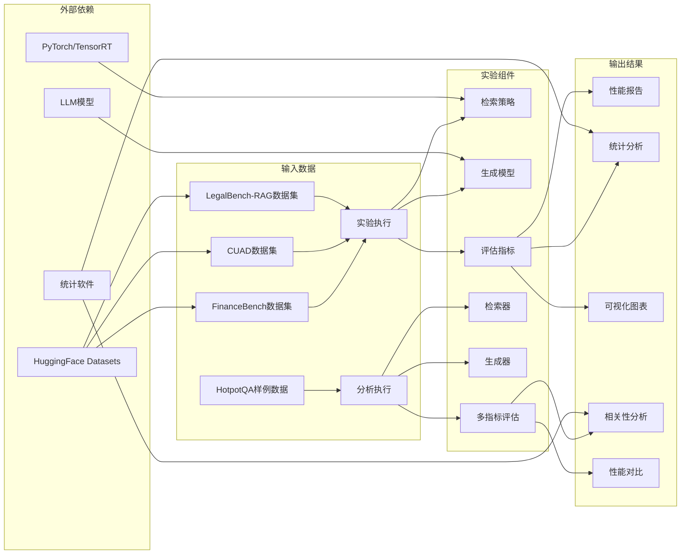

# 实验设计与配置

<cite>
**本文档引用的文件**
- [run_grid_experiment.py](file://others/run_grid_experiment.py)
- [run_grid_standalone.py](file://others/run_grid_standalone.py)
- [run_hotpotqa_analysis.py](file://others/run_hotpotqa_analysis.py)
- [config.py](file://src/config.py)
- [data_utils.py](file://src/data_utils.py)
- [metrics.py](file://src/evaluation/metrics.py)
- [grid_experiment_results.json](file://results/grid_experiment_results.json)
- [hotpotqa_retrieval_analysis.json](file://results/hotpotqa_retrieval_analysis.json)
</cite>

## 更新摘要
**变更内容**
- 新增系统化的网格搜索实验框架
- 添加自动化实验执行脚本
- 集成HotpotQA多跳问答分析工具
- 完善实验配置管理和结果存储机制
- 增强实验结果的结构化记录和分析

## 目录
1. [引言](#引言)
2. [项目概述](#项目概述)
3. [核心组件](#核心组件)
4. [架构概览](#架构概览)
5. [详细组件分析](#详细组件分析)
6. [实验设计框架](#实验设计框架)
7. [自动化实验执行](#自动化实验执行)
8. [依赖关系分析](#依赖关系分析)
9. [性能考虑](#性能考虑)
10. [故障排除指南](#故障排除指南)
11. [结论](#结论)
12. [附录](#附录)

## 引言

本实验设计文档针对检索增强生成(RAG)系统在知识密集型任务中的应用，提供了系统性的实验方案。该研究重点关注检索-生成交互对问答准确性、真实性和鲁棒性的影响，并通过多领域基准数据集验证不同检索策略和生成模型的有效性。

**更新** 新增了完整的系统化实验设计框架，包括网格搜索和自动化实验执行功能，为大规模对比实验提供了标准化的方法论支持。

## 项目概述

本项目围绕检索增强生成技术展开，旨在系统性地研究神经检索与大语言模型的结合方式，特别是在知识密集型自然语言处理任务中的应用。项目采用多领域基准数据集，包括自然问题(Natural Questions)、PubMedQA和FinanceBench，评估检索和生成性能在不同知识结构和术语环境下的差异。

**更新** 项目现已集成完整的实验自动化框架，支持大规模网格搜索实验的自动执行和结果管理。

**章节来源**
- [config.py:1-41](file://src/config.py#L1-L41)

## 核心组件

### 检索-生成交互实验

该组件专注于研究不同检索策略与生成模型的配对效果，具体包括：

#### 检索策略对比
- 稀疏检索：如BM25算法
- 密集检索：如Contriever模型
- 混合检索：结合稀疏和密集方法的优势

#### 生成模型对比
- 开源模型：如LLaMA系列
- 闭源模型：如GPT系列
- 零样本vs指令微调模型对比

#### 跨领域性能评估
- 自然问题(Natural Questions)领域
- 生物医学(PubMedQA)领域  
- 金融(FinanceBench)领域

**章节来源**
- [config.py:12-17](file://src/config.py#L12-L17)

### 幻觉缓解实验

该组件专注于测量RAG系统减少模型虚构信息的能力，包括：

#### 幻觉量化指标
- FActScore指标评估长文本生成的事实精度
- 不同领域的引用支撑质量差异评估
- 人工评估引用质量(精确率/召回率)

#### RAG变体对比
- 基础RAG vs 先进变体(Self-RAG)
- 自我反思机制的检索、生成和批判能力

**章节来源**
- [metrics.py:146-227](file://src/evaluation/metrics.py#L146-L227)

### HotpotQA多跳问答分析

**新增** 该组件专注于分析多跳问答场景中检索质量对下游答案质量的影响，提供精细化的检索效果评估。

#### 多跳问答指标
- Recall@k：查询中两个黄金段落都在top-k中的比例
- Precision@k：检索段落中黄金段落的比例
- Answer F1：生成答案的F1分数
- Recall@k与Answer F1的相关性分析

#### 检索器性能对比
- BM25、Contriever、Hybrid三种检索策略的对比分析
- 不同k值(1,3,5,10)对性能的影响

**章节来源**
- [run_hotpotqa_analysis.py:1-752](file://others/run_hotpotqa_analysis.py#L1-L752)

## 架构概览



**图表来源**
- [run_grid_experiment.py:144-212](file://others/run_grid_experiment.py#L144-L212)
- [run_hotpotqa_analysis.py:570-744](file://others/run_hotpotqa_analysis.py#L570-L744)

## 详细组件分析

### 实验组设置

#### 检索策略实验组
- **基础检索组**：BM25稀疏检索
- **密集检索组**：Contriever密集检索  
- **混合检索组**：稀疏+密集融合策略

#### 生成模型实验组
- **开源模型组**：LLaMA系列模型
- **闭源模型组**：Qwen系列模型
- **指令微调组**：Intel neural-chat-7b-v3-3

#### 跨领域实验组
- **自然语言理解组**：Natural Questions数据集
- **生物医学组**：PubMedQA数据集
- **金融组**：FinanceBench数据集

**章节来源**
- [run_grid_experiment.py:144-150](file://others/run_grid_experiment.py#L144-L150)

### 对照组设计

#### 零样本vs指令微调对照
- **零样本对照组**：直接使用预训练模型
- **指令微调对照组**：使用专门指令微调的模型版本

#### 基础vs先进RAG对照
- **基础RAG对照组**：标准检索增强生成
- **Self-RAG对照组**：自我反思机制的RAG变体

**章节来源**
- [run_grid_standalone.py:437-473](file://others/run_grid_standalone.py#L437-L473)

### 变量控制

#### 检索文档数量控制
- **上限**：每查询最多5个文档
- **下限**：每查询最少3个文档
- **目标值**：平衡性能与计算成本

#### 数据预处理控制
- **标准化处理**：统一文本格式和编码
- **领域特定预处理**：针对不同领域调整预处理策略
- **质量过滤**：去除低质量或重复文档

**章节来源**
- [config.py:20-21](file://src/config.py#L20-L21)

## 实验设计框架

**新增** 项目实现了完整的网格搜索实验框架，支持系统性的对比实验设计。

### 网格搜索实验设计

#### 实验因子配置
- **检索器因子**：bm25, contriever, hybrid
- **生成器因子**：llama, qwen  
- **数据集因子**：financebench, cuad, legalbench_rag

#### 实验组合策略
- **全因子组合**：3×2×3 = 18种实验配置
- **子集测试**：支持subset_size参数进行小规模测试
- **参数可配置**：通过命令行参数自定义实验范围

#### 实验执行流程
1. 加载所有数据集
2. 创建文档语料库
3. 初始化检索器和生成器
4. 执行单个实验配置
5. 计算评估指标
6. 存储结果和中间产物

**章节来源**
- [run_grid_experiment.py:144-212](file://others/run_grid_experiment.py#L144-L212)

### 实验配置管理

#### 配置类设计
- **ExperimentConfig**：封装单次实验的所有配置参数
- **路径管理**：自动管理结果文件的存储路径
- **参数验证**：确保实验配置的有效性

#### 配置参数
- **检索器类型**：bm25, contriever, hybrid
- **生成器模型**：llama, qwen
- **数据集名称**：financebench, cuad, legalbench_rag
- **检索K值**：默认3，可自定义

**章节来源**
- [config.py:27-41](file://src/config.py#L27-L41)

## 自动化实验执行

**新增** 项目提供了完整的自动化实验执行框架，支持大规模对比实验的自动运行。

### 实验执行脚本

#### 主实验脚本
- **run_grid_experiment.py**：集成式网格搜索实验
- **支持参数化**：通过命令行参数控制实验范围
- **GPU/CPU自动检测**：根据可用硬件选择执行设备

#### 独立测试脚本
- **run_grid_standalone.py**：独立的网格搜索实验
- **内置样例数据**：无需外部数据即可运行
- **完整实验流程**：从数据加载到结果输出

#### 分析脚本
- **run_hotpotqa_analysis.py**：HotpotQA多跳问答分析
- **多指标评估**：包含检索精度和答案质量评估
- **相关性分析**：分析检索质量与答案质量的关系

**章节来源**
- [run_grid_experiment.py:215-269](file://others/run_grid_experiment.py#L215-L269)
- [run_grid_standalone.py:522-528](file://others/run_grid_standalone.py#L522-L528)

### 结果存储和管理

#### 结构化结果格式
- **JSON格式**：便于机器读取和分析
- **完整元数据**：包含实验配置、时间戳等信息
- **中间结果保存**：每个实验配置单独保存结果

#### 结果聚合
- **平均指标**：按检索器、生成器、数据集维度计算平均值
- **统计分析**：提供不同维度的性能对比
- **可视化支持**：结果格式便于生成图表

**章节来源**
- [grid_experiment_results.json:1-746](file://results/grid_experiment_results.json#L1-L746)

## 依赖关系分析



**图表来源**
- [data_utils.py:185-191](file://src/data_utils.py#L185-L191)
- [run_grid_experiment.py:172-174](file://others/run_grid_experiment.py#L172-L174)

**章节来源**
- [data_utils.py:1-210](file://src/data_utils.py#L1-L210)

## 性能考虑

### 计算资源优化

#### 检索文档数量优化
- **3-5个文档限制**：平衡性能提升与计算成本
- **动态调整策略**：根据查询复杂度调整检索数量
- **缓存机制**：重用相似查询的检索结果

#### 内存管理
- **批量处理**：分批处理大型数据集
- **增量更新**：逐步更新检索索引
- **内存映射**：使用内存映射文件处理大文档

### 性能监控

#### 实时监控指标
- **检索延迟**：查询响应时间
- **生成时间**：答案生成耗时
- **内存使用**：系统资源占用情况

#### 性能基准测试
- **基线性能**：确定系统性能基准
- **回归检测**：监控性能退化
- **瓶颈识别**：定位性能瓶颈

**章节来源**
- [run_grid_experiment.py:242-246](file://others/run_grid_experiment.py#L242-L246)

## 故障排除指南

### 常见问题诊断

#### 检索质量下降
- **症状**：检索结果相关性降低
- **原因**：索引过期、查询预处理错误
- **解决方案**：重建索引、检查预处理管道

#### 生成质量异常
- **症状**：生成答案不准确或冗余
- **原因**：模型配置错误、上下文截断
- **解决方案**：调整模型参数、优化上下文长度

#### 性能问题
- **症状**：系统响应缓慢
- **原因**：内存不足、磁盘空间不足
- **解决方案**：清理缓存、扩展存储

### 质量控制措施

#### 数据质量控制
- **完整性检查**：验证数据集完整性
- **一致性验证**：确保标注一致性
- **异常值检测**：识别异常数据点

#### 实验质量保证
- **交叉验证**：使用多个数据集验证结果
- **随机化测试**：避免实验偏差
- **双盲评估**：减少主观偏见影响

**章节来源**
- [metrics.py:10-21](file://src/evaluation/metrics.py#L10-L21)

## 结论

本实验设计文档为检索增强生成系统的评估提供了系统性的方法论框架。通过多检索策略、多生成模型和跨领域评估的综合设计，能够全面验证RAG系统在不同条件下的性能表现。严格的变量控制和质量控制措施确保了实验结果的可靠性和可重复性。

**更新** 新增的系统化实验设计框架进一步完善了项目的实验能力，包括：
- 完整的网格搜索实验框架
- 自动化实验执行和结果管理
- HotpotQA多跳问答分析工具
- 结构化的实验配置和结果存储
- 支持大规模对比实验的自动化执行

关键创新点包括：
- 多维度对比实验设计
- 跨领域性能评估框架
- 幻觉缓解量化指标体系
- 性能与成本平衡的检索策略
- 完整的实验自动化执行框架

## 附录

### 实验执行步骤

#### 第一阶段：环境准备
1. 安装必要的Python包和依赖
2. 准备基准数据集下载和解压
3. 配置模型权重和配置文件
4. 设置实验日志和结果存储路径

#### 第二阶段：数据预处理
1. 下载并解压HotpotQA开发集
2. 应用领域特定的文本预处理
3. 构建检索索引
4. 验证数据质量

#### 第三阶段：实验执行
1. 运行基础检索策略实验
2. 执行生成模型对比实验
3. 进行跨领域性能评估
4. 收集和整理实验结果

#### 第四阶段：结果分析
1. 计算各项评估指标
2. 进行统计显著性检验
3. 生成可视化图表
4. 编写实验报告

**章节来源**
- [run_grid_experiment.py:215-269](file://others/run_grid_experiment.py#L215-L269)

### 统计分析方法

#### 描述性统计
- **均值、中位数、标准差**：评估各指标的中心趋势和离散程度
- **置信区间**：估计参数的不确定性
- **分布特征**：检验数据分布的正态性

#### 推断统计
- **t检验**：比较两组间的差异显著性
- **方差分析(ANOVA)**：多组间差异检验
- **效应量**：衡量差异的实际重要性

#### 相关性分析
- **皮尔逊相关系数**：线性相关性分析
- **斯皮尔曼相关系数**：非线性相关性分析
- **偏相关分析**：控制混杂变量的影响

**章节来源**
- [run_hotpotqa_analysis.py:664-708](file://others/run_hotpotqa_analysis.py#L664-L708)

### 结果记录方法

#### 结构化数据记录
- **实验元数据**：时间戳、实验者、设备信息
- **参数配置**：检索阈值、生成参数、模型超参
- **中间结果**：每轮迭代的性能指标
- **最终结果**：汇总统计和可视化

#### 版本控制
- **代码版本**：Git提交历史追踪
- **数据版本**：数据集版本标识
- **配置版本**：实验配置版本管理
- **结果版本**：分析结果版本控制

**章节来源**
- [grid_experiment_results.json:1-746](file://results/grid_experiment_results.json#L1-L746)

### 实验配置示例

#### 基本实验配置
```python
# 使用默认配置运行实验
python run_grid_experiment.py

# 指定实验范围
python run_grid_experiment.py --retrievers bm25 hybrid --generators llama --datasets financebench cuad
```

#### 高级配置选项
- **--subset-size**：指定测试数据大小
- **--device**：指定执行设备(cuda/cpu)
- **--seed**：设置随机种子
- **--results-dir**：指定结果存储目录

**章节来源**
- [run_grid_experiment.py:215-232](file://others/run_grid_experiment.py#L215-L232)