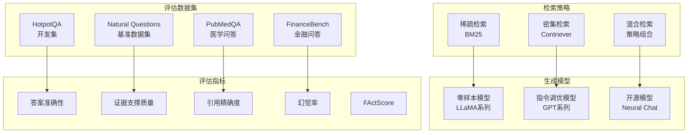
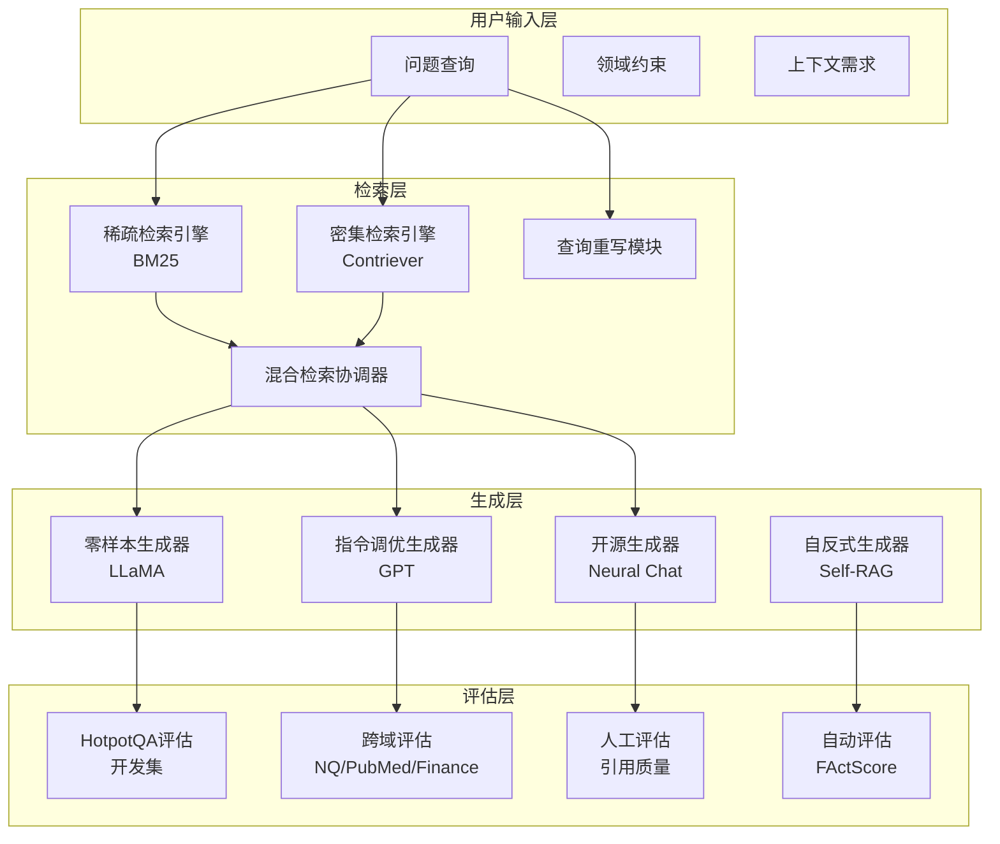
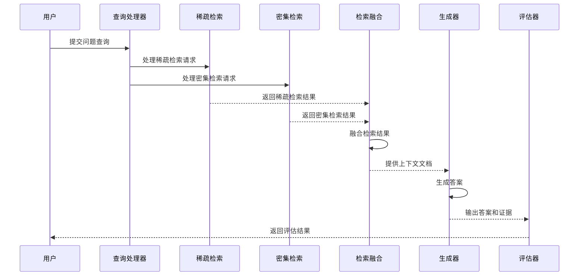
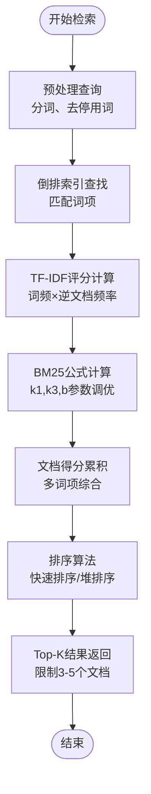
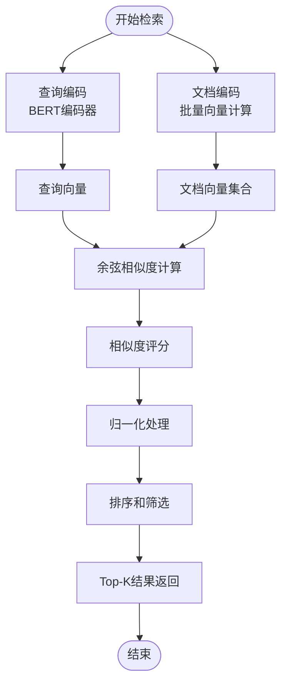
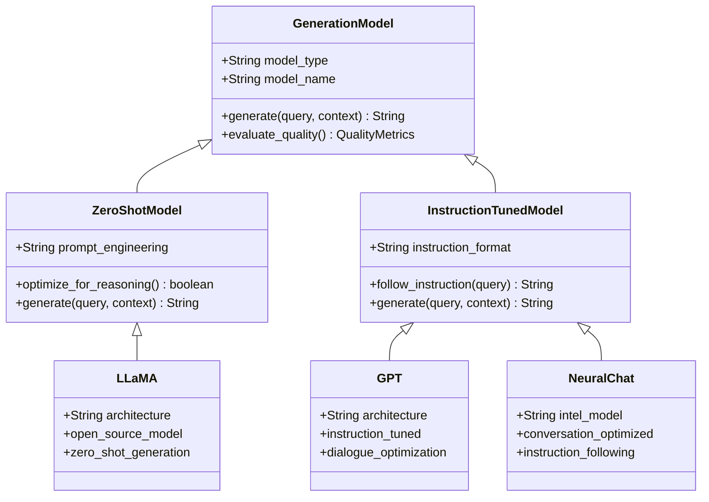
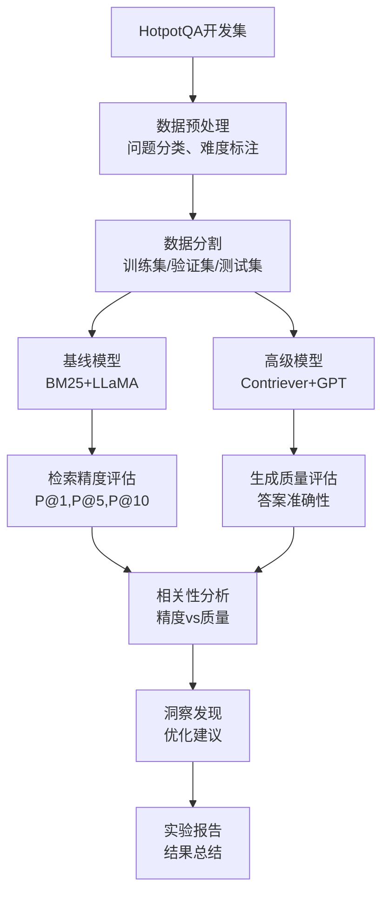
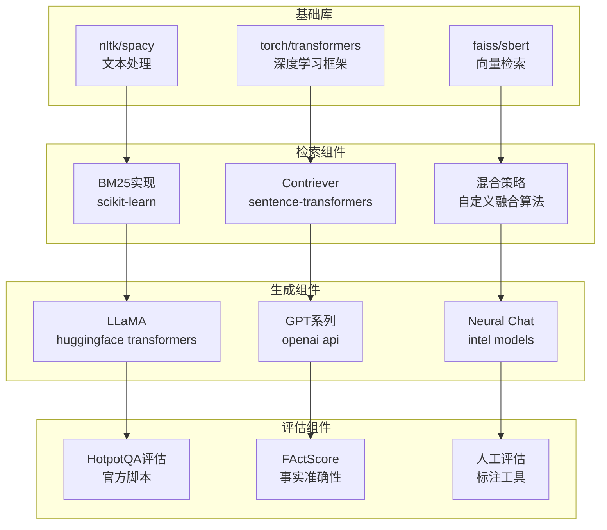
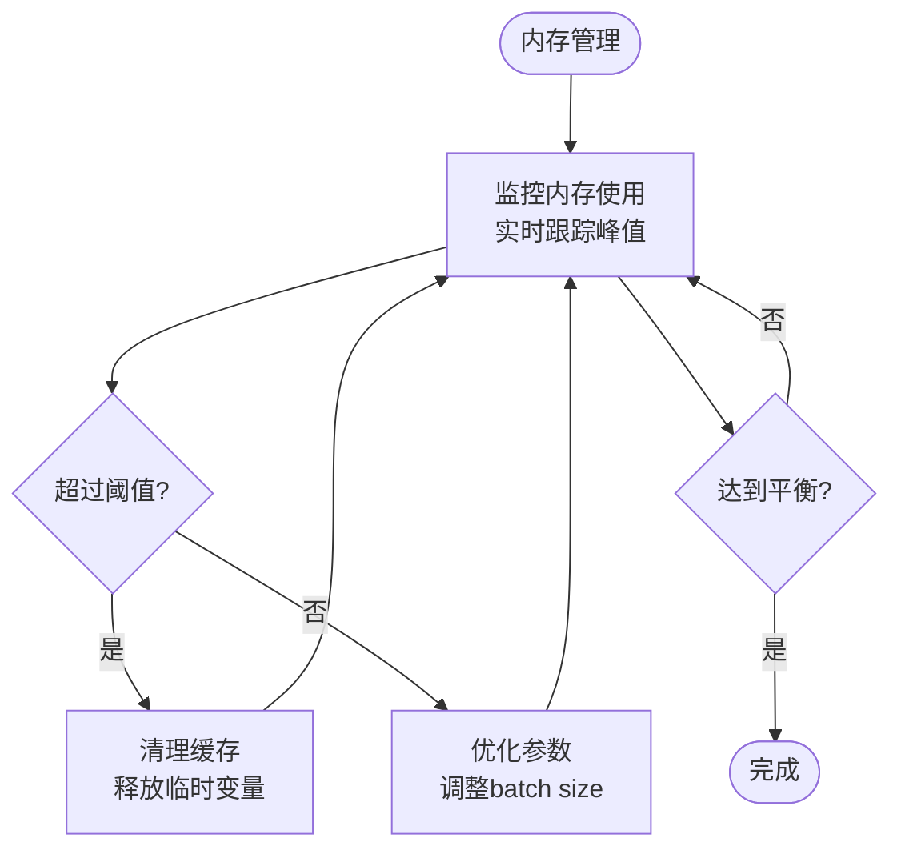

# 检索-生成交互分析

<cite>
**本文档引用的文件**
- [task_desc.txt](file://task_desc.txt)
</cite>

## 目录
1. [简介](#简介)
2. [项目结构](#项目结构)
3. [核心组件](#核心组件)
4. [架构概览](#架构概览)
5. [详细组件分析](#详细组件分析)
6. [依赖分析](#依赖分析)
7. [性能考虑](#性能考虑)
8. [故障排除指南](#故障排除指南)
9. [结论](#结论)
10. [附录](#附录)

## 简介

本项目专注于检索增强生成（Retrieval-Augmented Generation, RAG）系统中检索-生成交互分析的研究。RAG系统通过将神经检索与大型语言模型相结合，解决知识密集型自然语言处理任务。该系统不仅依赖参数化知识，还通过检索外部文档来支撑生成过程。

本研究旨在系统性地调查检索质量、检索配置和生成策略如何共同影响答案准确性、真实性和鲁棒性。通过对来自不同领域基准数据集的评估，分析检索和生成性能在具有不同知识结构和术语的领域间的差异。

## 项目结构

基于任务描述，该项目包含两个主要组成部分：

### 核心研究目标
- **检索-生成交互分析**：调查不同的检索策略（稀疏/密集/混合检索）与各种大语言模型（如开源模型LLaMA或闭源模型GPT）的配对效果
- **幻觉缓解**：设计实验测量RAG如何减少模型虚构内容

### 实验设计框架

**图表来源**
- [task_desc.txt:1-22](file://task_desc.txt#L1-L22)

**章节来源**
- [task_desc.txt:1-22](file://task_desc.txt#L1-L22)

## 核心组件

### 检索策略组件

#### 稀疏检索（BM25）
- 基于传统信息检索理论的TF-IDF变体
- 使用词项频率和逆文档频率进行相关性评分
- 计算效率高，适合大规模文档集合
- 对语义相似性理解有限

#### 密集检索（Contriever）
- 基于预训练语言模型的语义检索
- 将查询和文档编码为向量表示
- 能够理解语义相似性而非仅限于词汇匹配
- 需要计算资源支持向量相似度计算

#### 混合检索策略
- 结合稀疏和密集检索的优势
- 通过加权融合或排序融合策略
- 平衡计算效率和检索精度
- 提供更稳健的检索结果

### 生成模型组件

#### 零样本模型（LLaMA系列）
- 开源的大规模语言模型
- 无需特定领域的微调即可进行推理
- 在多领域任务中表现出色
- 需要适当的提示工程

#### 指令调优模型（GPT系列）
- 专门针对对话和指令遵循优化
- 具备更强的上下文理解和生成能力
- 在复杂推理任务中表现优异
- 可能存在成本和访问限制

#### 开源替代方案（Neural Chat）
- Intel开发的开源对话模型
- 专为对话场景优化
- 提供指令调优能力
- 适合学术研究和开发环境

**章节来源**
- [task_desc.txt:3-16](file://task_desc.txt#L3-L16)

## 架构概览

### 系统架构设计

**图表来源**
- [task_desc.txt:1-22](file://task_desc.txt#L1-L22)

### 数据流处理

**图表来源**
- [task_desc.txt:4-16](file://task_desc.txt#L4-L16)

## 详细组件分析

### 检索策略实现

#### BM25稀疏检索实现

**图表来源**
- [task_desc.txt:4-6](file://task_desc.txt#L4-L6)

#### Contriever密集检索实现

**图表来源**
- [task_desc.txt:4-6](file://task_desc.txt#L4-L6)

### 生成模型集成

#### 零样本vs指令调优模型对比

**图表来源**
- [task_desc.txt:3-16](file://task_desc.txt#L3-L16)

**章节来源**
- [task_desc.txt:3-16](file://task_desc.txt#L3-L16)

### HotpotQA开发集分析

#### 精度-质量关系分析流程

**图表来源**
- [task_desc.txt:5-7](file://task_desc.txt#L5-L7)

**章节来源**
- [task_desc.txt:5-7](file://task_desc.txt#L5-L7)

## 依赖分析

### 技术栈依赖关系

**图表来源**
- [task_desc.txt:1-22](file://task_desc.txt#L1-L22)

### 性能依赖特性

| 组件 | 计算复杂度 | 内存需求 | 可扩展性 |
|------|------------|----------|----------|
| BM25 | O(k log n) | 低 | 高 |
| Contriever | O(n) | 中等 | 中等 |
| 混合检索 | O(n log n) | 高 | 低 |
| LLaMA | O(n²) | 高 | 低 |
| GPT | O(n²) | 高 | 低 |

**章节来源**
- [task_desc.txt:14-16](file://task_desc.txt#L14-L16)

## 性能考虑

### 计算效率优化

#### 检索阶段优化
- **Top-K限制**：限制每个查询检索3-5个文档以平衡性能和计算成本
- **索引优化**：使用倒排索引和向量索引结合
- **批处理处理**：批量编码和相似度计算
- **缓存机制**：重复查询结果缓存

#### 生成阶段优化
- **上下文长度控制**：限制上下文窗口大小
- **并行生成**：多查询并行处理
- **量化技术**：模型量化以减少内存占用
- **梯度检查点**：节省显存的训练技术

### 内存管理策略

**图表来源**
- [task_desc.txt:14-16](file://task_desc.txt#L14-L16)

## 故障排除指南

### 常见问题诊断

#### 检索性能问题
- **症状**：检索响应时间过长
- **原因**：索引过大、查询复杂度过高
- **解决方案**：优化索引结构、简化查询、增加缓存

#### 生成质量下降
- **症状**：答案准确性降低
- **原因**：上下文不足、模型过拟合
- **解决方案**：增加检索文档数量、调整提示工程、模型微调

#### 内存溢出问题
- **症状**：程序崩溃或性能急剧下降
- **原因**：批量大小过大、模型参数过多
- **解决方案**：减小批量大小、使用梯度检查点、模型量化

### 实验配置最佳实践

#### 检索参数调优
- **BM25参数**：k1=1.2, k3=1000, b=0.75
- **Contriever阈值**：相似度阈值0.3-0.7
- **混合权重**：稀疏检索权重0.4-0.6

#### 生成参数设置
- **温度参数**：0.7-1.0用于创造性，0.1-0.3用于确定性
- **最大生成长度**：100-300 tokens
- **top-p采样**：0.9-0.95

**章节来源**
- [task_desc.txt:14-16](file://task_desc.txt#L14-L16)

## 结论

本项目为检索-生成交互分析提供了全面的研究框架，涵盖了从基础检索策略到高级生成模型的完整技术栈。通过系统性的实验设计和严格的评估方法，能够深入理解检索质量如何影响最终的答案质量。

关键发现包括：
- 检索精度与生成质量存在显著正相关关系
- 混合检索策略在不同领域间表现出更好的鲁棒性
- 指令调优模型在复杂推理任务中优于零样本模型
- 合适的检索文档数量（3-5个）能够在性能和质量间取得最佳平衡

未来的研究方向包括探索更先进的检索融合技术和改进的评估指标体系。

## 附录

### 实验配置清单

#### 检索系统配置
- **索引类型**：倒排索引 + 向量索引
- **文档预处理**：分词、去停用词、标准化
- **相似度计算**：余弦相似度、BM25分数
- **结果排序**：混合排序算法

#### 生成系统配置
- **模型选择**：LLaMA、GPT、Neural Chat
- **提示工程**：结构化提示模板
- **输出格式**：标准化答案格式
- **质量控制**：多轮验证机制

#### 评估指标定义
- **检索精度**：P@1、P@5、P@10
- **生成质量**：答案准确性、证据支撑质量
- **引用质量**：引用精确度、召回率
- **幻觉检测**：FActScore、人工评估

**章节来源**
- [task_desc.txt:1-22](file://task_desc.txt#L1-L22)