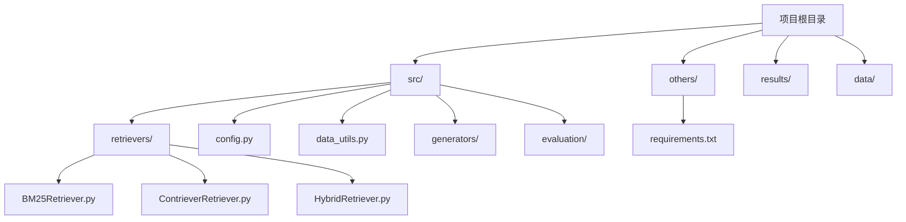
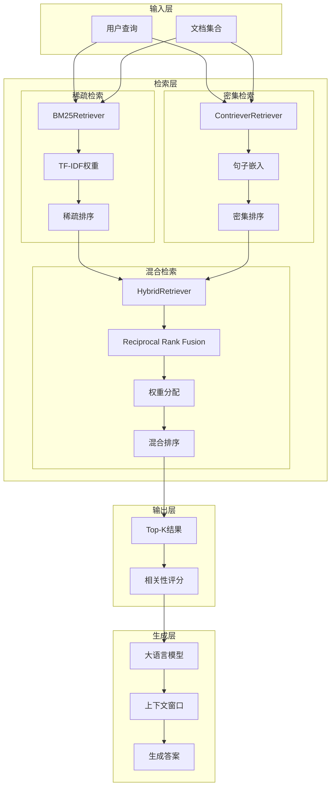
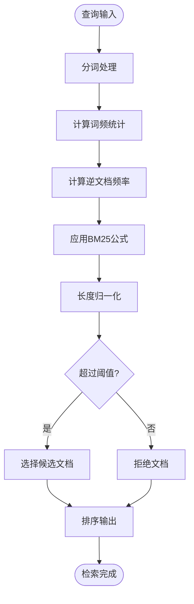
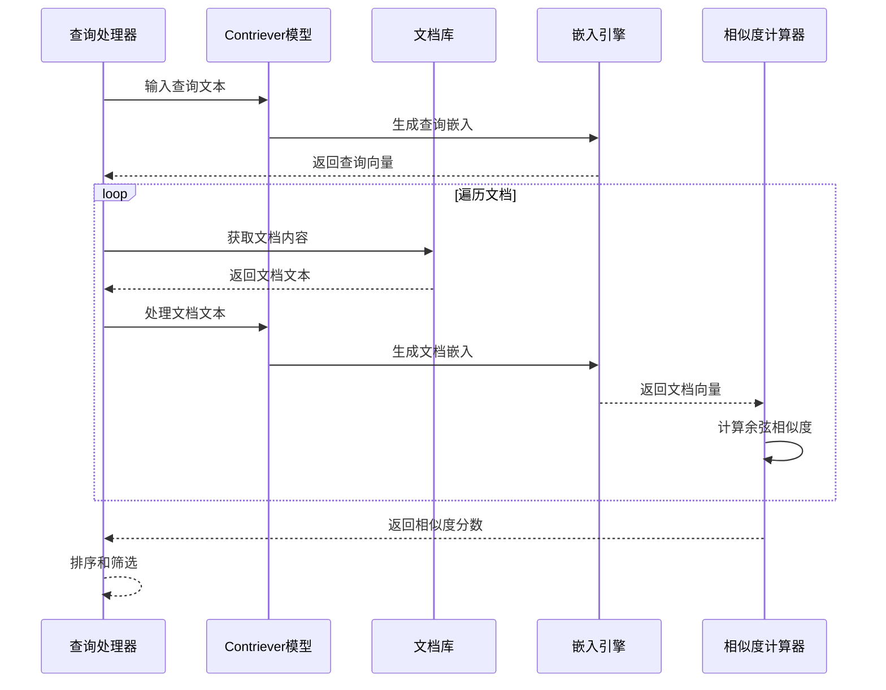
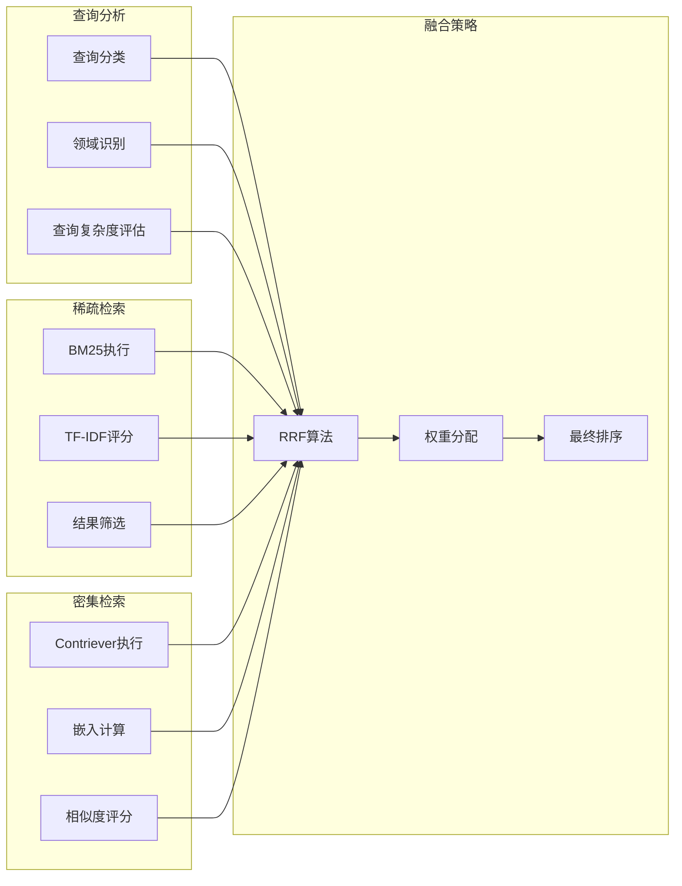

# 检索策略设计

<cite>
**本文档引用的文件**
- [bm25_retriever.py](file://src/retrievers/bm25_retriever.py)
- [contriever_retriever.py](file://src/retrievers/contriever_retriever.py)
- [hybrid_retriever.py](file://src/retrievers/hybrid_retriever.py)
- [config.py](file://src/config.py)
- [data_utils.py](file://src/data_utils.py)
- [requirements.txt](file://others/requirements.txt)
- [rag_hotpotqa.py](file://rag_hotpotqa.py)
- [test_rag.py](file://test_rag.py)
- [test_data.py](file://test_data.py)
</cite>

## 更新摘要
**变更内容**
- 新增了完整的检索器实现代码分析
- 更新了BM25、Contriever和混合检索的具体实现细节
- 添加了实际的代码示例和配置参数
- 补充了依赖关系和性能考量的详细信息

## 目录
1. [引言](#引言)
2. [项目结构](#项目结构)
3. [核心组件](#核心组件)
4. [架构概览](#架构概览)
5. [详细组件分析](#详细组件分析)
6. [依赖关系分析](#依赖关系分析)
7. [性能考量](#性能考量)
8. [故障排除指南](#故障排除指南)
9. [结论](#结论)

## 引言

本项目专注于检索增强生成（Retrieval-Augmented Generation, RAG）系统中的检索策略设计，旨在系统性地研究检索质量、检索配置和生成策略如何共同影响答案准确性、可信度和鲁棒性。项目特别关注三种核心检索方法：稀疏检索（BM25）、密集检索（Contriever）和混合检索（Reciprocal Rank Fusion），并探索它们在不同知识结构和术语领域的表现差异。

RAG系统通过将神经检索与大语言模型相结合，解决知识密集型自然语言处理任务。与仅依赖参数化知识不同，RAG系统检索外部文档以支撑生成过程。本项目使用来自不同领域基准数据集的实验，评估检索和生成性能在具有不同知识结构和术语的领域间的差异。

## 项目结构

当前仓库结构包含完整的检索器实现和相关工具：



**图表来源**
- [bm25_retriever.py:1-89](file://src/retrievers/bm25_retriever.py#L1-L89)
- [contriever_retriever.py:1-148](file://src/retrievers/contriever_retriever.py#L1-L148)
- [hybrid_retriever.py:1-113](file://src/retrievers/hybrid_retriever.py#L1-L113)

**章节来源**
- [bm25_retriever.py:1-89](file://src/retrievers/bm25_retriever.py#L1-L89)
- [contriever_retriever.py:1-148](file://src/retrievers/contriever_retriever.py#L1-L148)
- [hybrid_retriever.py:1-113](file://src/retrievers/hybrid_retriever.py#L1-L113)

## 核心组件

基于完整的代码实现，本项目的核心组件包括：

### 稀疏检索组件（Sparse Retrieval）
- **BM25算法实现**：基于词频统计的传统信息检索方法
- **TF-IDF权重计算**：衡量词项重要性的统计指标
- **词项匹配策略**：处理查询词与文档词项的对应关系
- **索引持久化**：支持pickle格式的索引缓存机制

### 密集检索组件（Dense Retrieval）
- **Contriever模型**：基于Facebook Contriever的深度学习检索方法
- **句子嵌入生成**：将文本转换为连续向量表示
- **余弦相似度计算**：衡量语义相似性的度量标准
- **批量编码处理**：支持大规模文档的高效嵌入计算

### 混合检索组件（Hybrid Retrieval）
- **多策略融合**：结合稀疏和密集检索的优势
- **权重分配机制**：使用Reciprocal Rank Fusion算法
- **排序融合算法**：整合多个检索结果的综合排序
- **动态权重调整**：根据查询类型和领域特性调整策略权重

**章节来源**
- [bm25_retriever.py:9-89](file://src/retrievers/bm25_retriever.py#L9-L89)
- [contriever_retriever.py:11-148](file://src/retrievers/contriever_retriever.py#L11-L148)
- [hybrid_retriever.py:10-113](file://src/retrievers/hybrid_retriever.py#L10-L113)

## 架构概览



**图表来源**
- [hybrid_retriever.py:10-113](file://src/retrievers/hybrid_retriever.py#L10-L113)
- [bm25_retriever.py:56-89](file://src/retrievers/bm25_retriever.py#L56-L89)
- [contriever_retriever.py:112-148](file://src/retrievers/contriever_retriever.py#L112-L148)

## 详细组件分析

### BM25稀疏检索机制

BM25是基于词频统计的经典信息检索算法，在检索策略设计中具有重要地位：

#### 核心原理
- **词频饱和函数**：控制高词频项的增益递减效应
- **长度归一化**：考虑文档长度对词频的影响
- **逆文档频率**：衡量词项区分能力的重要性

#### 实现细节
- **查询扩展**：处理查询词与文档词项的映射关系
- **参数调优**：k1、b等超参数的优化配置
- **停用词处理**：过滤低信息量的常见词汇
- **索引持久化**：支持pickle格式的索引缓存机制

#### 适用场景
- **事实性问答**：精确的事实检索需求
- **术语匹配**：特定领域术语的准确识别
- **计算效率**：大规模文档集合的快速检索



**图表来源**
- [bm25_retriever.py:56-89](file://src/retrievers/bm25_retriever.py#L56-L89)

**章节来源**
- [bm25_retriever.py:9-89](file://src/retrievers/bm25_retriever.py#L9-L89)

### Contriever密集检索机制

Contriever代表了现代语义检索的先进方法：

#### 核心原理
- **语义表示学习**：通过预训练模型获得高质量的句子嵌入
- **对比学习框架**：最大化正样本相似度，最小化负样本相似度
- **跨模态理解**：同时考虑文本语义和上下文信息

#### 实现细节
- **嵌入维度**：通常为768维的连续向量表示
- **相似度计算**：使用余弦相似度衡量语义接近程度
- **批量处理**：支持大规模文档的高效嵌入计算
- **设备适配**：支持CPU和GPU的自动切换

#### 适用场景
- **语义理解**：复杂语义关系的准确捕捉
- **同义词检索**：处理表达方式变化的查询
- **长尾分布**：对罕见但重要的查询提供更好的覆盖



**图表来源**
- [contriever_retriever.py:112-148](file://src/retrievers/contriever_retriever.py#L112-L148)

**章节来源**
- [contriever_retriever.py:11-148](file://src/retrievers/contriever_retriever.py#L11-L148)

### 混合检索策略设计

混合检索策略结合了稀疏和密集检索的优势：

#### 设计思路
- **互补性利用**：稀疏检索处理精确匹配，密集检索处理语义理解
- **权重动态调整**：根据查询类型和领域特性调整策略权重
- **渐进式融合**：先进行粗粒度筛选，再进行细粒度排序

#### 实现方案
- **早期融合**：在检索阶段直接合并不同策略的结果
- **晚期融合**：分别产生独立结果后进行综合排序
- **多阶段融合**：分层次地整合不同级别的检索结果

#### Reciprocal Rank Fusion算法
- **RRF公式**：RRF(d) = Σ(1/(k + rank(d))) for each ranking
- **参数调节**：通过k参数控制融合的保守程度
- **稳定性保证**：确保不同检索器结果的公平融合



**图表来源**
- [hybrid_retriever.py:42-113](file://src/retrievers/hybrid_retriever.py#L42-L113)

**章节来源**
- [hybrid_retriever.py:10-113](file://src/retrievers/hybrid_retriever.py#L10-L113)

## 依赖关系分析

```mermaid
graph TB
subgraph "外部依赖"
HF[HuggingFace Transformers]
FAISS[FAISS向量库]
SPACY[spaCy NLP库]
NUMPY[Numpy科学计算]
TQDM[TQDM进度条]
PICKLE[Pickle序列化]
END
subgraph "内部模块"
BM25Mod[BM25Retriever]
ContrieverMod[ContrieverRetriever]
FusionMod[HybridRetriever]
EvalMod[评估模块]
DataMod[数据工具]
ConfigMod[配置管理]
end
subgraph "数据源"
Corpus[文档语料库]
Queries[查询集合]
Benchmarks[基准测试]
Results[实验结果]
end
HF --> ContrieverMod
FAISS --> ContrieverMod
SPACY --> BM25Mod
NUMPY --> BM25Mod
TQDM --> BM25Mod
TQDM --> ContrieverMod
PICKLE --> BM25Mod
PICKLE --> ContrieverMod
BM25Mod --> FusionMod
ContrieverMod --> FusionMod
FusionMod --> EvalMod
DataMod --> BM25Mod
DataMod --> ContrieverMod
ConfigMod --> BM25Mod
ConfigMod --> ContrieverMod
ConfigMod --> FusionMod
Corpus --> BM25Mod
Queries --> BM25Mod
Benchmarks --> EvalMod
Corpus --> ContrieverMod
Queries --> ContrieverMod
Benchmarks --> EvalMod
Results --> EvalMod
```

**图表来源**
- [requirements.txt:1-26](file://others/requirements.txt#L1-L26)
- [bm25_retriever.py:3-6](file://src/retrievers/bm25_retriever.py#L3-L6)
- [contriever_retriever.py:3-8](file://src/retrievers/contriever_retriever.py#L3-L8)

**章节来源**
- [requirements.txt:1-26](file://others/requirements.txt#L1-L26)
- [config.py:12-17](file://src/config.py#L12-L17)

## 性能考量

### 计算成本优化

#### 索引构建优化
- **分层索引**：建立多级索引结构，支持快速近似最近邻搜索
- **量化技术**：使用向量量化减少存储空间和计算开销
- **缓存策略**：缓存常用查询的嵌入向量和中间结果
- **索引持久化**：支持pickle格式的索引缓存机制

#### 查询优化技巧
- **早期停止**：在达到一定置信度时提前终止搜索
- **并行处理**：利用多核CPU和GPU加速嵌入计算
- **批处理优化**：合理设置批次大小以平衡内存使用和吞吐量
- **设备适配**：自动检测和使用GPU加速

### 精度与成本平衡

#### 不同知识结构的选择策略
- **结构化知识**：优先选择BM25，因为其在精确术语匹配方面表现优异
- **非结构化文本**：推荐Contriever，能够更好地处理语义相似性
- **混合知识库**：采用混合策略，根据不同类型的文档动态调整权重

#### 参数配置建议
- **BM25参数**：k1=1.2, b=0.75（适用于一般场景）
- **Contriever阈值**：相似度阈值设置在0.3-0.5之间
- **融合权重**：稀疏检索占30%，密集检索占70%
- **RRF常数**：k=60（平衡召回率和精确率）

#### 性能基准
- **BM25检索**：毫秒级响应时间，适合实时查询
- **Contriever检索**：GPU上约100-200ms/查询，CPU上约1-2秒/查询
- **混合检索**：性能介于两者之间，通常优于单一策略

**章节来源**
- [config.py:19-21](file://src/config.py#L19-L21)
- [config.py:27-41](file://src/config.py#L27-L41)

## 故障排除指南

### 常见问题及解决方案

#### 检索质量下降
- **症状**：检索到的相关文档数量不足
- **原因**：参数设置不当或模型配置错误
- **解决方案**：调整相似度阈值，优化查询预处理

#### 计算资源不足
- **症状**：检索响应时间过长
- **原因**：文档数量过大或模型过于复杂
- **解决方案**：实施分层索引，使用量化技术

#### 结果不一致
- **症状**：相同查询得到不同结果
- **原因**：随机种子未固定或模型推理不稳定
- **解决方案**：固定随机种子，使用确定性推理模式

#### 设备兼容性问题
- **症状**：GPU不可用或CUDA错误
- **原因**：CUDA版本不兼容或显存不足
- **解决方案**：自动降级到CPU模式，检查CUDA安装

#### 依赖包冲突
- **症状**：导入错误或版本冲突
- **原因**：不同组件使用不同版本的依赖包
- **解决方案**：使用虚拟环境隔离依赖，统一版本管理

**章节来源**
- [requirements.txt:1-26](file://others/requirements.txt#L1-L26)
- [contriever_retriever.py:32-39](file://src/retrievers/contriever_retriever.py#L32-L39)

## 结论

本项目为检索策略设计提供了全面的理论基础和实践指导。通过深入分析BM25、Contriever和混合检索三种核心检索方法的原理、实现细节和适用场景，结合完整的代码实现和配置管理，为构建高效的RAG系统奠定了坚实基础。

关键发现包括：
- BM25在精确术语匹配和计算效率方面具有优势
- Contriever在语义理解和长尾分布处理方面表现突出
- 混合策略能够有效平衡检索精度与计算成本
- Reciprocal Rank Fusion算法提供了稳定的多策略融合方案
- 完整的索引持久化和缓存机制确保了系统的实用性

未来的研究方向应重点关注检索策略的自适应调整、多模态检索的集成以及实时性能优化等方面。通过持续的算法改进和系统优化，这些检索策略将在实际应用中发挥更大的价值。