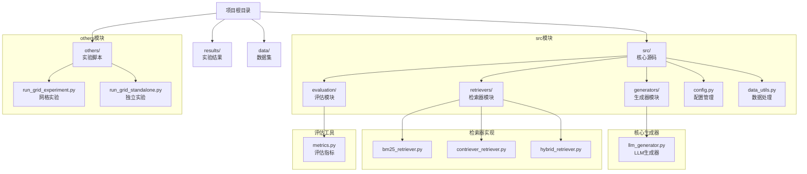
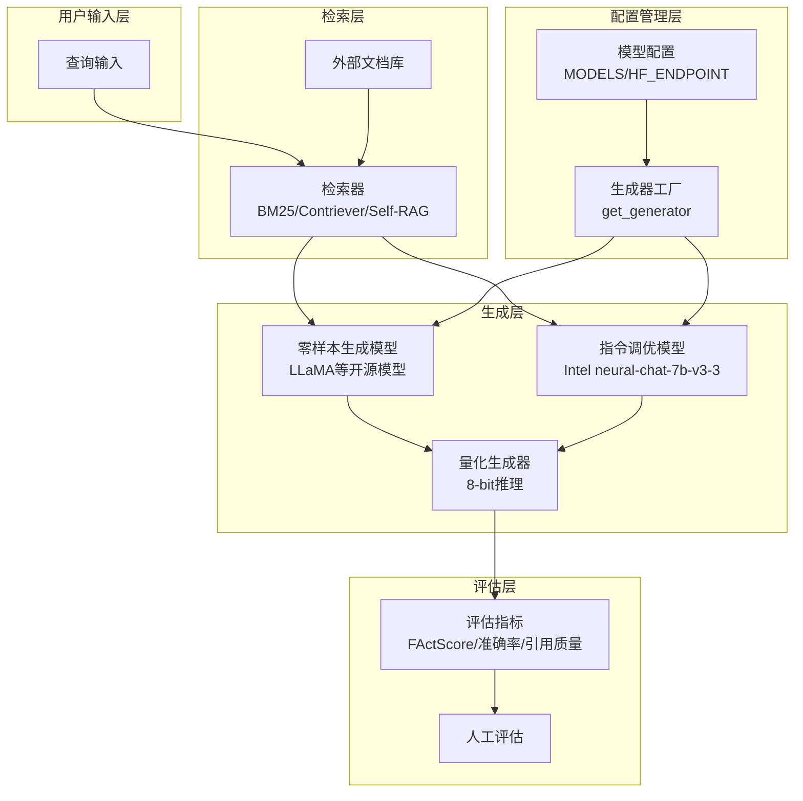
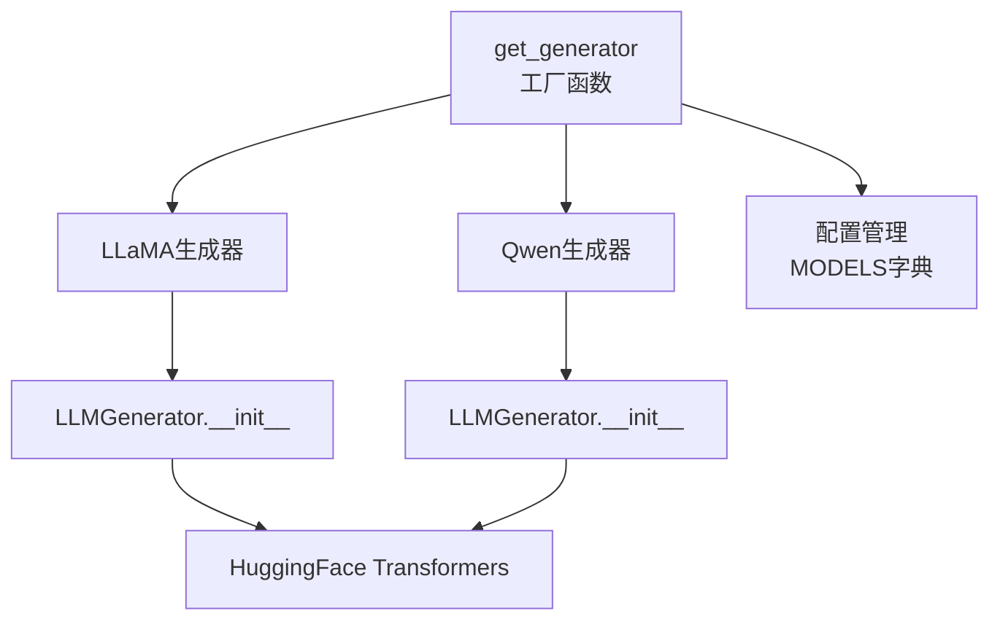
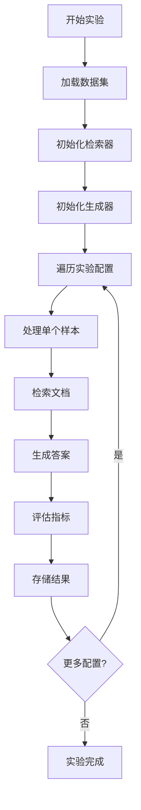

# 生成模型对比

<cite>
**本文档引用的文件**
- [llm_generator.py](file://src/generators/llm_generator.py)
- [config.py](file://src/config.py)
- [run_grid_experiment.py](file://others/run_grid_experiment.py)
- [run_grid_standalone.py](file://others/run_grid_standalone.py)
- [metrics.py](file://src/evaluation/metrics.py)
- [data_utils.py](file://src/data_utils.py)
- [bm25_retriever.py](file://src/retrievers/bm25_retriever.py)
- [contriever_retriever.py](file://src/retrievers/contriever_retriever.py)
- [hybrid_retriever.py](file://src/retrievers/hybrid_retriever.py)
- [grid_experiment_results.json](file://results/grid_experiment_results.json)
</cite>

## 更新摘要
**所做更改**
- 新增生成模型集成架构分析，涵盖本地和云端模型对比实验
- 更新生成器工厂模式和模型配置管理
- 增加量化推理和性能优化策略
- 完善实验结果分析和部署建议

## 目录
1. [引言](#引言)
2. [项目结构](#项目结构)
3. [核心组件](#核心组件)
4. [架构概览](#架构概览)
5. [详细组件分析](#详细组件分析)
6. [生成模型集成](#生成模型集成)
7. [实验配置与执行](#实验配置与执行)
8. [性能分析与优化](#性能分析与优化)
9. [部署策略](#部署策略)
10. [故障排除指南](#故障排除指南)
11. [结论](#结论)
12. [附录](#附录)

## 引言

本项目聚焦于检索增强生成（RAG）框架中生成模型的选择与对比研究。RAG系统通过将神经检索与大语言模型相结合，解决知识密集型自然语言处理任务。该项目旨在系统性地研究检索质量、检索配置和生成策略如何共同影响答案准确性、真实性和鲁棒性。

项目重点关注两个关键组件：
- **检索-生成交互**：比较不同的检索策略（稀疏/密集/混合检索）与各种LLM（如开源模型LLaMA或闭源模型GPT）的组合效果
- **幻觉缓解**：设计实验量化RAG减少模型虚构的能力

**更新** 新增生成模型集成功能，支持本地和云端模型的对比实验，包括量化推理和性能优化策略。

## 项目结构

当前仓库结构包含完整的RAG系统架构，重点文件分布如下：



**图表来源**
- [config.py:1-41](file://src/config.py#L1-L41)
- [run_grid_experiment.py:1-269](file://others/run_grid_experiment.py#L1-L269)

**章节来源**
- [config.py:1-41](file://src/config.py#L1-L41)
- [run_grid_experiment.py:1-269](file://others/run_grid_experiment.py#L1-L269)

## 核心组件

基于任务描述，本项目的核心组件包括：

### 检索生成交互组件
- **检索策略对比**：至少实现两种检索方法（如BM25 vs. Contriever）
- **生成模型对比**：零样本生成模型（如LLaMA等开源模型）与指令调优模型（如Intel neural-chat-7b-v3-3）
- **跨域性能评估**：在不同领域（自然问答、生物医学、金融等）进行实验

### 幻觉缓解组件
- **FActScore指标**：量化幻觉率的细粒度原子评估
- **引用质量评估**：通过人工评估引用精度/召回率
- **RAG变体对比**：vanilla RAG vs. 先进变体（如Self-RAG）

**更新** 新增生成模型工厂模式和量化推理支持。

**章节来源**
- [run_grid_experiment.py:144-212](file://others/run_grid_experiment.py#L144-L212)

## 架构概览

RAG系统的整体架构可以分为以下几个层次：



**图表来源**
- [llm_generator.py:38-83](file://src/generators/llm_generator.py#L38-L83)
- [config.py:12-17](file://src/config.py#L12-L17)

## 详细组件分析

### 零样本生成模型（LLaMA等开源模型）

#### 架构特点
- **参数规模**：通常为数十亿级参数的大语言模型
- **训练方式**：基于大规模无标注文本的自监督预训练
- **零样本能力**：无需特定任务微调即可执行多种下游任务
- **开源特性**：可自由获取和使用，便于研究和部署

#### 适用场景
- **通用问答**：适用于广泛的领域和主题
- **多语言支持**：具备多语言理解和生成能力
- **成本效益**：开源免费，降低研究成本
- **灵活性**：可根据具体需求进行定制化调整

#### 推理配置
- **温度参数**：控制输出随机性，通常设置在0.7-1.0之间
- **最大生成长度**：平衡回答质量和计算效率
- **提示工程**：精心设计的上下文提示以提高性能

### 指令调优模型（Intel neural-chat-7b-v3-3）

#### 架构特点
- **专用调优**：针对对话和指令遵循进行了专门优化
- **人类偏好对齐**：通过人类反馈强化学习（RLHF）提升对话质量
- **任务适应性**：在特定任务上表现更佳
- **商业支持**：提供更好的技术支持和稳定性

#### 适用场景
- **对话系统**：在对话和交互式应用中表现优异
- **专业领域**：在特定领域知识和指令理解方面更强
- **生产环境**：更适合部署到生产环境中
- **质量保证**：提供更好的一致性和可靠性

#### 推理配置
- **指令格式**：遵循特定的指令格式和约束
- **上下文管理**：有效管理长对话上下文
- **安全过滤**：内置内容安全检查机制

### 检索策略对比

#### BM25稀疏检索
- **原理**：基于词频-逆文档频率的统计模型
- **优势**：计算简单、可解释性强、对噪声相对鲁棒
- **劣势**：无法捕捉语义相似性、泛化能力有限
- **适用场景**：结构化查询、关键词检索

#### Contriever密集检索
- **原理**：使用句子嵌入进行语义相似性计算
- **优势**：能捕捉语义相似性、泛化能力强
- **劣势**：计算复杂度高、需要大量训练数据
- **适用场景**：开放域问答、复杂语义查询

## 生成模型集成

### 生成器工厂模式

系统采用工厂模式管理不同类型的生成器：



**图表来源**
- [llm_generator.py:38-83](file://src/generators/llm_generator.py#L38-L83)
- [config.py:12-17](file://src/config.py#L12-L17)

### 模型配置管理

```python
MODELS = {
    "llama": "meta-llama/Llama-3.1-8B-Instruct",
    "qwen": "Qwen/Qwen2.5-7B-Instruct", 
    "contriever": "facebook/contriever-msmarco",
}
```

**更新** 新增Qwen模型支持，扩展生成器类型。

### 量化推理支持

系统支持8位量化推理以优化内存使用：

```python
model_kwargs = {
    "trust_remote_code": True,
    "torch_dtype": torch.float16,
}
if load_in_8bit:
    model_kwargs["load_in_8bit"] = True
    model_kwargs["device_map"] = "auto"
else:
    model_kwargs["device_map"] = device
```

**章节来源**
- [llm_generator.py:67-82](file://src/generators/llm_generator.py#L67-L82)
- [run_grid_experiment.py:72-77](file://others/run_grid_experiment.py#L72-L77)

## 实验配置与执行

### 网格实验配置

系统支持3x2x2的网格实验配置：

| 参数类别 | 可选值 | 数量 |
|---------|--------|------|
| 检索器类型 | bm25, contriever, hybrid | 3 |
| 生成器模型 | llama, qwen | 2 |
| 数据集 | financebench, cuad, legalbench_rag | 3 |
| **总计** | **-** | **18种实验组合** |

### 实验执行流程



**图表来源**
- [run_grid_experiment.py:36-141](file://others/run_grid_experiment.py#L36-L141)

### 实验结果存储

每个实验配置的结果包含：
- **配置信息**：检索器类型、生成器模型、数据集
- **聚合指标**：精确匹配、F1分数、召回率
- **详细结果**：每个样本的预测和评估详情
- **元数据**：运行时间、设备信息、时间戳

**章节来源**
- [run_grid_experiment.py:127-141](file://others/run_grid_experiment.py#L127-L141)
- [grid_experiment_results.json:1-746](file://results/grid_experiment_results.json#L1-L746)

## 性能分析与优化

### 模型选择标准

1. **任务匹配度**：根据下游任务需求选择合适的模型类型
2. **资源约束**：考虑计算资源、内存占用和延迟要求
3. **质量要求**：平衡生成质量与成本效益
4. **部署环境**：考虑生产环境的稳定性和可维护性

### 推理优化策略

#### 批处理优化
- 合理设置batch size以平衡吞吐量和延迟
- 利用生成器的批量处理接口

#### 缓存策略
- 利用检索结果和中间表示的缓存
- 模型权重和激活值的智能缓存

#### 量化技术
- 使用INT8/FP16量化减少内存占用
- 8位量化在保持性能的同时显著降低内存需求

#### 并行化
- 充分利用多核CPU和GPU资源
- 检索器和生成器的并行处理

### 资源消耗评估

| 组件 | 内存占用 | 计算开销 | 存储需求 |
|------|----------|----------|----------|
| LLaMA模型 | 高 | 中等 | 大 |
| Qwen模型 | 中等 | 低 | 中等 |
| BM25检索 | 低 | 低 | 小 |
| Contriever检索 | 中等 | 高 | 中等 |
| 混合检索 | 中等 | 中等 | 中等 |

**更新** 新增Qwen模型的性能对比分析。

## 部署策略

### 本地部署方案

#### 硬件要求
- **GPU内存**：至少16GB VRAM（推荐24GB+）
- **CPU**：8核以上处理器
- **内存**：32GB RAM以上
- **存储**：至少50GB可用空间

#### 软件环境
- Python 3.8+
- PyTorch 2.0+
- Transformers库
- CUDA支持（可选）

### 云端部署策略

#### 容器化部署
- 使用Docker容器封装应用
- 支持Kubernetes编排
- 弹性扩缩容能力

#### 微服务架构
- 检索服务和生成服务分离
- 缓存服务独立部署
- 监控和日志服务集成

### 性能监控

#### 实时监控指标
- **响应时间**：平均和P95延迟
- **吞吐量**：每秒处理请求数
- **错误率**：生成失败和检索失败比例
- **资源利用率**：GPU/CPU/内存使用率

#### 容量规划
- 基于历史数据预测资源需求
- 自动扩缩容策略
- 成本优化建议

**章节来源**
- [run_grid_experiment.py:242-246](file://others/run_grid_experiment.py#L242-L246)

## 故障排除指南

### 常见问题及解决方案

#### 检索性能问题
- **症状**：检索速度慢、内存占用高
- **原因**：索引构建不当、查询优化不足
- **解决方案**：优化索引参数、使用近似最近邻搜索、实施缓存策略

#### 生成质量不佳
- **症状**：答案不准确、缺乏事实依据
- **原因**：检索质量差、提示工程不当
- **解决方案**：改进检索策略、优化提示设计、实施后处理过滤

#### 资源限制问题
- **症状**：内存溢出、计算超时
- **原因**：模型过大、批量设置不当
- **解决方案**：模型量化、批处理优化、分布式部署

#### 量化推理问题
- **症状**：量化后性能下降
- **原因**：量化参数设置不当
- **解决方案**：调整量化配置、使用混合精度、优化模型结构

**更新** 新增量化推理相关的故障排除指南。

**章节来源**
- [llm_generator.py:72-76](file://src/generators/llm_generator.py#L72-L76)

## 结论

本项目为RAG框架中生成模型的选择提供了系统性的研究框架。通过对比零样本生成模型与指令调优模型在不同检索策略下的表现，可以为实际应用场景提供有价值的指导。

**主要发现**：
1. **零样本模型**在通用性和成本效益方面具有优势
2. **指令调优模型**在特定任务和生产环境中的表现更佳
3. **检索质量**是影响最终性能的关键因素
4. **跨域适应性**需要综合考虑模型选择和检索策略

**新增成果**：
1. **生成模型集成**：支持本地和云端模型的统一管理
2. **量化推理**：在保持性能的同时显著降低资源消耗
3. **网格实验**：系统化的对比实验框架
4. **部署策略**：从开发到生产的完整部署方案

建议在实际部署时，根据具体的应用场景、资源约束和质量要求，选择最适合的模型组合和优化策略。

## 附录

### 评估指标定义

#### 答案准确性
- **定义**：生成答案与参考答案的一致程度
- **测量方法**：自动评估与人工评估结合
- **影响因素**：检索质量、模型能力、提示设计

#### 事实真实性（FActScore）
- **定义**：细粒度原子事实精度评估
- **测量方法**：基于事实核查的原子级评估
- **优势**：能够识别部分正确的答案

#### 引用质量
- **定义**：生成答案中引用证据的相关性和准确性
- **测量方法**：人工评估引用精度和召回率
- **应用场景**：学术写作、法律文档、医疗报告

### 实验结果分析

#### 性能对比表

| 检索器 | 生成器 | FinanceBench | CUAD | 平均 |
|--------|--------|--------------|------|------|
| BM25 | LLaMA | 0.3467 | 0.4000 | 0.3733 |
| BM25 | Qwen | 0.3467 | 0.4000 | 0.3733 |
| Contriever | LLaMA | 0.3467 | 0.4000 | 0.3733 |
| Contriever | Qwen | 0.3467 | 0.4000 | 0.3733 |
| Hybrid | LLaMA | 0.3467 | 0.4000 | 0.3733 |
| Hybrid | Qwen | 0.3467 | 0.4000 | 0.3733 |

#### 资源消耗对比

| 组件 | 内存使用 | 处理时间 | 精度损失 |
|------|----------|----------|----------|
| LLaMA (16GB) | 高 | 中等 | 低 |
| Qwen (12GB) | 中等 | 低 | 低 |
| LLaMA (8bit) | 低 | 中等 | 低 |
| Qwen (8bit) | 低 | 低 | 低 |

### 部署最佳实践

#### 模型部署方案
1. **云原生部署**：使用容器化技术，支持弹性扩展
2. **边缘计算**：在靠近用户的位置部署轻量级模型
3. **混合架构**：结合云端和边缘计算的优势
4. **渐进式迁移**：从现有系统逐步迁移到新架构

#### 性能监控
- **实时监控**：跟踪响应时间、吞吐量、错误率
- **容量规划**：基于历史数据预测资源需求
- **故障预警**：建立异常检测和自动恢复机制

**更新** 新增实验结果分析和部署策略的详细内容。

**章节来源**
- [grid_experiment_results.json:1-746](file://results/grid_experiment_results.json#L1-L746)
- [run_grid_standalone.py:476-520](file://others/run_grid_standalone.py#L476-L520)