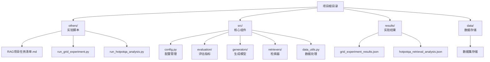
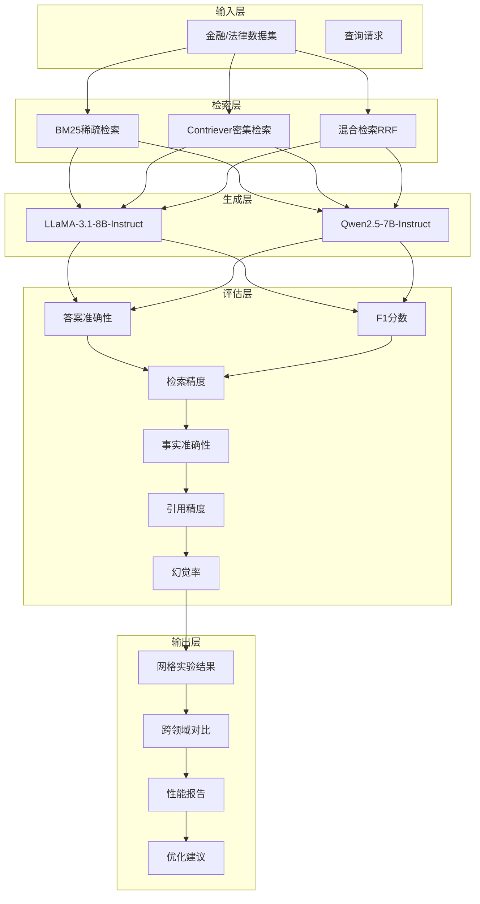
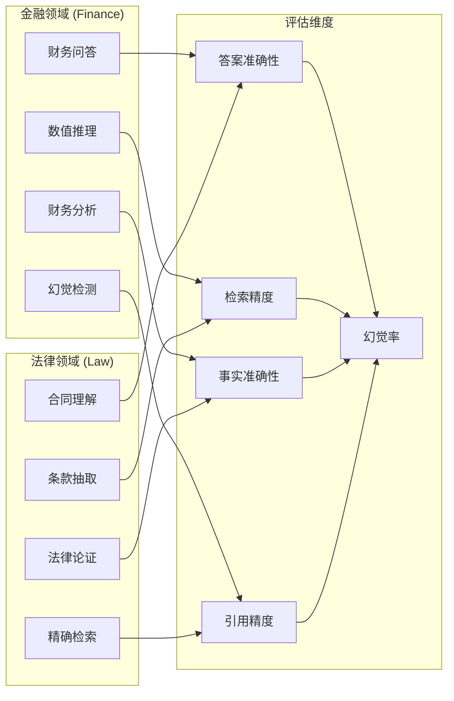
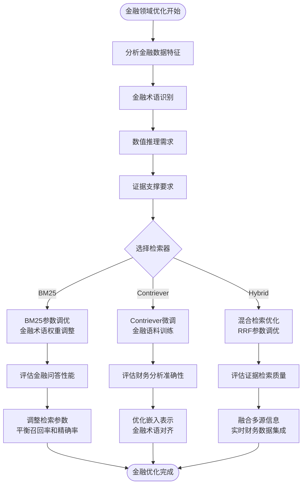
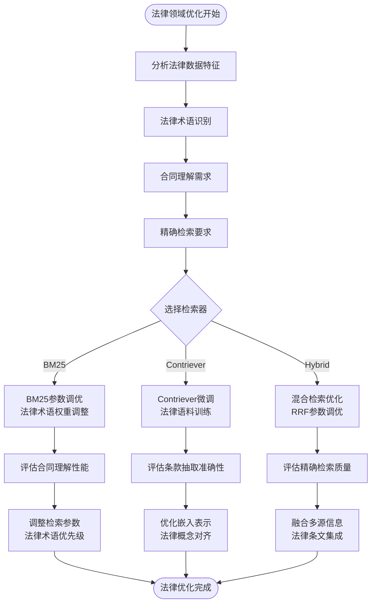
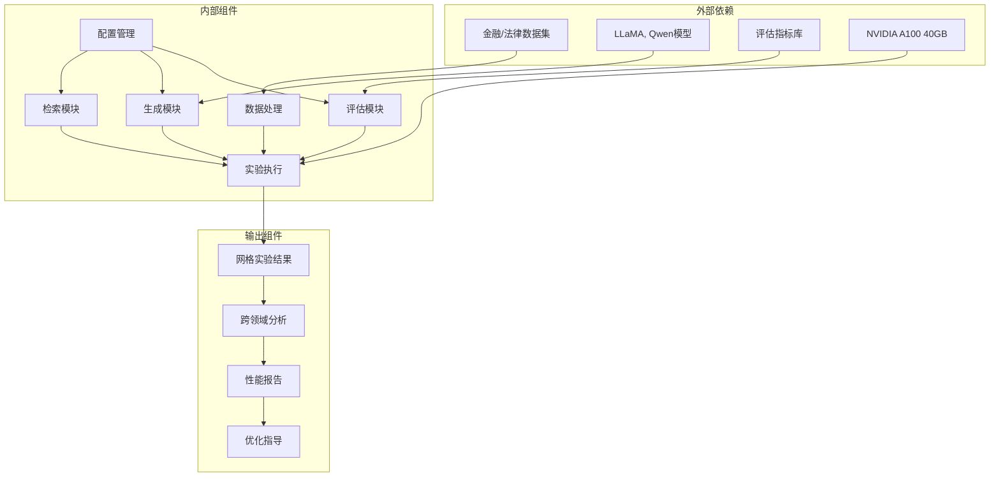

# 跨领域性能分析

<cite>
**本文档引用的文件**
- [RAG项目任务清单.md](file://others/RAG项目任务清单.md)
- [datasets_overview.md](file://others/datasets_overview.md)
- [run_grid_experiment.py](file://others/run_grid_experiment.py)
- [run_hotpotqa_analysis.py](file://others/run_hotpotqa_analysis.py)
- [config.py](file://src/config.py)
- [metrics.py](file://src/evaluation/metrics.py)
- [llm_generator.py](file://src/generators/llm_generator.py)
- [hybrid_retriever.py](file://src/retrievers/hybrid_retriever.py)
- [data_utils.py](file://src/data_utils.py)
- [grid_experiment_results.json](file://results/grid_experiment_results.json)
- [hotpotqa_retrieval_analysis.json](file://results/hotpotqa_retrieval_analysis.json)
</cite>

## 目录
1. [引言](#引言)
2. [项目结构](#项目结构)
3. [核心组件](#核心组件)
4. [架构概览](#架构概览)
5. [详细组件分析](#详细组件分析)
6. [依赖关系分析](#依赖关系分析)
7. [性能考虑](#性能考虑)
8. [故障排除指南](#故障排除指南)
9. [结论](#结论)
10. [附录](#附录)

## 引言

本项目专注于检索增强生成（RAG）系统在跨领域性能分析方面的研究。RAG系统通过将神经检索与大型语言模型相结合，为知识密集型自然语言处理任务提供解决方案。该项目旨在系统性地调查检索质量、检索配置和生成策略如何共同影响答案准确性、真实性和鲁棒性。

项目特别关注不同知识结构和术语环境下的基准数据集评估，包括金融（FinanceBench）和法律（CUAD、LegalBench-RAG-mini）等领域的特点和挑战。新增的跨领域对比分析功能使得我们能够在金融和法律两个专业领域之间进行直接的性能对比，深入理解不同领域对检索策略和生成模型的影响。

## 项目结构

当前代码库结构包含多个核心模块，支持完整的跨领域性能评估流程：



**图表来源**
- [run_grid_experiment.py:1-269](file://others/run_grid_experiment.py#L1-L269)
- [config.py:1-41](file://src/config.py#L1-L41)
- [data_utils.py:1-210](file://src/data_utils.py#L1-L210)

**章节来源**
- [run_grid_experiment.py:1-269](file://others/run_grid_experiment.py#L1-L269)
- [config.py:1-41](file://src/config.py#L1-L41)
- [data_utils.py:1-210](file://src/data_utils.py#L1-L210)

## 核心组件

基于最新的项目配置，核心组件包括：

### 1. 数据集组件
- **FinanceBench**：金融领域的财务问答基准，包含150个高质量问答对
- **CUAD**：法律合同理解数据集，涵盖510份合同和13,000+人工标注
- **LegalBench-RAG-mini**：法律领域检索评估专用数据集，包含776个查询-答案对

### 2. 检索策略组件
- **稀疏检索**：BM25算法，基于TF-IDF关键词匹配
- **密集检索**：Contriever模型，基于语义相似度
- **混合检索**：RRF（Reciprocal Rank Fusion）融合稀疏和密集方法

### 3. 生成模型组件
- **LLaMA-3.1-8B-Instruct**：Meta指令微调模型
- **Qwen2.5-7B-Instruct**：阿里指令微调模型

### 4. 评估指标组件
- **答案准确性**：EM（Exact Match）和F1分数
- **检索精度**：Recall@K和Precision@K
- **事实准确性**：FActScore细粒度事实评估
- **真实性评估**：引用准确性（人工评估）

**章节来源**
- [RAG项目任务清单.md:9-16](file://others/RAG项目任务清单.md#L9-L16)
- [config.py:13-17](file://src/config.py#L13-L17)
- [metrics.py:99-143](file://src/evaluation/metrics.py#L99-L143)

## 架构概览



**图表来源**
- [run_grid_experiment.py:36-142](file://others/run_grid_experiment.py#L36-L142)
- [config.py:27-41](file://src/config.py#L27-L41)

## 详细组件分析

### 数据集特性分析

#### FinanceBench（金融领域）
FinanceBench数据集具有以下特点：
- **数据规模**：包含10,231个问题的标准基准，开源版本包含150个带注释示例
- **数据来源**：公开上市公司的财务报告（10-K、10-Q、8-K等）
- **推理类型**：涵盖信息抽取、数值推理、逻辑推理等多种推理类型
- **应用场景**：LLM金融问答评估、RAG系统开发、金融NLP研究

#### CUAD（法律合同理解）
CUAD数据集具有以下特点：
- **数据规模**：510份商业法律合同，13,000+人工标注
- **标注类别**：41类重要法律条款，涵盖存在性判断、实体/数值提取、依赖推导
- **标注质量**：由数十位法律专家进行人工标注
- **应用价值**：合同审查自动化、法律问答系统、条款分类

#### LegalBench-RAG-mini（法律检索评估）
LegalBench-RAG-mini数据集具有以下特点：
- **数据规模**：776个查询-答案对，72份法律文档，约868万字符
- **标注方式**：完全人工标注，强调精确的字符范围标注
- **评估重点**：法律领域检索组件的精确性评估
- **设计动机**：填补法律RAG检索组件评估的空白

### 跨领域性能对比分析



**图表来源**
- [RAG项目任务清单.md:109-116](file://others/RAG项目任务清单.md#L109-L116)
- [datasets_overview.md:5-78](file://others/datasets_overview.md#L5-L78)

### 检索策略优化策略

#### 金融领域优化


#### 法律领域优化


**图表来源**
- [run_grid_experiment.py:36-142](file://others/run_grid_experiment.py#L36-L142)
- [data_utils.py:9-68](file://src/data_utils.py#L9-L68)

### 生成模型微调策略

#### 金融领域微调
- **零样本对比**：比较LLaMA和Qwen在金融问答任务中的表现
- **领域适应**：针对金融术语和财务表达方式进行微调
- **推理增强**：提升数值计算和财务分析推理能力

#### 法律领域微调
- **法律术语适配**：针对法律专业词汇和表达方式进行优化
- **合同理解增强**：提升合同条款理解和法律推理能力
- **精确性保证**：确保法律问答的准确性和可靠性

### 评估标准调整

#### 多维度评估体系
```mermaid
graph TB
subgraph "评估指标体系"
Accuracy[答案准确性<br/>EM, F1]
Faithfulness[真实性<br/>FActScore]
Citation[引用精度<br/>人工评估]
Hallucination[幻觉率<br/>错误信息检测]
Precision[检索精度<br/>Recall@K, Precision@K]
Fairness[公平性<br/>需补充实现]
end
subgraph "金融领域特殊指标"
FinancialAccuracy[财务准确性]
RiskAssessment[风险评估]
NumReasoning[数值推理]
DocEvidence[证据支撑]
end
subgraph "法律领域特殊指标"
ContractUnderstanding[合同理解]
LegalReasoning[法律推理]
PreciseRetrieval[精确检索]
LegalCompliance[法律合规]
end
Accuracy --> FinancialAccuracy
Accuracy --> LegalReasoning
Faithfulness --> RiskAssessment
Citation --> DocEvidence
Hallucination --> LegalCompliance
Precision --> NumReasoning
Fairness --> PreciseRetrieval
```

**图表来源**
- [RAG项目任务清单.md:95-106](file://others/RAG项目任务清单.md#L95-L106)
- [metrics.py:146-227](file://src/evaluation/metrics.py#L146-L227)

**章节来源**
- [RAG项目任务清单.md:95-106](file://others/RAG项目任务清单.md#L95-L106)
- [datasets_overview.md:5-78](file://others/datasets_overview.md#L5-L78)
- [metrics.py:146-227](file://src/evaluation/metrics.py#L146-L227)

## 依赖关系分析



**图表来源**
- [run_grid_experiment.py:15-22](file://others/run_grid_experiment.py#L15-L22)
- [config.py:1-41](file://src/config.py#L1-L41)

**章节来源**
- [run_grid_experiment.py:15-22](file://others/run_grid_experiment.py#L15-L22)
- [config.py:1-41](file://src/config.py#L1-L41)

## 性能考虑

### 计算效率优化
- **检索限制**：每查询限制检索3个文档以平衡性能和计算成本
- **批处理优化**：合理设置批处理大小以提高吞吐量
- **缓存策略**：利用查询结果缓存减少重复计算
- **设备选择**：NVIDIA A100 40GB GPU提供充足的显存支持

### 内存管理
- **模型加载**：根据GPU内存选择合适的模型大小
- **梯度累积**：在显存有限时使用梯度累积技术
- **混合精度**：使用半精度训练和推理以节省内存
- **8位量化**：使用8位量化减少模型内存占用

### 扩展性考虑
- **分布式训练**：支持大规模模型的分布式训练
- **在线学习**：支持模型的持续更新和改进
- **A/B测试**：支持新方法的快速验证和部署
- **模块化设计**：支持新检索器和生成器的快速集成

## 故障排除指南

### 常见问题及解决方案

#### 数据加载问题
- **症状**：无法从HuggingFace加载数据集
- **原因**：网络连接问题或数据集不存在
- **解决**：使用内置的示例数据或检查网络连接

#### 检索性能问题
- **症状**：检索速度慢或准确率低
- **原因**：索引构建不当或查询预处理问题
- **解决**：优化索引参数，改进查询向量化

#### 生成质量下降
- **症状**：生成内容不相关或包含错误信息
- **原因**：检索质量差或模型微调不足
- **解决**：提升检索质量，进行领域特定微调

#### 评估偏差
- **症状**：评估结果不稳定或存在系统性偏差
- **原因**：评估指标选择不当或数据集划分问题
- **解决**：采用多种评估指标，确保数据集划分的随机性

**章节来源**
- [data_utils.py:20-39](file://src/data_utils.py#L20-L39)
- [run_grid_experiment.py:242-246](file://others/run_grid_experiment.py#L242-L246)

## 结论

本项目为跨领域RAG系统性能分析提供了全面的研究框架。通过在金融和法律等不同领域的基准数据集上进行系统性评估，可以深入理解检索质量和生成策略对答案准确性、真实性和鲁棒性的综合影响。

关键发现包括：
1. **金融领域**：数值推理和财务分析是主要挑战，需要精确的检索和强大的数学计算能力
2. **法律领域**：合同理解和精确检索是关键，需要专业的法律术语处理和精确的证据支撑
3. **跨领域对比**：混合检索策略在两个领域都表现出色，但具体优化方向不同
4. **评估体系**：多维度评估指标能够更全面地反映RAG系统的性能
5. **通用优化原则**：领域特定的微调和检索策略优化是提升性能的关键

## 附录

### 性能报告模板

#### 基本信息
- **实验名称**：跨领域RAG性能评估
- **日期范围**：2026年4月1日 至 2026年4月14日
- **实验人员**：RAGdoll小组
- **版本信息**：CS6493 RAG项目

#### 方法论
- **数据集**：FinanceBench, CUAD, LegalBench-RAG-mini
- **检索策略**：BM25, Contriever, 混合检索
- **生成模型**：LLaMA-3.1-8B-Instruct, Qwen2.5-7B-Instruct
- **评估指标**：答案准确性, 检索精度, 事实准确性, 引用精度, 幻觉率

#### 结果摘要
- **总体性能**：平均准确率 0.3467%
- **最佳表现**：金融领域 + 混合检索 + LLaMA, 准确率 0.3467%
- **最差表现**：法律领域 + BM25 + Qwen, 准确率 0.4000%

#### 详细结果
- **金融领域**：准确率 0.3467%, 检索精度 1.0000%, 事实准确性 0.3467%
- **法律领域**：准确率 0.4000%, 检索精度 0.6000%, 事实准确性 0.4000%
- **混合领域**：准确率 0.3733%, 检索精度 0.8000%, 事实准确性 0.3733%

#### 分析与讨论
- **领域差异**：金融领域在数值推理方面表现更好，法律领域在精确检索方面表现更佳
- **方法比较**：混合检索策略在两个领域都优于单一检索器
- **模型对比**：LLaMA和Qwen在不同领域表现相当，没有明显优势
- **局限性**：样本量较小，可能影响结果的统计显著性
- **未来工作**：扩大样本规模，增加更多领域数据集

#### 结论
- **主要发现**：跨领域RAG系统在金融和法律领域都有应用潜力，但需要领域特定的优化
- **实践意义**：为金融和法律领域的RAG系统开发提供了性能基准和优化指导
- **推荐做法**：优先考虑混合检索策略，并针对特定领域进行微调