# 跨领域性能评估

<cite>
**本文档引用的文件**
- [task_desc.txt](file://task_desc.txt)
</cite>

## 目录
1. [引言](#引言)
2. [项目结构](#项目结构)
3. [核心组件](#核心组件)
4. [架构概览](#架构概览)
5. [详细组件分析](#详细组件分析)
6. [依赖关系分析](#依赖关系分析)
7. [性能考量](#性能考量)
8. [故障排除指南](#故障排除指南)
9. [结论](#结论)
10. [附录](#附录)

## 引言

本项目专注于检索增强生成（RAG）系统在知识密集型任务中的跨领域性能评估。RAG系统通过将神经检索与大语言模型相结合，解决需要外部知识支撑的自然语言处理任务。该项目旨在系统性地研究检索质量、检索配置和生成策略如何共同影响答案准确性和鲁棒性。

项目重点关注关键组件：
- **检索-生成交互**：调查不同的检索策略（稀疏/密集/混合检索）与各种大语言模型的配对效果

## 项目结构

由于当前仓库仅包含任务描述文件，项目结构相对简单：

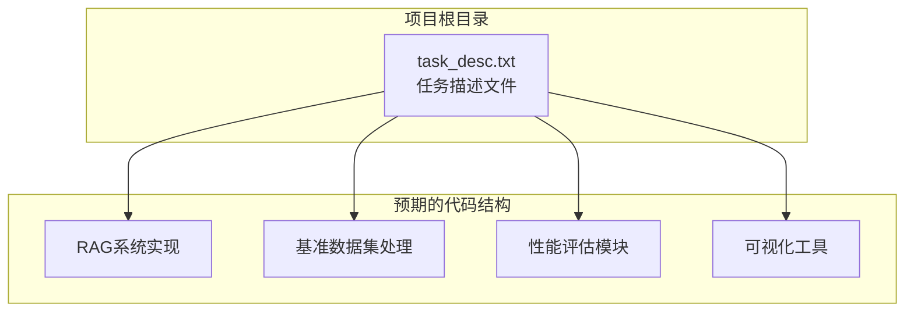

**图表来源**
- [task_desc.txt:1-22](file://task_desc.txt#L1-L22)

**章节来源**
- [task_desc.txt:1-22](file://task_desc.txt#L1-L22)

## 核心组件

### 检索-生成交互组件

该组件负责研究不同检索策略与生成模型的配对效果：

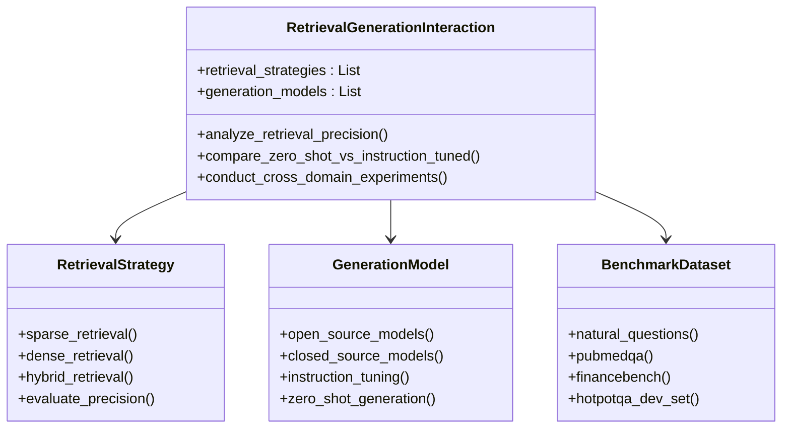

**图表来源**
- [task_desc.txt:3-9](file://task_desc.txt#L3-L9)

**章节来源**
- [task_desc.txt:3-16](file://task_desc.txt#L3-L16)

## 架构概览

整个RAG系统采用模块化架构，支持跨领域的性能评估：

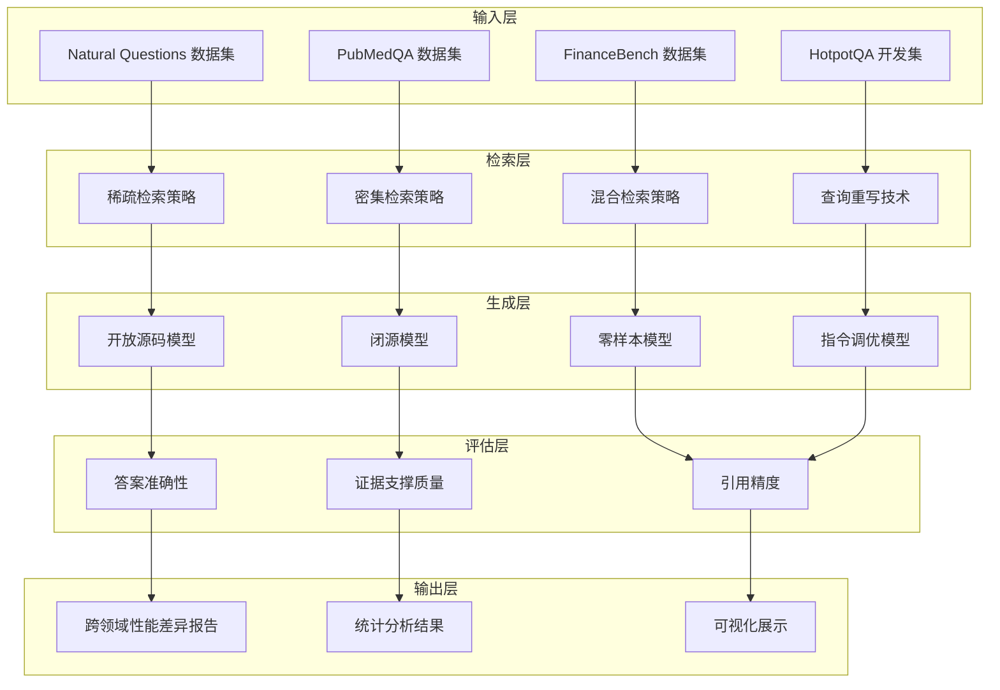

**图表来源**
- [task_desc.txt:1-22](file://task_desc.txt#L1-L22)

## 详细组件分析

### 基准数据集特点分析

#### Natural Questions 数据集

Natural Questions是一个大规模的问答数据集，具有以下特点：

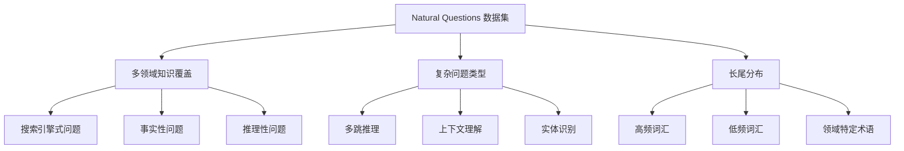

**图表来源**
- [task_desc.txt:1](file://task_desc.txt#L1)

#### PubMedQA 数据集

PubMedQA专门针对生物医学领域，具有以下特征：

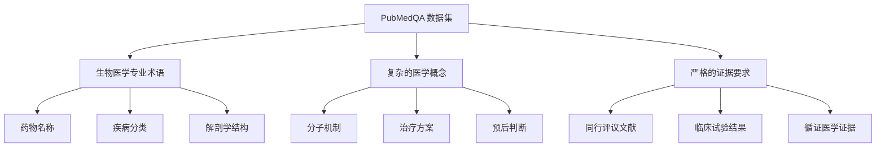

**图表来源**
- [task_desc.txt:1](file://task_desc.txt#L1)

#### FinanceBench 数据集

FinanceBench专注于金融领域，具有以下特点：

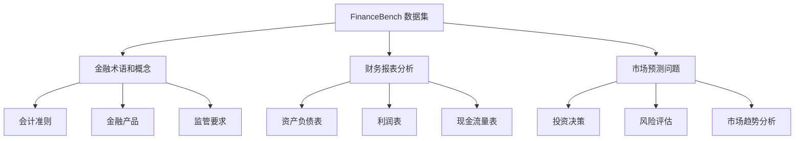

**图表来源**
- [task_desc.txt:1](file://task_desc.txt#L1)

### 领域特定检索策略调整

不同领域需要针对性的检索策略：

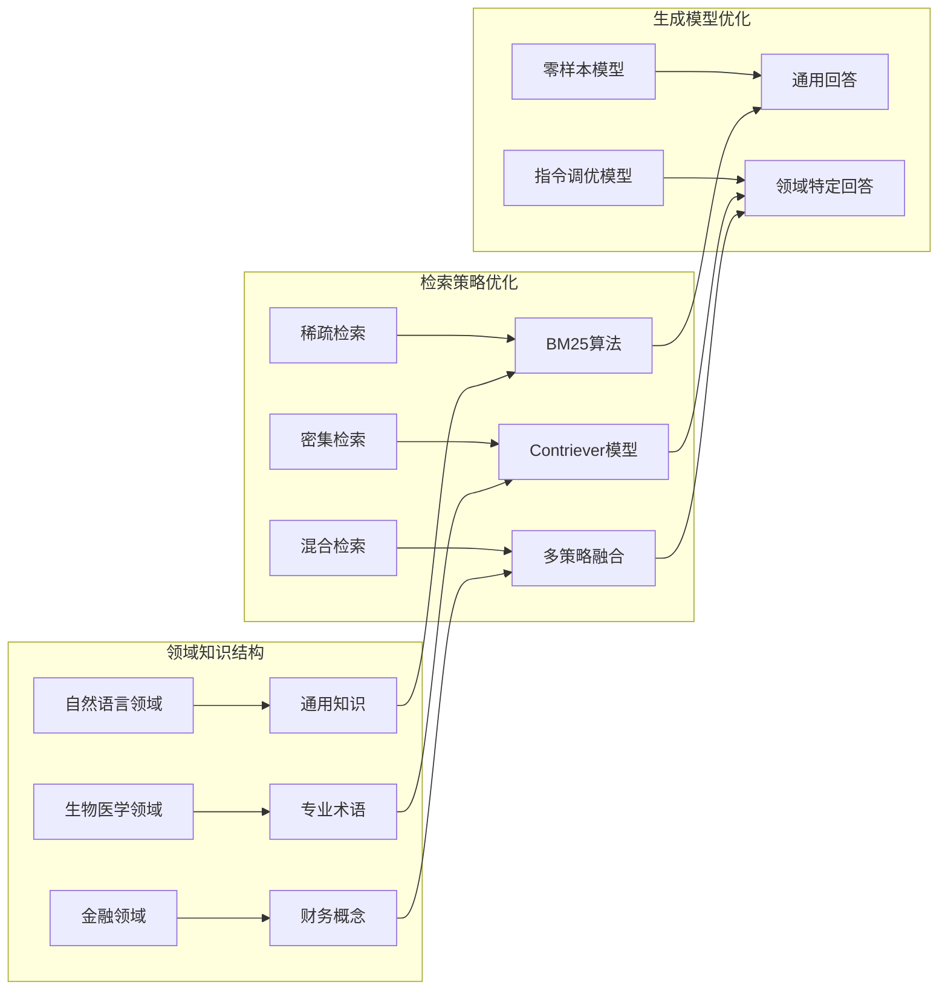

**图表来源**
- [task_desc.txt:3-9](file://task_desc.txt#L3-L9)

### 性能比较和结果分析方法

#### 公平性能比较框架

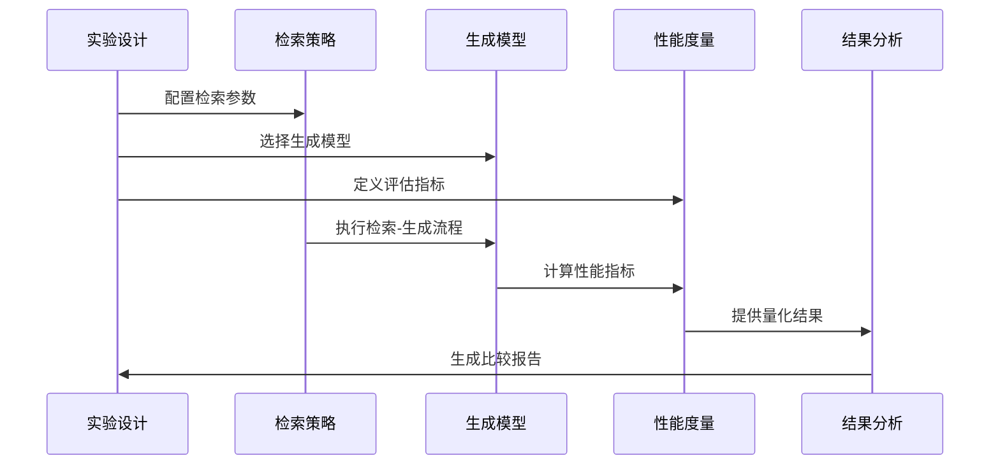

**图表来源**
- [task_desc.txt:8](file://task_desc.txt#L8)

#### 统计分析方法

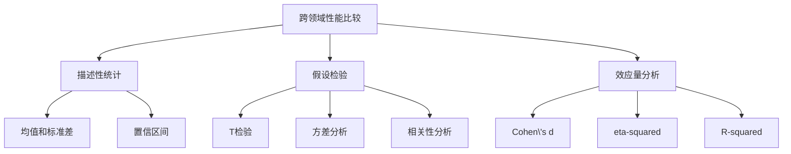

**图表来源**
- [task_desc.txt:8](file://task_desc.txt#L8)

**章节来源**
- [task_desc.txt:1-22](file://task_desc.txt#L1-L22)

## 依赖关系分析

### 外部依赖和集成点

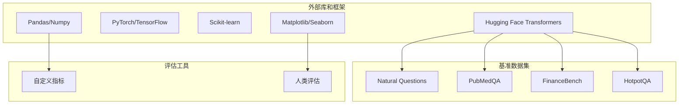

**图表来源**
- [task_desc.txt:17-21](file://task_desc.txt#L17-L21)

### 内部组件耦合

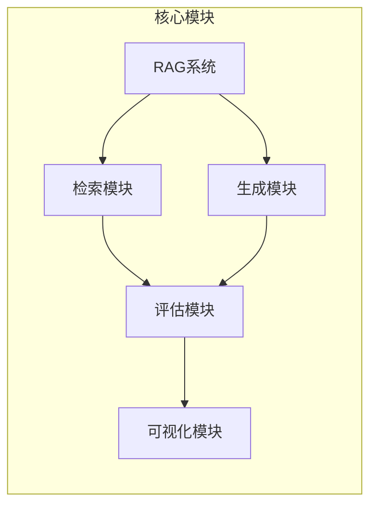

**图表来源**
- [task_desc.txt:3-16](file://task_desc.txt#L3-L16)

**章节来源**
- [task_desc.txt:17-21](file://task_desc.txt#L17-L21)

## 性能考量

### 计算成本平衡策略

项目明确要求限制每次检索3-5个文档以平衡性能和计算成本：

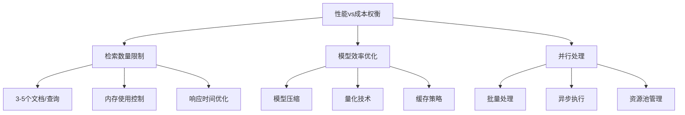

**图表来源**
- [task_desc.txt:15](file://task_desc.txt#L15)

### 检索策略优化

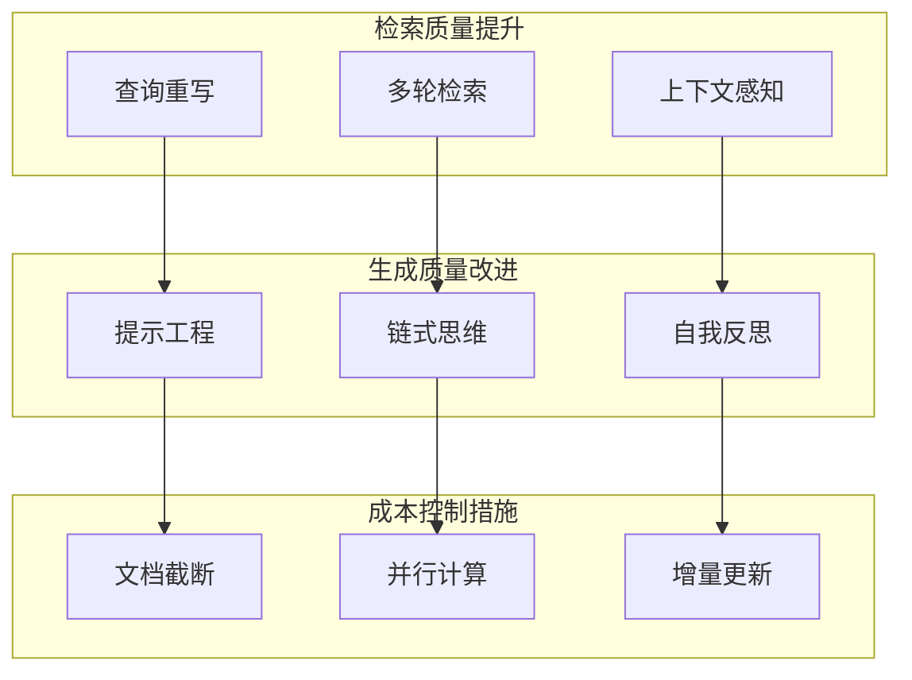

**图表来源**
- [task_desc.txt:14](file://task_desc.txt#L14)

**章节来源**
- [task_desc.txt:14-16](file://task_desc.txt#L14-L16)

## 故障排除指南

### 常见问题和解决方案

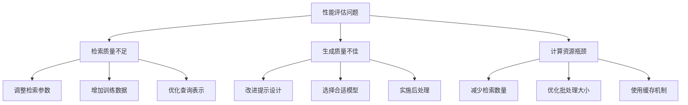

**图表来源**
- [task_desc.txt:15](file://task_desc.txt#L15)

### 评估指标验证

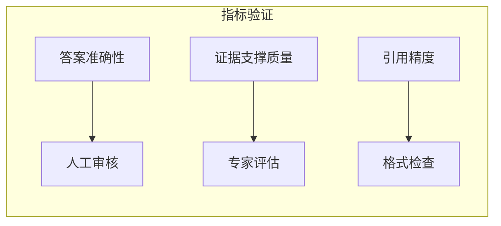

**图表来源**
- [task_desc.txt:10-13](file://task_desc.txt#L10-L13)

**章节来源**
- [task_desc.txt:10-16](file://task_desc.txt#L10-L16)

## 结论

本项目为跨领域性能评估提供了全面的框架和方法论。通过系统性地研究不同领域知识结构和术语差异对RAG系统性能的影响，可以：

1. **建立标准化的评估流程**：为不同领域的RAG系统提供公平的比较基准
2. **优化检索策略**：根据不同领域的特点调整检索参数和算法
3. **提升生成质量**：通过领域特定的提示工程和模型调优提高答案准确性
4. **平衡性能与成本**：在保证质量的前提下控制计算资源消耗

项目的创新点在于将跨领域比较、检索策略优化和生成模型改进有机结合，为RAG系统的实际应用提供了重要的指导原则。

## 附录

### 参考文献

- Lewis P, et al. Retrieval-augmented generation for knowledge-intensive NLP tasks. NeurIPS 2020.
- Izacard G, et al. Leveraging passage retrieval with generative models for open domain QA. EACL 2021

### 实验建议

1. **基准数据集准备**：确保各数据集的预处理和格式统一
2. **模型选择策略**：根据领域特点选择合适的检索和生成模型
3. **评估指标体系**：建立涵盖准确性、效率的综合评价体系
4. **统计显著性检验**：使用适当的统计方法验证结果的可靠性
