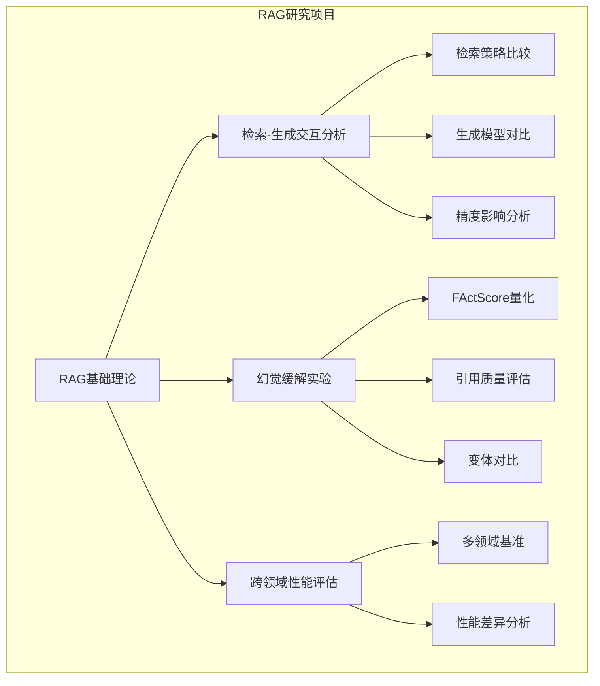
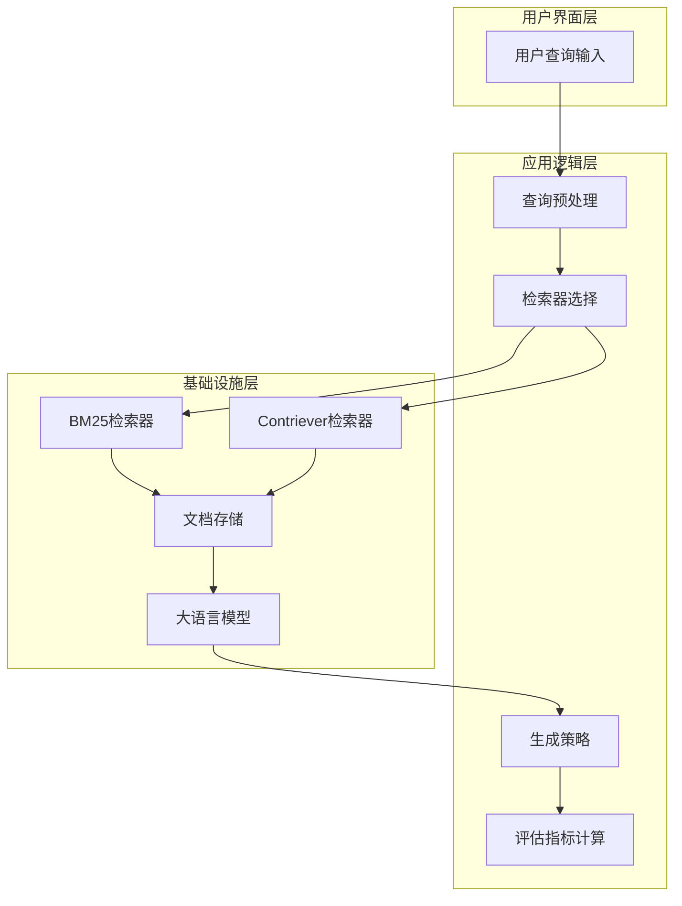
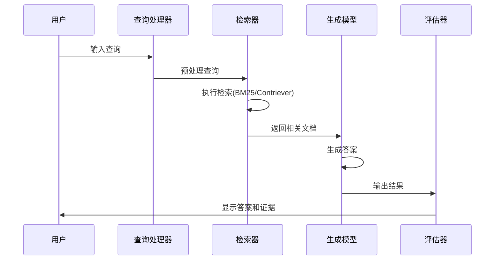
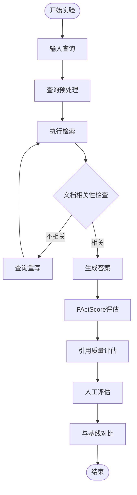
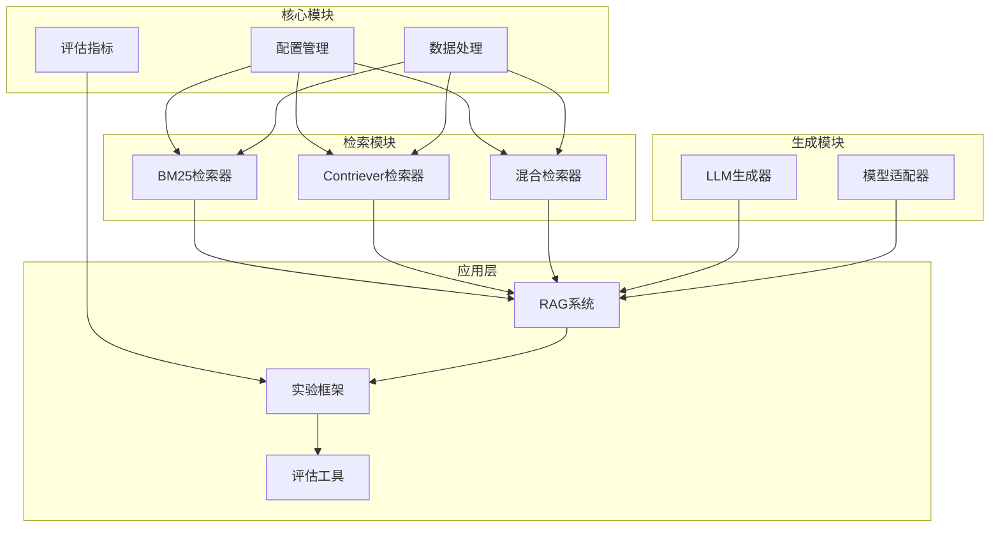
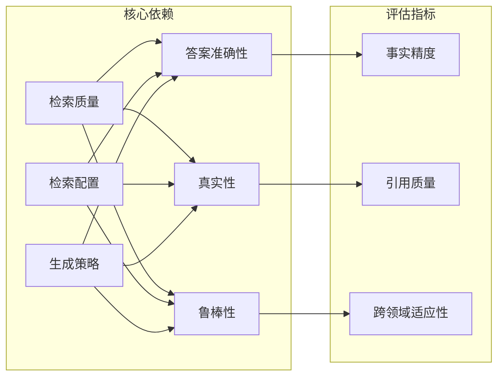

# 项目概述

<cite>
**本文档引用的文件**
- [RAG项目任务清单.md](file://others/RAG项目任务清单.md)
- [datasets_overview.md](file://others/datasets_overview.md)
- [project_timeline.md](file://others/project_timeline.md)
- [rag_hotpotqa.py](file://rag_hotpotqa.py)
- [src/config.py](file://src/config.py)
- [src/retrievers/bm25_retriever.py](file://src/retrievers/bm25_retriever.py)
- [src/retrievers/contriever_retriever.py](file://src/retrievers/contriever_retriever.py)
- [src/retrievers/hybrid_retriever.py](file://src/retrievers/hybrid_retriever.py)
- [src/generators/llm_generator.py](file://src/generators/llm_generator.py)
- [src/data_utils.py](file://src/data_utils.py)
- [src/evaluation/metrics.py](file://src/evaluation/metrics.py)
</cite>

## 更新摘要
**所做更改**
- 新增完整的RAG系统架构文档，包括三层架构设计
- 详细介绍了检索、生成、评估三大核心组件的实现
- 补充了混合检索策略和Reciprocal Rank Fusion技术
- 增加了完整的模块化设计说明和组件交互流程

## 目录
1. [引言](#引言)
2. [项目结构](#项目结构)
3. [核心组件](#核心组件)
4. [架构概览](#架构概览)
5. [详细组件分析](#详细组件分析)
6. [依赖关系分析](#依赖关系分析)
7. [性能考虑](#性能考虑)
8. [故障排除指南](#故障排除指南)
9. [结论](#结论)

## 引言

本项目聚焦于检索增强生成（Retrieval-Augmented Generation, RAG）在知识密集型自然语言处理任务中的应用研究。RAG系统通过将神经检索与大语言模型相结合，能够从外部文档中检索相关信息来支撑生成过程，从而减少对参数化知识的过度依赖。

该项目旨在系统性地研究检索质量、检索配置和生成策略如何共同影响答案准确性、真实性（faithfulness）和鲁棒性。通过在不同领域的基准数据集上进行评估，如自然问题（Natural Questions）、PubMedQA和FinanceBench，研究不同知识结构和术语环境下检索与生成性能的变化。

**章节来源**
- [RAG项目任务清单.md:1-164](file://others/RAG项目任务清单.md#L1-L164)

## 项目结构

基于任务描述，该项目采用模块化的研究架构，主要包含两个核心研究方向：

**图表来源**
- [RAG项目任务清单.md:119-130](file://others/RAG项目任务清单.md#L119-L130)

**章节来源**
- [RAG项目任务清单.md:1-164](file://others/RAG项目任务清单.md#L1-L164)

## 核心组件

### 检索-生成交互分析

该组件专注于研究不同检索策略与生成模型的组合效果：

#### 检索方法实现
- **BM25算法**：经典的稀疏检索方法，使用rank_bm25库实现TF-IDF关键词匹配
- **Contriever模型**：先进的密集检索方法，基于facebook/contriever-msmarco模型
- **混合检索策略**：结合稀疏和密集方法的优势，使用Reciprocal Rank Fusion (RRF)融合

#### 生成模型对比
- **LLaMA系列**：Meta指令微调模型，支持8位量化以提高推理效率
- **Qwen系列**：阿里指令微调模型，支持多种模型变体
- **指令微调模型**：如Intel neural-chat-7b-v3-3

#### 性能评估指标
- **检索精度**：HotpotQA开发集上的表现
- **零样本vs.指令微调**：不同训练策略的效果对比
- **跨领域性能**：至少两个不同领域的性能差异

**章节来源**
- [RAG项目任务清单.md:18-37](file://others/RAG项目任务清单.md#L18-L37)

### 幻觉缓解实验

该组件致力于量化和减少模型虚构信息的问题：

#### 幻觉量化指标
- **FActScore**：细粒度原子级事实精度评估
- **引用质量**：通过人工评估的引用精度/召回率
- **幻觉率**：模型虚构信息的比例

#### 变体对比实验
- **vanilla RAG**：基础RAG方法
- **Self-RAG**：自反思检索、生成和批评方法
- **查询重写策略**：创新的检索增强策略探索

**章节来源**
- [RAG项目任务清单.md:77-92](file://others/RAG项目任务清单.md#L77-L92)

### 跨领域性能评估

该组件关注不同知识结构和术语环境下的系统表现：

#### 基准数据集
- **自然问题**：涵盖广泛的知识领域
- **PubMedQA**：生物医学领域的专业问答
- **FinanceBench**：金融领域的专业问答

#### 评估维度
- **答案准确性**：事实正确性评估
- **证据定位质量**：检索到文档的相关性
- **引用精度**：引用信息的准确性

**章节来源**
- [RAG项目任务清单.md:95-117](file://others/RAG项目任务清单.md#L95-L117)

## 架构概览

RAG系统的整体架构可以分为三个层次：

**图表来源**
- [RAG项目任务清单.md:119-130](file://others/RAG项目任务清单.md#L119-L130)

### 三层架构设计

系统采用三阶段架构设计：

1. **离线语料索引**：构建持久化的文档索引
2. **在线查询时检索**：实时响应用户查询
3. **Prompt增强生成**：基于检索结果生成答案

**章节来源**
- [RAG项目任务清单.md:119-130](file://others/RAG项目任务清单.md#L119-L130)

## 详细组件分析

### 检索-生成交互流程

**图表来源**
- [rag_hotpotqa.py:416-473](file://rag_hotpotqa.py#L416-L473)

### 幻觉缓解机制

**图表来源**
- [RAG项目任务清单.md:77-92](file://others/RAG项目任务清单.md#L77-L92)

### 模块化设计架构

**图表来源**
- [src/config.py:27-41](file://src/config.py#L27-L41)
- [src/data_utils.py:185-191](file://src/data_utils.py#L185-L191)

**章节来源**
- [rag_hotpotqa.py:416-473](file://rag_hotpotqa.py#L416-L473)
- [src/config.py:1-41](file://src/config.py#L1-L41)
- [src/data_utils.py:1-210](file://src/data_utils.py#L1-L210)

## 依赖关系分析

项目各组件之间的依赖关系体现了RAG系统的核心要素：

**图表来源**
- [RAG项目任务清单.md:50-106](file://others/RAG项目任务清单.md#L50-L106)

**章节来源**
- [RAG项目任务清单.md:50-106](file://others/RAG项目任务清单.md#L50-L106)

## 性能考虑

### 计算效率优化
- **文档数量限制**：每次查询限制检索3-5个文档以平衡性能和计算成本
- **检索策略选择**：根据任务需求选择合适的检索方法组合
- **模型推理优化**：针对不同生成模型的特点进行推理优化

### 系统可扩展性
- **模块化设计**：便于添加新的检索方法和生成模型
- **评估框架**：支持多种评估指标和基准测试
- **跨领域适配**：能够适应不同知识结构和术语环境

## 故障排除指南

### 常见问题及解决方案

#### 检索性能问题
- **症状**：检索速度慢或准确率低
- **解决方案**：调整检索参数，选择合适的检索方法组合

#### 生成质量不佳
- **症状**：答案缺乏事实依据或包含虚构信息
- **解决方案**：改进检索策略，使用更严格的评估指标

#### 跨领域适应困难
- **症状**：在特定领域表现不佳
- **解决方案**：针对领域特点调整查询预处理和检索配置

**章节来源**
- [RAG项目任务清单.md:133-141](file://others/RAG项目任务清单.md#L133-L141)

## 结论

本RAG项目通过系统性的研究设计，深入探讨了检索增强生成技术在知识密集型任务中的应用潜力。项目重点关注以下关键贡献：

1. **理论贡献**：深化对检索-生成交互机制的理解，为RAG系统的优化提供理论指导

2. **实践价值**：建立完善的评估框架，为实际应用中的RAG系统部署提供参考标准

3. **技术创新**：探索新的检索策略和评估方法，推动RAG技术的发展

4. **跨领域适用性**：验证RAG系统在不同知识结构环境下的通用性和适应性

通过本项目的研究，期望能够为构建更加准确、真实且鲁棒的检索增强生成系统奠定坚实基础，为知识密集型自然语言处理任务提供有效的解决方案。

**章节来源**
- [RAG项目任务清单.md:1-164](file://others/RAG项目任务清单.md#L1-L164)